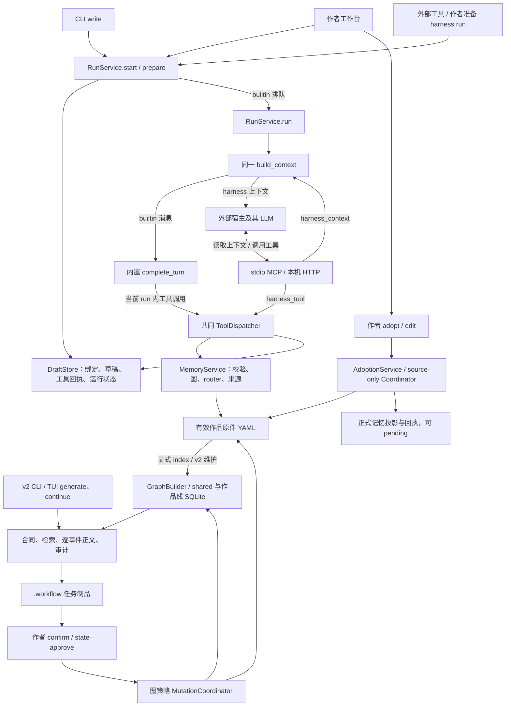

# Novel Project 工程与架构审计

2026-11-25 · Windows · 审计对象为 `D:\novel-project` 的实际工作树。文中源码路径未以目录开头时，相对 `src/novel_rag/`。行号指这份工作树。同名的构建副本、备份和 Git HEAD 可能具有不同实现。

## 1. Executive Summary｜先读结论

**可以继续以 v3 作为单作者、已知作品线的正式创作核心。扩大到多条时间线协作，或把旧状态批准作为可靠的批量提交入口之前，应先解决两个涉及正式资料的缺陷。** 子线修订从父线继承的 History 时会选到父线原件。v2 批量更新状态时，第二个文件替换失败可以留下第一个文件已更新、调用方收到“YAML 未提交”的状态。两者均有可达代码链与内存探针。当前资料库只有两部作品各自的 main，审计没有向任何一部作品写入，没有观察到既有资料损坏。详见 A01、A02。

工作台已经有会话、一次请求对应的运行、分支草稿、来源校验、事件记忆和作者采用。两个 LLM 驱动共用应用服务。内置驱动会自己请求模型。外部驱动向宿主提供上下文和五个工具。用户在网页点击采用才会改变正式 History。与此同时，CLI/TUI 的 v2 入口仍会规范化大纲、逐事件生成、审计与修复，最后按另一套协议确认正文。旧 Skill 中的 Ruler、Judgment 等名称不能用来推算 v3 的模块或完成度。

| 本轮证据 | 实际结果 | 能回答的问题 |
|---|---|---|
| 工作树、源码与入口 | 124 个产品 Python 文件、30 个脚本、89 个测试/辅助 Python 文件均通过只读 AST 解析。两个前端 JS 通过 `node --check` | 模块盘点与语法。入口接通另由调用链、已有测试和实跑区分 |
| 现有数据与索引 | validate 为 729 份、0 问题。72 个检索用例、0 失败。两张作品图的文档 ID 集/指纹及 shared 依赖与当前资料匹配 | 两部现有作品的 main 及这批查询。AU、坏元数据与崩溃窗口另计 |
| 本次软件测试 | **107 passed**，16 个测试模块的筛选用例。doctor 实测 SQLite 3.35.5，FTS5/trigram 可用 | 纯函数、静态边界、内存合同和模拟传输。完整 pytest、浏览器、写回、真实模型均列为 NOT RUN |
| 历史执行 | 最近本地日志 812 passed、1 deselected、90 warnings。独立两章历史宿主样本两次成功提交记忆、六次拒绝。六万字试验停在第一章采用、第二章草稿 | 已有落盘证据支持短链使用。长篇闭环、跨宿主、内置真实 provider 与远端 CI 仍待验证 |

先看 §5 的入口图和 §6 的权威数据表，故障与优先级见 §11–16。**事实**指当前文件、代码路径、实测输出或明确标记的历史材料。**推断**指据此判断的触发条件、影响及外推限制。**建议**均为后续工作。

### 审计对象与保护基线

开始时 `PROJECT_AUDIT.md` 不存在。分支 `feat/hybrid-graphrag-v2`，HEAD `63266256f9baf839f6d2459a68454ba1f8816813`（2026-08-20，v2）。未暂存 diff 的 Git shortstat 为 108 个文件、+3,593 / −19,920 行。暂存区为空。`git --no-optional-locks status --short --untracked-files=all` 按路径计数为 27 M、84 D、28,650 个 ??。status 涵盖换行状态等路径，与内容 diff 的文件数口径不同。84 个旧根包文件显示删除，当前 `src/` 的 148 个发行输入、CI 文件、根 AGENTS、51 个测试/夹具路径均在未跟踪集合。未跟踪中 `output/` 占 28,304，`build/` 占 124。还有资料文件、图、说明、既有日志与工作区锁。不据文件名判断锁的主人仍在运行。

工作区可通过以下指纹复核。Git porcelain v1、展开未跟踪、NUL 分隔（剔除空尾项再用 NUL 连接）SHA-256 为 `d8d33dc329515f80db2d0db1941d448ac8f3935d2e93035e67fe4b4d7809dde9`。`git diff --binary` 为 `0cdaff58640e7b711d5271f77467f07447772b704d6eec1c2bb1c2dd966108fa`。正式库 1,573 个文件（含 index 子树），排序相对路径、NUL、各文件二进制 SHA-256 串联后再取 SHA-256，值为 `ad470cf366b95570ea09139b3d207a674a9faba0a20ff0795af9da15c75d63a6`。最终保护复核见文末。

## 2. Repository Inventory｜目录地图

| 位置 | 用途、主要文件与入口 | 读取者、依赖与当前使用 |
|---|---|---|
| `pyproject.toml:5–32`、`src/novel_rag/` | setuptools 从 src 发现单发行包，Python ≥3.10，基础依赖 PyYAML。model 用 HTTPX，web 增加 FastAPI/Uvicorn，tui 用 prompt-toolkit。入口 `novel-rag = novel_rag.cli:main` | 正式包源。仓库自带 15 张 JPG、两个 JS、HTML/CSS、三个 JSON、两个状态模板。无产品 TypeScript 包 |
| `novel-rag/registry, shared, stories, templates` | 作品/布局注册、共享规则与规格、正式文档、作者与资料模板。每本含 common、timelines 和旧目录 | v3 的作品源与偏好、v2 资料和建图输入。物理存在的文档、某个游标可见的文档、进入一次模型请求的材料数量各不相同 |
| `novel-rag/index, archive` | index 中有两张 scope graph、一张 shared graph、两张旧 story DB 和占位文件。archive 单独留历史文件 | 图、FTS、模块反向映射只作派生投影。v3 写作不要求建图。`archive/legacy-index/README.md` 指明归档合库用途 |
| `outputs/` | `.workspace` 是 v3 运行/稿件/采用 journal 默认根。`.workflow` 是 v2 每任务制品。其他 TXT/图是导出 | 默认路径由 `composition.py:1085–1098` 和 `generation/pipeline.py:32–65` 决定。生产代码按选定 workspace 读。现成导出不得充作本轮模型执行证据 |
| `output/` | 28 个阶段/研究目录，包括 freeze、diff、JSONL、截图、试点库、模拟及真实宿主产物 | 验证依据和历史实验。`longform-live-60k-20261023/STOPPED.md`、`ergonomics-entrypoints-ci-20261023/live/TECHNICAL_REVIEW.md` 分别给出两种独立试验口径 |
| `docs/`、根 README、AGENTS | 架构、工程约束、状态索引、旧合同与原始研究资料 | 文档导航见 §8。运行时模型提示/校验器分别由代码和包资源拥有 |
| `skills/rag-outline-to-novel/` | 本地操作 Skill、宿主展示 YAML、workflow/add_rag/update 三份参考 | 面向人工/宿主的旧式创作流程。对 src/scripts/CI 搜索未发现运行时加载该 SKILL 的链 |
| `scripts/` | 30 个 Python 文件。检索/依赖检查，备份/隔离验证，迁移，以及特定章节的导入、晋升、段落合并和文风检查 | 部分脚本直接读写作品或固定输出目录。例 `scripts/import_chapters_21_24.py:23–31,663–672` 顺序写正文、状态、注册表和回归集。不是工作台 Stage |
| `tests/`、`.github/workflows/ci.yml` | 87 个 test 模块、616 个 test_ 定义（参数化前），另有 `native_http_fixture.py`、`writer_fixtures.py` | pytest 仅以 tests 为默认发现根。CI 安装依赖、浏览器、建图、验证，见 §10 |
| `build/lib/novel_rag`、`novel_rag.egg-info`、`src/*.egg-info` | 构建镜像和发行元数据。对应 src 与旧 build 的 124 个同路径文件有 46 个字节不同。另有 24 个仅在 src（含 std、contracts、12 张图等） | 对照发行定义只认 src。使用 build 副本推导现状会漏掉当前所有权和资源 |
| `backups/`、`add/Userwork.txt`、`.reasonix/`、`.opencodeopencode.json` | 迁移前快照、单次作者输入、既有宿主元数据与本地配置文件 | 没有在主执行链找到这些文件作为架构合同的调用。原件、配置值均未改动 |
| `.venv/`、`.writing-deps/`、`.pytest_cache/`、`.codex-final-pytest*`、`.git/` | 既有虚拟环境、历史打包依赖、缓存、旧日志与版本控制 | 用现成 .venv 运行只读检查。没有安装、清缓存、改 index、建 checkout 或提交。旧日志需和运行输入一起解释 |

**Git 沿革。** `git log` 可见 2026-08-18 的初始导入/拆包，最后一次提交为上述 v2 HEAD。`git ls-tree -d HEAD` 含 `novel_rag/` 而没有 `src/`、`.github/`、`output/`。因此本报告对应的是当前工作树，在其他机器仅检出该 HEAD 无法复现 v3 基线。

## 3. Current Architecture｜谁掌握状态

一次 **session** 在固定作品线下串联一组 run。一次 **run** 固定原纲、请求、驱动、书线、游标、基线、输出模式与草稿分支。一次 **turn/attempt** 属于 run。一次幂等**写操作**另有身份。`RunService.prepare/_prepare/feedback`（`generation/session.py:155–286`）在同一锁域校验 request_id 和参数、恢复建到一半的续写、登记 session。`session.json` 只列 run_ids。`run.json` 及其引用的同 run 载荷保存运行事实。作者在浏览器恢复的未提交输入、服务器已接收的流式前缀、已保存的 DraftRef、正式 History 是四种不同承诺。

| 运行职责 | 实际 owner / 接口 | 效果及边界 |
|---|---|---|
| 建任务、路由、结束 | `RunService.prepare, run, finish_harness`。`generation/session.py:155–260,491–666`，`DraftStore.set_status`（`generation/store.py:205`） | 内置 queued→running→完成/失败/取消/中断。外部 prepared 等宿主工具及显式 finish。路由在应用服务，状态字段由 Store 持久化，未见单独 Stage Router 或通用制品注册器 |
| 草稿、checkpoint、观察 | `DraftStore.load/write/save/prepare_turn/commit_turn`（`generation/store.py:44–120,128–188,238–449`）。`web/app.py:201–223` | 保存版本、原文 hash、调用回执、流式前缀/事件。SSE、live 快照和浏览器本地输入用于观看或恢复输入。模型迟到稿可留存，作者选稿指针另管 |
| 锁、并发、恢复 | `DraftStore.writer_lease/recover`（`generation/store.py:39–48,641–651`），`mutations/locks.py:46–278`，`std/locks.py:26–61`，`web/app.py:35–47`，`cli/commands.py:844–919` | 后端生命周期独占 workspace、源操作另取库锁。Web 获得 lease 后将遗留 queued/running 内置 run 标为 interrupted。stdio EOF 保留 prepared。CLI write 独占后开展当次写作。重启不会自动让模型重新执行全部请求 |
| 授权、审批、旁路 | `web/app.py:52–80,123–199,225–265`。`generation/tools.py:48–136`。`state/review.py:85–193` | HTTP 是本机同源/token 信任模型。模型能用五工具。采用和编辑由作者入口执行。v2 confirm、state-approve、import、偏好、建书各有 owner。脚本和直接编辑 YAML 也可绕过 run |
| 正式提交与失败 | `writeback/adopt.py:30–188`，`mutations/coordinator.py:112–179,511–529`，`writeback/confirm.py:338–426` | v3 先保存 intent 后单文件替换，再发记忆、写回执，可分别 pending。v2 先构建图再逐文件替换并提升图。源码失败、图提升失败、提交后回执失败必须分别判断（A01、A02、A04、A05） |

**判断。** v3 在一次写作运行内有明确主控。它没有统管整库生命周期。v2、作者编辑、运维脚本和直接 YAML 修改都能改变资料。协作写入者依靠源锁和范围校验，直接编辑 YAML 的外部程序可以不持锁，下一次读取须核对实际源指纹。仅检查 RunService 状态无法证明整个作品未变化。

## 4. Module Responsibility Matrix｜从哪里读代码

| 模块与正式接口 | 输入 → 输出 / 副作用 | 直接调用方与依赖 |
|---|---|---|
| `cli/__init__.py:45–70`、`cli/arguments.py`、`cli/commands.py:80–219,425–606,844–969` | 参数 → 已注册的命令/退出码。按命令惰性装配 | console script、python -m。write/workspace/harness 走 v3，generate/search/状态管理仍可进入兼容链 |
| `web/app.py:12–47,137–201,271–291`、`web/static/workspace.js`、`launcher.js` | HTTP/JSON/SSE、作者输入 → 运行/草稿/采用/资料视图。浏览器缓存未提交输入和操作 ID | launcher 只管 Metro 导航、图片和时钟。workspace.js 管 API、版本冲突、未定结果和刷新。Web 直接读 catalog/资料，并委托服务写入 |
| `harness.py:36–107,119–193` | stdio MCP/resource → 绑定后端和 run 的本机 HTTP 调用，返回上下文、五个工具的声明/结果 | CLI、外部宿主。不自己打开库、不获取项目模型凭据、不另建 Store |
| `composition.py:103–179,383–509,987–1052,1085–1098` | 库/索引/workspace/profile 路径 → 构造一套 writer 服务或旧 Retriever/建图事务 | CLI/Web 组合根。共享同一 Store、MemoryService、AdoptionService |
| `generation/session.py`、`store.py`、`types.py` | GraphKey、作者输入、来源 Ref、操作键 → 运行/版本/回执。未知写按原身份保留 | 内置、harness、作者操作共用。Store 有本进程 RLock、原子 JSON 和跨进程 lease。应用决定合法工作流 |
| `generation/context.py:126–167,351–439`、`tools.py:43–136,205–302`、`resources.json` | 原纲、有效版本、近期来源、当前焦点 → 完整导出或模型窗口、可续读入口、五工具定义 | 内置消息、harness、MCP。访问 memory、源及本地九项写法资源。旧 SKILL 全文没有进入本链 |
| `model_api.py:20–59,251–279,286–481,515–557`、`model_config/{store,types}.py` | profile/逻辑消息 → 同步旧 stage 或异步原生 turn、工具调用、公开文本和报告用量 | 内置与 v2。凭据由配置 owner 管，逻辑请求大小/估算与实际 provider 计费分开 |
| `generation/{pipeline,helpers,retrieval}.py`、`generation_schema.py:41–394` | v2 请求、偏好、检索 bundle → 事件、草稿、审计、结果文件 | generate。continue 由 `resume/continuation.py:23–145` 建子任务，保持 parent/supersedes 与原稿 |
| `documents.py`、`config.py`、`identity.py`、`catalog/{paths,layout,timelines,aliases,corpus}.py` | 原始 YAML → 同次字节快照、文档、身份/坐标和校验结果。路径映射、lineage、别名、指纹 | v2/v3/迁移/写回共用。以 `contracts/references.py` 定义 DocumentRef/DraftRef/AuthorInputRef 与解析 |
| `service.py:64–214,285–405`、`onboarding.py:20–29,43–81`、`scaffold.py::create_story` | 作品线 → 允许阅读的当前源/来源 hash。另有作品级偏好和受锁保护的建书注册入口 | Writer、资料 Web、CLI/TUI。create_story 注册最终提交，读偏好与读所有小说原文是不同操作 |
| `graph/{builder,shared,reader,promotion,schema}.py`、`retrieval/{service,assembler,conflicts,protocols,types}.py`、`chunking.py` | 有效组分/模块绑定 → SQLite/FTS 投影。GraphKey、查询、容量 → 有渠道/出处的 ContextBundle 或冲突/预算错误 | v2 generate/search、维护命令。`index.py` 保留老接口和既有 SQLite 搜索语义 |
| `memory/{schema,service,state,graph,router,effects}.py` | 批次、来源、位置、图焦点 → StateView、事件/关系/回忆包、写入拒绝或版本回执 | recall/remember/context、作者浏览/采用。schema 控制形状，service 核语义和来源，store 才提交 |
| `mutations/{coordinator,locks,source,summary,changes,types}.py`、`std/` | ChangeSet、预期指纹及策略 → staged/failed/pending/promoted。std 提供 hash、时间、序列化、原子写和 OS 锁 | v2 资料变更、v3 source-only 写回、SummaryEditor。物理多文件提交的限制见 A02 |
| `writeback/{adopt,confirm}.py`、`state/{review,helpers,types}.py` | 明确选稿、坐标、hash → v3 History + 发布回执。v2 确认后的提案 → 独立批准的 current/snapshot/change-log/version-map | 作者采用和显式 v2 confirm/state-approve。记忆服务不能自行完成作者采用 |
| `importers/{importer,helpers}.py`、`feedback.py:222–317`、`migration/layout.py:280–401` | 外部 YAML/文本及版本意图 → 预览/导入，反馈创建/解决。迁移先 plan 再 copy | 兼容 CLI/TUI/显式脚本。直接运行项目历史脚本与走这些服务的保留语义不同 |
| `tui/menu.py:257ff`、`tui/{helpers,session,wizards}.py`、`tui/console/` | 交互选择/作业 → 命令、状态条、转录、对话框。`cli/commands.py:797–812` 优先 console 并可降级行式 | 旧任务/资料管理入口。console adapter 和 JobRunner 管呈现/后台任务，业务仍走原有服务。`doctor.py` 独立检查 SQLite 能力 |

同名的单文件门面（如 `generation.py`、`writeback.py`）和包内惰性导出维持已有调用者。原始 index 的分词器与 graph trigram 有不同输入合同。这些差异有明确兼容理由。真正重复且已发生行为分化的例子在 B01。

## 5. Runtime / Pipeline Call Graph｜从作者动作追到落盘

### 附件列出的 12 个语义阶段

下表按附件列出的动作映射真实调用，核对入口、输入 Builder、Schema/Prompt/Spec、执行者、持久输出、验证/失败和下游。v2 的 `STAGE_INSTRUCTIONS` 及 stage callable 在 `generation/types.py:37–46`、`generation/helpers.py`。字典 payload 未必有可独立验证的 JSON Schema。标为“无独立阶段”的行，其单独执行器、制品、重试及下游合同均未找到。

| 动作 | v2 输入 / 构造与执行 | v2 输出、验证、失败及下游 | v3 对应行为 |
|---|---|---|---|
| Outline | 用户文件、请求和偏好 → `build_contract`。GenerationRequest/OutlineContract/GenerationContract，调用 `normalize` | 合并源条款、检查语义错误。失败中止。`contract.json` 给检索和事件执行。`helpers.py:137–210; pipeline.py:42–65` | prepare 固定原纲/请求及 hash。长文续读。无逐项 normalize |
| Retrieval | 合同 → `build_retrieval_request` → GraphRetriever 的五通道 → ContextBundle。默认不暗降级 YAML | 转换 retrieved/cpm_context，入 `context.json`。stale、冲突、必要材料超预算可拒绝。事件语义、验证、修复消费。`generation/retrieval.py:333–456; pipeline.py:49–64` | 源快照、按需 recall、read_document。完整包可冻结，交付窗口可续读 |
| Ruler | 规则是权威资料，可进 cpm_context。由检索器选择并带入原合同 | 文档校验及 bundle 检查，随合同消费。无独立规则裁决进程或 `ruler.json`。`retrieval/service.py:498–570; pipeline.py:55–62` | 五工具入口无 Ruler 阶段 |
| Judgment | 作者事件、角色和 SceneState → `execute_scene` 组 payload → `decide_behavior`、`derive_result` | 行为/结果/观察者/变化进入 EventResult，宽松字典规范化后供本事件渲染与下个事件消费。`helpers.py:413–447`。检索到 judgment_spec 不会自动再跑一个 Judgment | 连贯创作 LLM 自行组织，不持久化独立 judgment |
| Generator Skeleton | 前述 AuthorEvent/行为/结果充当渲染前语义材料 | 无独立 Skeleton 的 builder、prompt、executor 或文件。`helpers.py:413–457` 可直接追到 render | 无强制骨架 |
| Generator Rendering | 已成立事件、状态、长度、偏好、参考 → `render_prose` | `_draft` 取正文，空串报错。合为 `draft-00.txt`。有 reference 时可 polish，检查事件证据，失败保留原稿。`helpers.py:448–464; pipeline.py:66–98` | 内置解析 JSON/SSE turn 并保存草稿。harness 需显式 save_draft |
| Audit | `validate_draft` 输入正文、contract、events、state。确定性长度/事件规则 + `validate` 提示 | ValidationIssue/Report → `audit-00.json`。依严重度通过、修复或请求指导。语义检查异常可降为 warning。状态冲突见 A09。`helpers.py:470–528` | 产品合同明确取消默认文学审计 |
| Revision Plan | 上轮 report.issues、原事件与扩写点临时组成 repair 参数 | 缺独立 RevisionPlan 持久化、执行及验证合同。下游直接调 repair。`pipeline.py:96–128` | 作者反馈可创建 revise 子 run，无自动修订计划 |
| Reviser | `repair` 与可选 polish 是两个不同调用。沿用同一 stage callable | `draft-NN.txt`。`_semantic_envelope_ok` 核 ID、正文锚及证据，失败回退/留警告，再审。`helpers.py:303–352; pipeline.py:96–134` | 显式改写、作者编辑、CAS 保存均已接入 |
| Re-Audit | 同一个 `validate_draft` 复用合同与 prompt，带当前 attempt | `audit-NN.json`。修复次数耗尽转等待作者。`resume/continuation.py:23–145` 创建新子任务。confirm 只收允许的状态 | 无此自动阶段 |
| State Delta | `derive_result` 的 state_deltas → 临时 SceneState / EventResult，随 `result.json` 保存 | 先影响运行中场景，确认后形成 needs_review 提案，作者批准才推进 current。`helpers.py:364–447; writeback/confirm.py:268–272; state/review.py:133–193,312–415` | LLM 按情节调 remember。MemoryService 检查来源、合法身份与草稿/记忆版本，原子提交一批。state/graph 派生读取 |
| Canonical Writeback | 正文、坐标、明确确认 → `confirm_runtime` / ChangeSet。不需模型 | 内部对目标取指纹供 ChangeSet 校验。生成 History、confirmation 和状态提案；建图/回归可失败或产生 pending。`writeback/confirm.py:105–177,338–426` | `AdoptionService.adopt` 以 DraftRef/hash/坐标/操作键写单一 History，后续发布可重试。Canon 设定编辑另有作者入口 |

## 6. RAG & Data Architecture｜什么能算作本书事实

| 资料 / 当前有效范围 | 权威与读取入口 | 写入和隔离 |
|---|---|---|
| Registry | `registry/stories.yaml` 有两部作品，各有一条 active main。作品级 timelines/version-map 目标目录优先，保留 legacy fallback。`catalog/paths.py:110–155; service.py:133–148,492–702` | 确定合法身份、lineage 和注册引用。注册行、故事发生事实、索引 manifest 各有用途 |
| Canon / History | 有效性校验全集含 60 份 Canon（59 canon、1 deprecated）、547 份 canon History。稳定设定与已采用正文分开。v3 对原字节取 DocumentRef/hash/revision，按 before/after 游标读取 | 作者显式编辑 Canon。采用写 History，不把草稿、计划、样例或角色听闻当作已发生事实。`service.py:68–130,151–214; writeback/adopt.py:30–166,269–304` |
| Outline / 原纲 / 作者反馈 | 正式 Outline 是可版本化计划。现场无注册的该类文档。原纲/当次要求固化于 run，作者反馈续作生成子 run。v2 feedback 有正式目标绑定、创建/解决。现场有效集合无 Feedback | `cli/commands.py:607–745; feedback.py:222–317; generation/session.py:155–286`。运行反馈、持久偏好与经确认的正式事实须分别回读 |
| Character State / World State | 87 份角色状态（17 active、32 canon、38 archived），10 份世界状态（2 active、3 canon、5 archived）。带位置的旧 current、快照及 change log 是参考。v3 StateView 按有效来源与故事次序重放 | v2 state-approve 改版本化 YAML。v3 的 World、CharacterView、OpenCondition 等在同一批次区分世界结果、角色知识/说法、未结事项。采用后经保护的发布证据进入后续会话。`memory/service.py:40–160,327–371,398–495; memory/state.py` |
| Shared rules / Judgment、Generator、Audit / Style Audit / Approved Samples / Overrides | 现场 25 份 shared 文档为 2 份 active rule、2 份 judgment_spec（1 deprecated）、21 份 style_audit（5 deprecated）。generator_spec/audit_spec/style_sample 属支持类别，现场无此类有效记录。approved-samples 留占位，未见有效 override | v2 故事图记录 module-map 绑定，默认 Retriever 的 shared 路径还会从共享库命中和全库模块引用组装材料，见 A11。v3 源读取直接跳过 system-overrides 与系统文档类型。内建九项写法资源按需读取，不给事实图授权。`config.py:44–81; service.py:169–190,354–377` |
| 作者偏好、运行制品、冻结版本 | 作品级 `author-preferences.txt` 是当前短偏好原文，网页以原字节 hash 做 CAS，保存前备份。草稿/接收/技术回执在 workspace。草稿分支可产生未发布记忆 | `onboarding.py:20–81; generation/context.py:351–431; generation/store.py:44–188; writeback/adopt.py:112–188`。备份可用于核对，不能仅因存在而复活失效记录 |
| Index / 旧副本 | 新图按 GraphKey 使用 `index/graphs/<story>/<timeline>.db`，共享图 `index/shared.db`。旧 story DB 在 `index/stories/`。SQLite/FTS 是投影。旧谱系配置和 story 根资料仍与新布局共存 | 逐类别优先目标树。只在目标类别缺席时回退。现场旧树与目标树有 716 对同相对文件名，其中 714 对字节相同。历史脚本仍能写旧树。保留迁移原件有价值，不能将副本视为第二份当前权威。`service.py:285–323; migration/layout.py:280–401` |

**本次现场对账。** 从实际源码重读，完整校验的 729 份为 shared 25、overturned-world-fujimaru 652、shirouxcile 52。v3 无游标裁切时可见 610 和 50 份，均属于相应书的 main/common，0 gaps。其中 common Canon 分别 53 和 6。两书共 660 份可见原件均无 source_revision 字段，当前实现交付 revision 1。文件系统的 1,486 份 YAML 还包括模板、注册、旧布局等，不能把该数字当作 1,486 个活跃知识对象。

以 SQLite `mode=ro&immutable=1` / `query_only` 核对 index 中五个数据库，`quick_check` 均为 ok。两张作品图 ID 集与当下预期完全相同，作品/共享源码指纹、共享依赖匹配。别名 48/18 条、模块引用各 4 条，按模块类型、文档 ID 及版本与现源重算一致。旧 story DB 分别重算 1,108/105 个文本块，内容和元数据匹配。旧记录保存了指向其他位置的 source_file 路径，搬迁后不宜作为本库的直接出处。旧搜索在只查本书时可用。强行选择 legacy 且加 shared 会遇到已改为 graph schema 的 shared.db，现代码返回 GraphReadError。没有把这个迁移诊断计入 v3 故障。

**最小必要与来源。** v2 图检索按 authority、graph、temporal、lexical、semantic 五种合同渠道组织证据（`retrieval/types.py:19–30`。是否有实际命中由 reader/配置决定）。semantic 默认关闭，启用需注入 provider（`retrieval/service.py:326–336,763–776`）。v2 搜索记录来源与版本；进入旧生成模型的 ContextItem 留有文档 ID、版本和图指纹，但 source_file 被置空（`generation/retrieval.py:459–488`）。v3 在一次来源快照上用词项、显式实体和每份原文最匹配的 chunk 找参考。图路由默认 2 跳、每页 64 个新候选、必要依赖展开上限 16，去重后交付完整包。作者材料不会被附会为事实。默认没有固定 token 容量，命中的原文可多于一屏。显式容量才触发容量选择。语义页、原 JSON 页与继续发现候选使用不同游标。它能控制范围和说明缺口，无法保证每份材料对一段具体创作都不可或缺。依据 `memory/router.py:14–70,101–253; memory/service.py:398–495; generation/context.py:351–439`。

**漂移与跨线。** v3 重新读取真实原文。v2 的有库根读法重算当前文档与 shared 指纹，常规原文变化会使旧图 stale。v2 带图写入可在 YAML 成功后留下待提升图，v3 source-only 提交刻意留给显式 index 更新。无库根兼容查询以图里已登记的源回算，无法由旧清单发现新增文件。别名/模块映射输入本身的 freshness 缺口见 A10。已有 sibling/cutoff 测试。真实库没有 AU，夹具揭示 A01、A03。跨作品读取、同作品祖先可见、对继承文件的写权限是三个不同问题。

## 7. Executor Integration Status｜模型实际由谁调用

| 接口 / 执行者 | 触发、协议和失败行为 | 集成与证据等级 |
|---|---|---|
| 内置 v3 `OpenAICompatibleModel.complete_turn` | `RunService.run` 构建消息与工具，HTTPX 异步请求 Chat/Responses，处理 JSON/SSE、原生 call ID、公开流和取消。工具轮次由模型输出驱动。profile 是显式配置。异常后保留已收到前缀，按分类结束。A07 是漏接的异常边界。`model_api.py:286–481,515–557; generation/session.py:539–666` | **已实现、接通、有测试**。传输实测历史包括本地 HTTP fixture。本次协议/策略子集 PASS，当前真实服务端密钥、模型推理、全部兼容端点均未试 |
| v2 `OpenAICompatibleModel.__call__` / 命令适配 | 同步 stage+payload 经旧 HTTP，或 `--model-command` 把 JSON 写入指定可执行程序 stdin，从 stdout 取 JSON/正文。命令有 timeout/非零退出错误，旧 HTTP 对特定暂时性错误有限重试。`model_api.py:251–279,483–512; cli/helpers.py:23–66` | **已实现、接通**，可复用通用 adapter。命令本身须由调用者提供。FakeModel 和 fake opener 不能认证任一外部模型 |
| 外部 harness / Codex Operator | 宿主选择模型，获取 resource/context，调用 stdio MCP → BackendClient → 同一运行。MCP 的 JSON-RPC request ID 与业务写 operation_id 分开；内置驱动另将 provider call ID 与内部 invocation_key 分开。网络未知写不会自动重发。EOF/刷新不结束任务，本地取消不能停止外部模型。`harness.py:36–193; generation/session.py:491–537` | **本机适配已接通**。历史 Codex CLI 实跑有 prompt、调用事件和提交结果。项目生产入口没有自动启动 Codex 或调度不同模型完成若干 stage 的专用 executor。人工布置的外部任务与宿主真实调用可以同时成立 |
| Fake / Fixture / 接口占位 | `tests/test_generation.py:39` 的 FakeModel 按 stage 产预设输出。`tests/native_http_fixture.py:93–110` 等模拟 provider。浏览器、ASGI、TCP、stdio 可是真实传输，另一端仍可回放固定回答 | 测顺序、解码、保存和恢复。不评价真实创作、首试工具成功率或文学质量。Metro 插件/终端磁贴是占位，没有发现生产 Agent 插件执行框架 |

**上下文预算。** `model_api.py:20–59,426–481` 和 `generation/context.py:351–439` 区分逻辑请求清单、估算和 provider 报告用量。初始窗口、输出保留量、turn 上限可未配置。长文有带 hash 的原文续读。候选搜索额度、语义页大小、上下文上限和账单是四种量。没有通用自动模型路由，provider compaction 当前不支持。多个宿主的上下文刷新、缓存收益和实际峰值尚未获同一轮对照验证。

## 8. Documentation Authority Matrix｜遇到矛盾时读什么

| 文档 / 材料 | 本审计定性 | 权威范围、引用与核对结果 |
|---|---|---|
| `docs/HYBRID_GRAPHRAG_ARCHITECTURE.md:5–43,166–265,762–874,1035–1067,1142–1187` | ACTIVE，局部 CONFLICTED | v3 产品、owner、权限与协议的主合同。顶部第 3 行仍写“最新615”，当前状态摘要为 812。§8 legacy revision 默认值也与原件读法冲突（C01/D01） |
| `docs/IMPLEMENTATION_STATUS_AND_NEXT.md:3–90` 及各阶段锚点 | ACTIVE 摘要。旧阶段 HISTORICAL | 跨 README/AGENTS 一致指定的状态导航。812/72/729 能定位到 11 月原始日志。10 月的 615、663、791 和不同作品样本只用于当时输入 |
| `AGENTS.md:1–37,48–139,141–148` | ACTIVE 工程操作合同 | 唯一模块登记、依赖和完成门，未跟踪。摘要列举的唯一 owner 与 CLI 当前实现不同（B01）。不把维护规则当作实现证明 |
| `docs/ENGINEERING_REFACTORING_BOUNDARIES.md:11–104,124–374,376–410,571–822` | ACTIVE 的实施边界 + HISTORICAL 迁移记录 | std 指项目工程约定，涵盖 src 布局、纯 Ref 合同、原事务 owner、三道门。历史修复项有阶段日期。本报告没有更改这些合同 |
| `README.md:3–69,102–131,158–266` | ACTIVE 使用入口。局部 CONFLICTED | v3 工作台/harness 与显式 v2 入口的分界可对上 CLI。后半部的确认、三轮修复是旧链。口令大小写、旧工作流说明见 D02 |
| `docs/archive/HYBRID_GRAPHRAG_ARCHITECTURE_V2.md:1–22,55–80,382–397` | ACTIVE 于 v2 兼容链，作全局默认已 SUPERSEDED | 文件开头明确覆盖原文“唯一权威”声明。仍约束显式 v2 scope、可重建图和 stale 拒绝。分歧快照读取与分叉初始状态须分别核对（F02） |
| `novel-rag/ARCHITECTURE.md:5–25,41–51,72–89` | SUPERSEDED（现行总体/投影布局），HISTORICAL（旧隔离迁移） | 描述 shared.db + 每作品单库，含恢复到另一旧路径的历史说明。当前 canonical 有每条 timeline 的 graph DB。保留迁移语境，不能拿来指导当下覆盖式恢复 |
| `novel-rag/WORKFLOW.md:3–35` | REFERENCE 于 v2。当作通用写作流程时 CONFLICTED | 人工确认、状态审核与 v2 路径有对应。相对路径从旧 story 根起算，十步还含作者手工动作。v3 采用不会依次执行这些步骤 |
| `skills/rag-outline-to-novel/SKILL.md:3–21,32–56`。`agents/openai.yaml` | REFERENCE 于显式旧宿主操作。默认范围 CONFLICTED | “每次生成”都规范化/判断/审计，和 v3 REQ-03 冲突。展示元数据只提供启动提示，生产代码以 `generation/context.py` 和工具声明组包 |
| 同 Skill 的 `references/workflow.md:114–229`、`add_rag.md:1783–2005`、`update.md:20–46,82–104` | REFERENCE / HISTORICAL | 比对角色、阶段、测试设计和旧资料添加方法。示意字段、MVP 清单、样例 prompt 不替代当前 Python validator 或实际 stage。全文分别 1,621、2,074、104 行 |
| `docs/references/kardia-r13-full-symbolic-lean.source.txt`、`kardia-memory-v0.5.source.txt` | REFERENCE | 原始 R13/记忆设计保留。代码交付精选资源，原版周期 CHECK、固定表和预算不作为 v3 运行合同 |
| `docs/references/information-fog.source.txt`、`information-fog-channels.addendum.txt`、`xuanjian-information-notes.md` | REFERENCE | 信息传播参考及作者补充，渠道与人物实际获知的规则可追到 `generation/context.py`、`memory/schema.py` 和 information_transmission 资源 |
| `docs/references/context-engineering-research-20261010.md`、`narrative-prose-guide.md`、`verb-collocation-reference.md` | REFERENCE | 前者是研究比较。后两份是试用指导/词句材料。九项 writing_resources 中没有后两篇的独立 ID。未作为文学评分门 |
| `novel-rag/shared/` 的规格/模板、`novel-rag/templates/`、`src/novel_rag/templates/`、`generation/resources.json` | ACTIVE 各自消费路径 | 机器合同分散在有明确输入域的 owner：YAML 文档形状由 documents/config。记忆工具形状由 memory/schema + dispatcher。v2 stage 的提示由 STAGE_INSTRUCTIONS。包内模板用于回退。重复维护风险见 B01/C02 |
| `pyproject.toml`、`.github/workflows/ci.yml`、`web/app.py:271–291`、`harness.py` | ACTIVE 本地可执行合同 | dependency、CI、HTTP 端点和 MCP 操作以代码注册为准。未发现独立维护的 TypeScript client、OpenAPI 规范文件、顶层 specs/validators 或通用 Goal Prompt 调度器。FastAPI 路由可生成接口描述 |
| `output/*/{RESULTS.md,FINAL.md,verification.json}`、宿主 `*prompt.txt`、长篇 `TEST_PROTOCOL.md / STOPPED.md`、`outputs/` 导出和备份 | HISTORICAL。备份为 REFERENCE | 特定实验的输入、产物、失败与审计收据。按具体文件、运行身份和原始事件核对。“final”字样不赋予新合同效力。不同轮的 prompt 可重复使用，未发现一个由旧 Goal 自动触发生产链的入口 |
| `add/Userwork.txt` 等单次输入 | UNKNOWN（当前任务授权） | 能识别为原有输入。未查到当前生产入口对它有固定依赖，不能当作审计期间的创作指令 |

本轮检查了上述主文档间的引用和 Git 范围。对 README、AGENTS、核心 docs、库内架构/工作流、Skill 与引用中 Markdown 相对文件链接做静态检查，未见目标文件缺失。此项未认证所有锚点、外部链接或历史输出目录中的每篇报告。

## 9. Design vs Implementation Matrix｜逐项对账

D = Design（合同已有），I = Implemented（实现可定位），G = Integrated（可从指定入口到达），T = Tested（存在对应测试），V = Verified（本次执行通过且标明范围）。历史通过单列。表中“部分”只覆盖该行明确写出的行为。

| 合同 / 用户关切 | D / I / G / T | V 或尚缺的证据 |
|---|---|---|
| REQ-V3-01 网页原纲、编辑与生成 | ✓ / ✓ / ✓ / ✓，`web/app.py:137–199; workspace.js:572–791` | 本次 JS 语法。真实浏览器保存/续写见历史 `output/author-workspace-20261125/verification.json` |
| 02 LLM 连贯写作、按需工具 | ✓ / ✓ / ✓ / ✓，`session.run; ToolDispatcher` | 两章外部宿主历史样本。本次没有文学或真实模型执行 |
| 03 默认移除逐事件审稿修复 | ✓ / ✓ / ✓ / ✓，独立于旧 pipeline，`tests/test_import_boundaries.py:92` | 本次核对生产 import/调用和请求装配源码。旧链保留属设计 |
| 04 短偏好与选定范例 | ✓ / 部分 / 部分 / 部分 | 偏好、九项固定写法资源已接入。独立选择、持久保存作者会话范例的端到端入口未见（F01） |
| 05 有出处的参考，可失效可编辑 | ✓ / ✓ / ✓ / ✓，`writeback/adopt.py:269ff; memory/service.py:327ff` | 本次校验现库与 Ref。改源后重读/摘要 CAS 由测试文件和历史阶段支持 |
| 06 保存、采用、取消/断线/重启 | ✓ / ✓ / ✓ / ✓，`generation/store.py; writeback/adopt.py` | 有分步故障测试。网页提交后回执问题 A05，父线目标问题 A01 |
| 07 旧库、lineage、显式兼容链 | ✓ / ✓ / ✓ / ✓ | 两条 main 对账和检索 PASS。分支错标、旧确认及“继承可改”反例见 §11 |
| 08 按情节 Set/Clear | ✓ / ✓ / ✓ / ✓，`memory/{schema,service,state}.py` | 本次纯字段/效力合同子集 PASS。实际宿主成功/拒绝次数见 §8 所引技术核对及 §10 |
| 09 分离人物信息、世界结果、未结事项 | ✓ / ✓ / ✓ / ✓，`tests/test_information_fog.py:40–161` | 当前检查结构，获知是否符合长篇叙事仍依赖来源与作者判断 |
| 10 R13 原本与选取资源 | ✓ / ✓ / ✓ / ✓，`generation/tools.py:43–45,289–292` | 本次读取九项资源键和包资源测试 PASS。八项写法与额外信息传播来源独立 |
| 11 轻量图与 router。12 线索、依赖、解除 | ✓ / ✓ / ✓ / ✓，`memory/{graph,router,state}.py` | 64/64/2 候选继续查找、百章人工种子/冷读有窄范围历史证据。当前审计未重跑百章试验。Dijkstra/DP 是条件选项，不列为默认交付要求 |
| §7.10–7.11、IMP-CTX-01–06 | ✓ / ✓ / ✓ / ✓（来源绑定、attempt、分页和显式容量）。长期成本/通用宿主验证仅部分 | `tests/test_context_{delivery,policy,workset,runtime}.py`。本次部分纯节点 PASS。不能从配置推断 context 真实上限、缓存命中与累计费用 |
| §15、§16–18、§19–21 | ✓ / ✓ / ✓ / ✓（harness、Metro、热状态、包/应用边界） | 本次观察到 CI 配置、src 发行入口和 AST 边界测试 PASS。远端/其他宿主 NOT RUN。UI/独立 wheel 仅历史证据 |
| 附件列出的固定阶段和“自动 Codex Executor” | 见 §5/7 | v2 的事件/渲染/校验是可调用实现。许多 stage 名称只对应资料或合并步骤。v3 默认不要求固定阶段。外部 MCP 和宿主使用证据不等于仓库内 Codex 编排器 |

## 10. Testing Coverage Matrix｜哪些结论可以重验

| 能力 / 测试位置 | 安全性与本轮结果 | 已检查的断言 / 缺口 |
|---|---|---|
| 架构边界、包、源合同 | 纯 AST/值对象/包资源 **PASS**。wheel 安装、子进程导入、tmp 源快照 **NOT RUN** | `tests/test_architecture_boundaries.py:63–107` 含违规反例。`test_source_snapshots.py:48–149,149–267` 区分读取和纯 Ref。`test_packaging_boundaries.py:59` 遍历实际资源。资源可读不能替代非 editable wheel |
| RAG、Graph、隔离 | 纯 retrieval 合同和当前库 72 例 **PASS**。写夹具的分支/cutoff/图提升 **NOT RUN**。另作 §6 只读实际对账 | `test_retrieval_contracts.py:54–125` 检查去重/预算/真冲突。`test_identity_catalog.py:162–245`、`test_graph_projection.py:224–440`、`test_memory_cursor.py:46,178,198` 覆盖 lineage、兄弟线、stale。分支继承写入和不同实体伪冲突另有反例 |
| v2 生成、审计、续作、写回 | schema **8 PASS**。完整 FakeModel 生成、写 runtime/库 **NOT RUN** | `test_generation.py:39–85,119–154,217–245` 测阶段/修复上限/语义锁。`test_resume.py:57–99` 续作不覆盖。`test_writeback.py:34–146` 检查确认、正文、坐标和部分失败，故障注入时点见 A04 |
| v3 Store、Runtime、作者保存与恢复 | 纯记忆提交效力子集 **PASS**。Run/HTTP/文件故障集 **NOT RUN** | `test_run_store.py:110,162,290,363,490`，`test_run_recovery.py:35,98,213`，`test_context_runtime.py:177,309,537,571` 涵盖晚到结果、断流、原键恢复和拒旧源。自动恢复能力仍需从真正入口看 |
| 记忆、信息边界、上下文 | 纯字段、语义页、窗口、操作身份子集 **PASS**。写记忆的集成 **NOT RUN** | `test_memory_state.py:242–335` 覆盖批次/CAS/稿件作废。`test_memory_examples.py:27–98` 和 `test_memory_tool_contract.py:42–80,205ff` 核 Schema/validator。`test_candidate_navigation.py:37,112`、`test_information_fog.py:40–161` 核分页和获知。真实模型使用这些规则的正确率只有限样本 |
| 事务、锁、幂等、写入前后 | 有行为测试。修改临时库/锁/文件/索引，全部 **NOT RUN**。只读替身窗口见 §11 | `test_mutations_coordinator.py:26,67,92,121,135`、`test_mutation_lock_pending.py:37,95,165,332,358`、`test_adoption_v3.py:275,313,349,448,516,570,795` 涵盖 CAS、构建失败/pending、双击、死进程、采用后故障。第 332 行旧跨进程测试被正式门排除，第 95 行仍有真实进程死亡/恢复测试 |
| 导入、状态审批、建书、反馈 | 有提交失败/跨书/并发夹具。本轮 **NOT RUN** | `test_rag_import.py:73,141`，`test_story_creation_v3.py:100,135,246`，`test_state_writeback_mutations.py`、`test_target_import_feedback.py`。多文件部分提交与回执丢失未由“先建图失败”覆盖 |
| 内置 provider / prompt | `test_model_api.py` 10 项（含 fake opener、协议模式和请求体检查）及 `test_context_policy.py` 子集 **PASS**。本地服务/真实 provider **NOT RUN** | `test_model_turn.py:73,175,326,370,395,442,487` 使用可实际传输的本地服务/替身，测 JSON、SSE、断流、取消。`test_prompt_resource_assembly.py:19–110` 测提示、资源及声明是否进入实际请求构造。真实 provider 行为不能由模拟返回值认证 |
| Web / harness / 浏览器 / CLI / TUI | JS 语法及 TUI 纯帮助函数 **PASS**。ASGI、HTTP/stdio、浏览器和写作 CLI **NOT RUN** | `test_web_workspace.py:105,220`、`test_harness_v3.py:64,129,217,368`、`test_harness_protocol.py:204,516,586`、`test_workspace_browser.py:154,316,360`、`test_writing_experience_browser.py:248,305` 区分真实浏览器/通道和模型夹具。第 316 行场景生成截图。兼容命令与五工具的宿主行为也应分开 |
| CI、运维诊断、长篇 | doctor、共享依赖脚本的当前输入 **PASS**。共享依赖全空映射反例仍输出 PASS（E01）。远端 Windows/Ubuntu CI、主动建图、完整 pytest、长篇生成 **NOT RUN** | `.github/workflows/ci.yml:12–46` 定义 Python 3.10 矩阵、浏览器安装、SQLite 探测、索引和 wheel 门。旧日志只证明指定运行 |

**72 例的判定能力。** `scripts/run_retrieval_tests.py:16–45` 从两本书根读取 cases，均指定一个类型与 main，每次查询取前 20 项。大书 53、小书 19。71 例要求一个文档 ID，19 例指定禁 ID（合计 37 项），72 例检查 draft/deprecated/archived 不出现。脚本把结果转集合，不核排名、不逐条断言返回的书线/类型、不检查全量可召回文件。它调用无 library_root 的兼容入口。我们另以实际源重建预期**集合和指纹**，没有重建任何 SQLite。

**本轮执行口径。** Windows 既有 `.venv/Scripts/python.exe`，Python 3.10.1、pytest 8.4.2。经 stdin 启动 `-B` 进程，显式节点、禁用插件自动加载、pytest 缓存/临时目录/日志插件。无 pyc 和文件输出。选择前检查测试正文，拦截写文件/启动子进程。纯测试进程让 Windows 平台版本查询使用标准 API 后备路径。初次包装遇到 pytest/Windows 对 NUL 的访问，调整包装后正式结果 **107 passed in 1.42s，exit 0，写入守卫触发 0 次**。不同轮次不累计。doctor 和 `--library novel-rag validate` 通过相同 CLI main。原 `scripts/run_retrieval_tests.py` 通过 runpy 调用。磁盘 SQLite 连接限定只读模式，能力探针和临时排序使用内存。主库为回滚日志模式，未见 journal/WAL sidecar，检查前后整个 index 六个文件及字节哈希相同。报告末尾列出精确用例选择。

**为何没有运行常规全门。** 全 pytest 中包含建库、模型配置、临时工作区、浏览器文件及固定路径截图。`scripts/verify_multi_story_isolation.py:38–111` 会创建资料与数据库。`index`、CI 安装步骤及 wheel 都会写入。审计授权仅允许创建报告。上述结果记 NOT RUN。阶段日志 `output/main-path-complexity-20261125/{pytest,retrieval,validate}.txt` 记录的 812/72/729 另列，不沿用为本轮 PASS。

## 11. Confirmed Bugs｜有可达路径或反例的问题

各行依次给出 `issue_id`、`category`（本节统一 A/Bug）、`severity / confidence`、`affected_modules / evidence`、`description / impact`、`dependency / recommended_action`。Critical 评价触发后的正式资料影响，不表示当前资料已经损坏。“内存”指实际代码运行且将数据、写盘或外部响应替换在进程内。“静态”指有路径证据、本次未在真实文件系统触发。建议的写入回归均应使用另行授权的隔离资料。

| ID · 严重度 / 置信度 | 范围及证据 | 条件、行为与影响 | 后续动作及依赖 |
|---|---|---|---|
| **A01 Critical / 高** | v3 继承稿采用。`generation/store.py:583–598; writeback/adopt.py:53–69,85–140,179–185; mutations/source.py:25–53` | 子线可合法读取祖先章，revise 返回该基线作为目标。采用同坐标时选原件路径，仅要求在本作品根，保留父线 metadata。校验器只核“物理路径=文件元数据”，二者均为父线。回执却取子线 intent.scope。可能改动父线正式 History，且回执不能准确指回源 | 先明确继承内容的写权限。至少在作者采用 owner 拒绝跨线修改原件。需要子线派生时显式创建本线修订。对相同读写边界的继承 Canon/摘要编辑另查，保留合法 common 编辑 |
| **A02 Critical / 高** | v2 多文件源提交。`mutations/coordinator.py:143–179,511–525,975–986; state/review.py:250–259,336–365` | 多份 current、快照、日志、版本表逐一 replace。后一个失败可以留下已换的前一个。硬 I/O 分支清 staging 并返回 yaml_committed=false，冲突分支可直接抛出。在这个窗口没有用来恢复已替换子集的源收据。内存故障替身运行真实提交循环，记录第一次替换已发生 | 明确 partial/可恢复结果，保存每个目标的旧/新 hash 与可核对状态。按第 2 到第 N 文件和进程中断测试实际调用者报告。图提升 pending 不能承担这个职责 |
| **A03 High / 高** | v3 来源过滤及 v2 图范围。`service.py:169–196,341–379; catalog/corpus.py:350–388; catalog/layout.py:167–195` | 位于祖先目录、元数据错标子线的资料，两次各自落在合法 lineage，却按子线的截止计算。内存夹具中，正确标记的晚期父章被排除，错标的同类来源可由 v3 read/search 返回且无 gap，v2 校验/for_graph 也接纳。可把分歧后的父线事件认成子线事实 | 在读源 owner 核物理 timeline 与显式 metadata 的一致性。复用已有 mapper 的规则，另保留 common/legacy 语义。为错标和正确继承成对留回归 |
| **A04 High / 高** | v2 确认后回执。`writeback/confirm.py:161–177,349–377,415–424; tests/test_writeback.py:102–124` | History 已提交后依次替换 proposal、result、confirmation。第三次失败，result 已标 confirmed，confirmation 缺失。相同请求重试在第 164 行拒绝。现有名为写后回滚的测试拦在第 351 行 staging，覆盖的是提交前。异常路径由代码确认，未执行真实写入 | 源提交前记录可恢复意图，提交后根据目标身份/hash 补齐回执。验证每一替换窗口和已存在正式正文的重试 |
| **A05 High / 高** | v3 Web 采用回执。`web/app.py:188–199; generation/session.py:78–88; writeback/adopt.py:151–166; web/static/workspace.js:882–904` | 服务可返回 adopted=true 且 receipt_state=pending。HTTP 忽略该返回，另读 full 快照和记忆。快照可失败，也可能成功却还没有本次 adoption 镜像。前端在 2xx 时即清原操作 ID。作者可能看不到已采用事实或失去原恢复入口。服务层已有回执失败测试 `test_adoption_v3.py:448–513`。HTTP 组合行为为静态结论 | 将本次采用的权威回执返回给 UI，观察读取独立附带。用原 operation_id 判定清理时机。沿已有草稿保存回执模式覆盖镜像失败/后读失败 |
| **A06 High / 高** | v2 同文目标处理。`writeback/confirm.py:209–214,232–268,370–377` | 正文相同的既有目标被标 noop，并将局部 document_id 换成旧 ID。提交给 coordinator 的 history 字典仍是此前新建的 metadata。可能覆盖原 ID、版本和作者元数据，提案/回执还指向旧身份。前提是从一个尚未确认的 runtime 选到既有同文目标。已确认 runtime 的早返是另一条路径 | 锁内复核整份目标。同文复用原件/原身份，元数据变更使用显式修订。回归核对既有文件逐字不变及回执指向 |
| **A07 High / 高** | 内置 native decoder 与运行终态。`model_api.py:412–424,515–547; generation/session.py:654–665; web/app.py:102–115` | 对不完整的嵌套响应形状，真实 decoder 纯探针抛 AttributeError。网络层与 run 的异常分类均未涵盖，Web 完成回调取走异常。已标 running 的任务可能没有失败终态，直到重启恢复。解码异常已实测，服务生命周期为调用链推断 | 在模型边界统一形状校验及 model_protocol。校验请求已有前缀得以保留，最终状态可观察 |
| **A08 High / 高** | v2 生成检索冲突。`retrieval/service.py:228–241; retrieval/conflicts.py:34–69; generation/retrieval.py:429–455` | 缺 fact_type 时回退为文档类型。按类型、线、时间分组，不含稳定主体。同线两项不同实体的独立 Canon 实际得到一个伪冲突。高显式预算下两本真实图对筛选的 canon/character/history 输入均可走到冲突拒绝。默认 4096 的相同输入更早在必要包预算处停止。无模型/写盘。不能从 72 条 search 通过推断 generate 可用 | 以主体、谓词、有效位置或明确的事实键判断矛盾。缺键保留各自证据。先测独立事实和真正互斥事实，再通过 generate 检索入口复验 |
| **A09 High / 高** | v2 语义状态归并。`generation/helpers.py:500–528; writeback/confirm.py:114–129` | 模型明确要求 user_guidance_required，但同时给一条 warning 时，真实 validate_draft 纯函数返回 pass_with_warnings、needs_repair=false。代码只在本地状态恰为 pass 时采用模型的阻断状态。旧 confirm 可接受该降级结果。触发不等于已经自动采用，仍需作者确认 | 定义并统一 host/model 状态优先级。用 warning 和强制指导/修复的组合验证 |
| **A10 Medium / 高** | v2 新鲜度输入域。`composition.py:129–167,281–319,472–489; graph/builder.py:462–480; graph/fingerprint.py:52–112` | 图使用独立注册的 aliases 和模块选择。作品 source_fingerprint 覆盖所选文档，shared hash 覆盖 shared 文档，读取时没有重新比对当前别名/模块选择。仅改合法注册项、文档集不变时，旧图仍可被认证 fresh。现场别名和引用一致，未发现现存脏图 | 把影响投影的规范化注册输入也纳入 freshness。分开标识有真实库根和离线索引自检的证据。加“只改别名/只改模块选择”回归 |
| **A11 Medium / 高** | v2 生成候选状态。`retrieval/service.py:498–576,745–761; composition.py:647–682; generation/retrieval.py:429–455,491–518` | story authority 命中筛状态，shared 候选和剩余模块引用不实行相同的 active/canon 与作品选择限制。真实高预算 bundle 的 Authority 含 deprecated shared，lexical 含 archived 状态。search 后端会过滤返回项，生成转换没有同等处理。该次 generate 检索在冲突处已停止，未观察到模型读到旧资料 | 在生成消费前按作品模块绑定与合法状态筛选，显式历史比较保留独立用途。测 shared 与 story 二者在成功生成输入中的来源 |
| **A12 High / 中高** | v2/v3 同坐标。`writeback/confirm.py:209–215,259–267; writeback/adopt.py:61–69,99–105; catalog/corpus.py:227–304` | 新建时一边使用三位章/场名，一边使用两位。v3 新建扫同坐标，v2 只查其目标路径。先 v3 采用再由 v2 确认可能形成两个不同路径/不同 ID 的同坐标 History。严格 corpus 内存探针接纳两份、issues=0。整套双写未运行，具体库的额外回归可能阻止提交 | 共用锁内坐标占用判定，先覆盖两种调用次序与历史文件名。保留既有 ID 和文件不动 |

**A01 探针边界。** 使用真实 main History 的 Ref/hash 和内存中的分支可见视图，运行 AdoptionService 的真实 prepare，得到目标为父线原件的 ChangeSet。实际目标路径解析、源文件 CAS 和 source policy 的 staged 校验均通过，校验中的待写文档由内存提供。Store、Memory、journal/备份及 coordinator.commit 为替身。没有取得源写锁、创建 staging、执行 os.replace 或向父线写入。结论是生产路径缺少阻止这一写入的范围检查。

## 12. Architecture Debt｜仍需共同维护的边界

| ID / 类别 · 严重度 / 置信度 | 模块与证据 | 描述与影响 | 依赖与建议 |
|---|---|---|---|
| B01 Architecture Debt · Medium / 高 | `AGENTS.md:70`、工程边界第 626 行。`cli/commands.py:248–287; tui/menu.py:73–98; tui/helpers.py:64–76` | 登记的摘要列表 owner 在 TUI，CLI 又实现排序、扫描与解析。TUI 跳过一般异常，CLI 仅跳过 SummaryError。两边还分别拼装同形状摘要 JSON。下次改字段或坏文件行为容易分叉 | 先确定坏条目/权限错误在两端的原有公开行为，再把公共投影和列举放在无 UI 依赖的合适 owner。保留 CLI 惰性加载及定向测试 |
| B02 Architecture Debt · Medium / 高 | `service.py:285–323; scripts/import_chapters_21_24.py:10–31,663–672; scripts/write_chapter14_current_state.py:276–288`。§6 物理统计 | 迁移按类别回退合理，但历史脚本可对 story 旧树直接写正文/状态，绕过 source coordinator。当前已有目标类别时，脚本改到的旧资料可能不会进入当前视图。脚本的多个副作用还可部分完成 | 在后续整理中先标识专书、年代和真实目标。需要继续使用的脚本再迁到当前公开导入/审批入口。保留旧树、备份和既有产物 |
| B03 Architecture Debt · Medium / 高 | `generation/store.py:44–87,641–651; web/app.py:35–47`。`tests/test_workspace_observation.py:171ff` | 启动恢复扫描同 workspace 的 run。单份无法解码或不支持的布局可抛错，使该后端的其余运行也无法启动。安全拒绝未知布局已测，单个坏 run 的隔离恢复未见相应保障 | 在不改原字节的前提下明确“整个工作区拒绝”或“报告坏运行并允许其他运行”。先确认共享目录及旧版本兼容策略 |

## 13. Contract Ambiguities｜相同术语下的不同承诺

| ID / 类别 · 严重度 / 置信度 | 模块与证据 | 描述与影响 | 依赖与建议 |
|---|---|---|---|
| C01 Contract Ambiguity · High / 高 | `docs/HYBRID_GRAPHRAG_ARCHITECTURE.md:782–788; service.py:202–208; writeback/adopt.py:106–117` | 主合同规定旧文档无 source_revision 读 0、首修 1。实际读 1、上述 History 修订会进 2。两部作品 660 个当前可见原件全部命中缺字段情况。独立调用者按合同重建 Ref 时可能与 host 不相等 | 先盘点已持久化的 Ref、harness 客户端和回执，再裁定兼容读法/规范与迁移。不能直接整体减一或改写原件 |
| C02 Contract Ambiguity · Medium / 高 | `generation/types.py:37–46; generation_schema.py:104,353–394; generation/helpers.py:470–528; generation/tools.py:83–136` | v3 工具参数有机器声明、嵌套校验与拒绝说明。v2 stage 同样使用“合同/校验”等词，却允许字符串或映射，部分失败降 warning，模型 status 与 issues 分开。宿主作者难以只根据 prompt 预测阻断结果（实例如 A09） | 先为仍对外承诺的 v2 stage 列清返回类型和状态优先级，用现有 FakeModel 做正反契约测试。不将旧文学门移植到 v3 |

## 14. Documentation Debt｜哪些说明最易误导接手人

| ID / 类别 · 严重度 / 置信度 | 模块与证据 | 描述与影响 | 依赖与建议 |
|---|---|---|---|
| D01 Documentation Debt · Medium / 高 | `docs/HYBRID_GRAPHRAG_ARCHITECTURE.md:3–8; docs/IMPLEMENTATION_STATUS_AND_NEXT.md:3–16,115` | 架构页首仍称 615 是“最新”完成门，后来追加的合同与状态摘要已到 812。去追同名 final 或翻最长文档，容易用错测试版本 | 状态数字只在现有状态锚点维护，旧数字改为带日期的阶段事实。保留每轮实测范围 |
| D02 Documentation Debt · Medium / 高 | `skills/rag-outline-to-novel/SKILL.md:12–21; novel-rag/{WORKFLOW,ARCHITECTURE}.md; README.md:210,222,266; tui/helpers.py:27–39` | 默认 Skill 对“每次”生成要求旧审稿，旧工作流还写旧目录。README 称部分口令必须大写，但实际统一忽略大小写。按这几种说明接手，可能启用已取消流程或写到旧树 | 明示 Skill/工作流/索引布局适用的入口、世代和历史恢复目标。口令说明跟随 `test_tui_helpers.py:18` 的当前合同。无需删除历史文件 |
| D03 Documentation Debt · Low / 高 | `docs/HYBRID_GRAPHRAG_ARCHITECTURE.md:46–52; pyproject.toml:10–18; README.md:102–112` | 早期架构说明把新依赖笼统归到 web extra。实际 PyYAML 为基础依赖，HTTPX 可由 model 单独取得，web 另含 HTTPX、FastAPI、Uvicorn。仅使用内置 CLI 的维护者会误估安装要求 | 将架构中的包组说明指回本版本发行声明，保留 HTTPX 晚加载等真正的依赖边界 |

## 15. Integration Gaps｜哪些能力只接上了一部分

| ID / 类别 · 严重度 / 置信度 | 模块与证据 | 描述与影响 | 依赖与建议 |
|---|---|---|---|
| F01 Integration Debt · Medium / 高 | v3 架构 §4 第 142 行。`web/app.py:137–149; generation/session.py:189–236; generation/context.py:382–399; generation/tools.py:289–292` | 作者的短偏好及固定资源可用。主合同还写到“作者选择的少量范例保存为会话参考”。所查启动参数、run 绑定、上下文与资源读取均未发现可独立选择/持久保存作者范例的正式入口。把片段粘进自由文本可提供参考，无法表示这份独立绑定 | 先确认作者是否仍要独立范例及其来源/撤销语义，再决定补入口或收窄文档 |
| F02 Integration Debt · Medium / 中高 | `docs/archive/HYBRID_GRAPHRAG_ARCHITECTURE_V2.md:55–80; catalog/timelines.py:111–206,344–381; catalog/corpus.py:350–388; service.py:169–214` | 分歧快照路径和合法性已有解析，lineage/cutoff 参与读取。对当前执行链未找到从 divergence snapshot 内容建立子线初始状态的消费点。坐标过滤本身无法证明继承的是分歧当时的 current | 用有父线事后更新的两线夹具界定初始状态断言，再决定接到哪个状态 owner。真实库没有分支样本 |
| F03 Integration Debt · Medium / 高 | `generation/store.py:641–651; generation/session.py:391ff,491–514,539ff; tests/test_context_runtime.py:605–622` | 内置重启保留原调用技术回执、标 interrupted。测试可在重新打开的服务对象上调用内部 execute_tool。生产 UI/CLI/harness 可读和恢复的操作范围不同，没有通用“按原内置调用键从外部继续执行”入口。丢失回执时误当重跑能力会制造新的写意图 | 明示哪些操作可查、可幂等补回、需显式新 run。只有用户确需同 run 恢复才设计入口，先保留原键与原参数 |
| F04 Integration Debt · High / 高 | `git ls-tree HEAD`、§1 工作区状态、`pyproject.toml:20–32; .github/workflows/ci.yml:12–46`。build 对照见 §2 | v3 源、CI 和多项验收只存在当前工作树。独立 checkout HEAD 得到 v2。使用已有 build 镜像也漏文件。当前本机能运行和另一环境可按 Git 精确复现是两种交付状态 | 日后由作者决定版本边界。先做发布输入/正式资料/运行产物清单，再以隔离 checkout 或非 editable wheel 复验。不能把 28,650 个未跟踪文件一并认作待提交 |

## 16. Critical Risks 与 Testing Debt｜优先验证哪些失败

| 优先级 | 可能影响 | 当前证据及何时解除 |
|---|---|---|
| 先处理 A01 / A03 | 子线改动父线正式 History。错标父线内容进入 AU 的可见事实 | 现场只有 main。需要有共同祖先的两线，在读、改、采用、恢复和冷读各步逐字核验父线原件、回执 scope 与可见 ID |
| 先处理 A02 / A04 / A05 | 正式源已经变动，调用方仍认为未提交或失去恢复键 | 锁和 fsync 不能代替跨文件业务回执。在隔离库逐一中断源替换、图提升、确认/采用回执、后置视图读取。重启后只根据原意图和真实源作出确定回答 |
| 随后处理 A06 / A12 | 同文覆盖既有身份。两个兼容入口写出同坐标双份 History | 兼容链和 v3 都支持作者写正式正文。双向顺序、同文/异文、三位旧路径/两位新路径必须共同验 |
| 随后处理 A07–A11 | 内置运行没有终态、旧生成拒绝合法事实、选入过时资料或降级阻断 | 以 §11 中读取侧反例建立回归。当前索引是健康快照。本次没有证据表明已生成的正式章节实际受这些条件影响 |

| ID / 类别 · 严重度 / 置信度 | 模块与证据 | 描述与影响 | 依赖与建议 |
|---|---|---|---|
| E01 Testing Debt · Medium / 高 | `scripts/verify_shared_dependency.py:75–120; docs/ENGINEERING_REFACTORING_BOUNDARIES.md:615` | 诊断声称检查反查完整性，缺映射只增加计数。真实输入 2 个 GraphKey/8 条引用/0 缺失。仅把进程内反查替为全空时，8 条全缺仍输出 PASS、exit 0。是检查器假绿，现有图实际匹配 | 先明确 required 映射，再要求包含每条引用所属的 GraphKey。以全空及漏一条作为负例 |
| E02 Testing Debt · High / 高 | `tests/test_writeback.py:102–124; tests/test_adoption_v3.py:313–615; tests/test_mutations_coordinator.py:67–147; tests/test_identity_catalog.py:162–245` | 有真实锁、幂等和负例，但故障注入覆盖阶段有限。写前失败证据不能覆盖写后失败，正确标记的分支资料也不覆盖错标与跨线采用 | 以 A01–A06、A12 的最窄可区分失败点建隔离回归，而非简单增加 happy-path 用例 |
| E03 Testing Debt · Medium / 高 | `docs/IMPLEMENTATION_STATUS_AND_NEXT.md:36–59,83–90`、`output/longform-live-60k-20261023/STOPPED.md:3–14`、`.github/workflows/ci.yml` | 本机模拟、本机外部宿主两章与第三冷读、人工种子百章试验均有证据。六万字试验第一章采用 1,977 汉字，第二章仅存草稿 2,171 汉字。作者要求停止，未进行末期冷读。没有当前远端 Linux、本轮真实内置模型、多宿主/新 MCP 或长期创作质量结果 | 按不同验收问题分别取证。先处理正式资料一致性。后续是否启动耗时/付费/长篇运行由作者定 |

## 17. Future Novel Agent Capability Gaps｜保留哪些基础，何处需要新合同

| 作者关切 | 当前可用的基础 | 差距与判断 |
|---|---|---|
| ① 正式生产核心是否值得保留 | YAML 原件、按作品线读取、作者采用、不可变 DraftRef、源版本和 CAS、可核对的公开事件 | 值得保留这些 owner。扩大生产书线和混用两个写回入口的前置条件是 §16 所列的范围与提交恢复验收 |
| ② 自然语言交互 | 大纲/要求是自由文本，单 LLM 可讨论、写作、修改，宿主可用 MCP | 操作仍围绕选作品、绑定基线、发起 run、显式存稿/采用。跨任务讨论产生正式决定需要可识别的作者动作 |
| ③ Session 与 Task | 已有独立 session_id/run_id、parent_run_id、request_id 和草稿分支。session 索引列 run_ids | 优先复用。若要在多次接触间围绕同一创作议题持续讨论，需明确会话级承诺与单次操作寿命，不能仅再加一个 ID |
| ④ 作者决策持久化 | 正式稿、偏好文件、v2 版本化 feedback、v3 子 run 请求均有可查的作者输入 | 没有证明可把一次讨论中“决定/候选/撤销”作为独立的、可追溯的长期对象。从作者确认/撤销和与 Canon 的权限关系开始设计 |
| ⑤ 讨论、构思、即兴、生产模式 | write/revise/discuss 实际接通。discuss 的最终文本单列，作者可在自由文本构思 | 未找到把构思、多方案和即兴试写作为可持久管理并显式晋升的独立模式。现有草稿分支支持实验稿 |
| ⑥ 跨 session 连续性 | 正式 History、来源失效、发布记忆、冷读。旧样本有两章真实生成与第三次冷读 | session 索引、宿主聊天历史、草稿分支与正式世界状态寿命各异。长期自主维护、错记修正与末期回放尚无充分实测 |
| ⑦ 学习作者反馈与偏好 | 作者可显式保存偏好，模型读取短偏好。反馈留在任务或正式版本化资料中 | 未发现自动提取并经作者确认、撤销、按作品适用的偏好学习链。旧反馈若在有效源中可被按需读取，作者输入不能自动晋升事实 |
| ⑧ 多作品、AU、Timeline 独立 | GraphKey、物理分区、lineage/cutoff、scope 绑定与 siblings 测试均存在。两部真实 main 对账通过 | 多作品 main 可用证据强于真实 AU 生产。分歧快照接入、父线源不可被子线采用覆盖及错标拒绝是扩大使用前的具体差距 |

| ID / 类别 · 严重度 / 置信度 | 模块与证据 | 描述与影响 | 依赖与建议 |
|---|---|---|---|
| G01 Future Capability Gap · Medium / 高 | `generation/session.py:246–286,645–652; feedback.py:222–317; onboarding.py:20–81` | 跨 run 作者决定、偏好演化与撤销尚无共同可追溯表示。持续合作容易依靠聊天上下文 | 先与作者界定决定、偏好和作品事实的权限/范围，选择现有 session、feedback 或来源机制复用 |
| G02 Future Capability Gap · Medium / 中高 | `generation/session.py:189–236; generation/types.py:58ff; output/longform-live-60k-20261023/TEST_PROTOCOL.md` | 讨论/试稿能执行，但多方案讨论到正式生产的长期任务管理及任意长篇连续性尚无验收 | 先用作者定义的跨会话小任务衡量“继续、变更、撤回、改选”的可观察行为，再决定是否需要新的任务或分支组件 |

## 18. Recommended Cleanup Roadmap｜分阶段整理建议

| 顺序 | 建议工作 | 完成信号 / 依赖 |
|---|---|---|
| 0 保存可复核版本边界 | 作者审阅本报告，确定哪个工作树/包作为下轮基线，列明旧源、小说、输出、备份各自归属。对 D01/D02 先明确权威入口 | 能在隔离路径确定源码、测试、实际加载包与原件指纹，任何历史数据都能定位。无需先清理整个仓库 |
| 1 保护正式资料 | 先处理 A01–A06、A12。明确祖先只读、common 可编辑范围、跨链目标唯一性、源提交后的回执与可恢复状态 | 两条 timeline、v2/v3 两种调用次序、不同断点和重启后复验。原件 hash、返回的 Ref 与操作 ID 都能交叉核对 |
| 2 恢复兼容链可解释性 | 对 A07–A11、C01/C02、E01 按 owner 定义状态和 freshness。先保留真实冲突/stale/保护性拒绝，再消除伪冲突与假绿 | 同一组正反输入经实际 generate 检索、确认、模型终态和诊断命令都得到约定结果。旧 Ref 无静默失效 |
| 3 收敛接口和工程说明 | 处理 B01/B02、D01–D03 和 F04。文档标入口世代，隔离发布源与旧 build，明确旧脚本适用的数据布局。仅在已知调用方兼容时合并实现 | 新维护者能从 README 一步到当前合同。CI 在选定可复现版本运行。非 editable 安装可实际加载同一批资源 |
| 4 再验证长期 Agent 假设 | 确认 F01–F03、G01/G02 是否符合作者需求。先做少量跨会话的作品内反馈、撤销、分支修订和冷读，再决定是否安排真实多宿主/长篇对照 | 给出实际保存的正文与来源、作者判断和失败样本，分别报告软件可靠性、工具调用成功率与文学效果。历史已停止的长篇试验保持停止 |

以上为排序建议。本次交付仅建立现状与故障基线，后续修复和产品方向由作者审阅决定。

## 附录 A｜本轮通过的 107 项如何定位

使用既有解释器，从项目根运行。pytest 调用参数为 `-q -s --disable-plugin-autoload -p no:cacheprovider -p no:tmpdir -p no:logging`，随后是下表展开的节点。模块栏补前缀 `tests/test_` 和后缀 `.py`，方法栏补 `::test_`。参数化交给 pytest 展开。表中计数为通过用例数。本次实际使用 §10 所述进程内只读包装，普通全目录 pytest 无此保证。

| 测试模块 | 通过 | 所选方法（省略公共前缀） |
|---|---:|---|
| `architecture_boundaries` | 18 | 整个模块 |
| `chunking` | 2 | 整个模块 |
| `generation_schema` | 8 | 整个模块 |
| `model_api` | 10 | 整个模块 |
| `retrieval_contracts` | 7 | 整个模块 |
| `context_policy` | 22 | `unknown_capacity_and_default_cache_do_not_guess_model`、`explicit_capacity_counts_tools_and_blocks_without_http_or_mutation`、`direct_client_rejects_invalid_policy`、`native_http_capacity_errors_use_codes_and_do_not_retry`、`responses_active_groups_survive_followup_and_manifest`、`usage_totals_preserve_reported_cache_and_missing_values` |
| `context_workset` | 5 | `semantic_delivery_preserves_discovery_reason_on_units_and_oversize`、`actor_state_precedes_ordinary_matching_seeds`、`selection_presence_failure_temporary_and_clear`、`semantic_page_keeps_required_pack_and_oversize_advances` |
| `context_delivery` | 4 | `character_range_rejects_invalid_start`、`empty_text_has_complete_zero_length_page` |
| `memory_tool_contract` | 3 | `memory_operations_reject_identity_fields_from_another_branch`、`update_validator_preserves_stored_identity_and_input_error_order` |
| `source_snapshots` | 15 | `source_references_and_run_binding_round_trip_as_json_values`、`source_contract_compatibility_exports_share_one_owner`、`document_ref_structure_preserves_validation_errors`、`draft_and_author_refs_keep_validation_and_parser_boundaries` |
| `memory_commit_boundaries` | 3 | `draft_selection_effect_preserves_inputs_and_same_start_prefix` |
| `tui_helpers` | 3 | `confirm_word_is_case_insensitive_and_defaults_to_cancel`、`display_width_counts_wide_chars`、`truncate_display_respects_terminal_width` |
| `tui_presentation` | 1 | `render_rows_aligns_mixed_scripts_and_truncates` |
| `packaging_boundaries` | 1 | `packaged_writer_and_web_resources_are_complete` |
| `templates` | 1 | `skill_references_do_not_define_legacy_character_state_fields` |
| `doctor_cli` | 4 | `doctor_is_additive_to_the_existing_cli_commands`、`doctor_report_matches_the_local_runtime`、`doctor_returns_nonzero_and_explains_missing_fts5`、`doctor_returns_nonzero_and_explains_missing_trigram` |

## 附录 B｜证据入口、范围与完整性

- 当前合同和状态按指定入口查阅。[v3 架构](docs/HYBRID_GRAPHRAG_ARCHITECTURE.md#architecture-overview) · [状态摘要及分阶段证据](docs/IMPLEMENTATION_STATUS_AND_NEXT.md#current-status) · [v2 归档](docs/archive/HYBRID_GRAPHRAG_ARCHITECTURE_V2.md)
- 复查正式资料风险，可从应用写入、源校验和正式确认各追一遍。[作者采用](src/novel_rag/writeback/adopt.py) · [目标 Ref 归属](src/novel_rag/generation/store.py) · [源提交策略](src/novel_rag/mutations/source.py) · [通用协调器](src/novel_rag/mutations/coordinator.py) · [v2 确认](src/novel_rag/writeback/confirm.py)
- 历史软件测试与人工安排的外部宿主试验各有原始材料。[最近 Windows 测试输出](output/main-path-complexity-20261125/pytest.txt) · [两章工具事件计数口径](output/ergonomics-entrypoints-ci-20261023/live/TECHNICAL_REVIEW.md) · [长篇停止点](output/longform-live-60k-20261023/STOPPED.md)
- 本轮检查了所有主要产品/测试目录、接口注册、关键调用与失败分支。对整个 Python 产品/测试/脚本做了清单与语法解析。数万份历史输出、依赖、缓存及小说正文没有逐份人工语义审读。没有远端 CI 结果、真实宿主重跑、破坏性故障实测或文学评价。内存反例和现场数据核对分别标注，可复查其输入边界。
- 工作区完整性采用两层核对。Git 覆盖 staged/unstaged 差异及未跟踪路径。非 Git 目录下 37,935 个既有文件按路径、大小、纳秒 mtime 排序汇总，指纹为 `08ac272466d6ecbe89290e915998cd68fef0ae4900368df53f7dcae241e4c8c1`（不含 .git 与本报告）。另对 `src, novel-rag, tests, scripts, docs, skills, .github, add` 全部文件做路径与字节 hash 复核。报告以禁止覆盖的方式新建。落盘后排除本报告，Git 变更清单、diff 指纹、37,935 个既有文件的元数据摘要和上述八处字节摘要均与开始时相同。没有对已有内容执行修复、重构、升级、迁移、建索引、Git 提交或清理。
