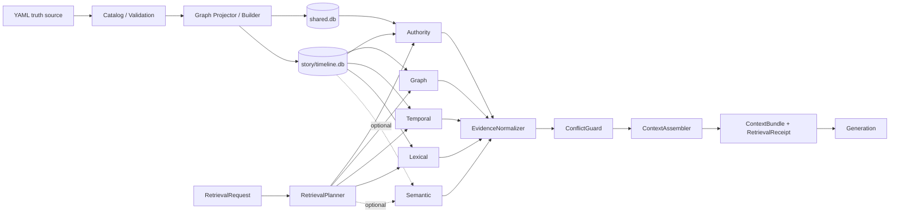
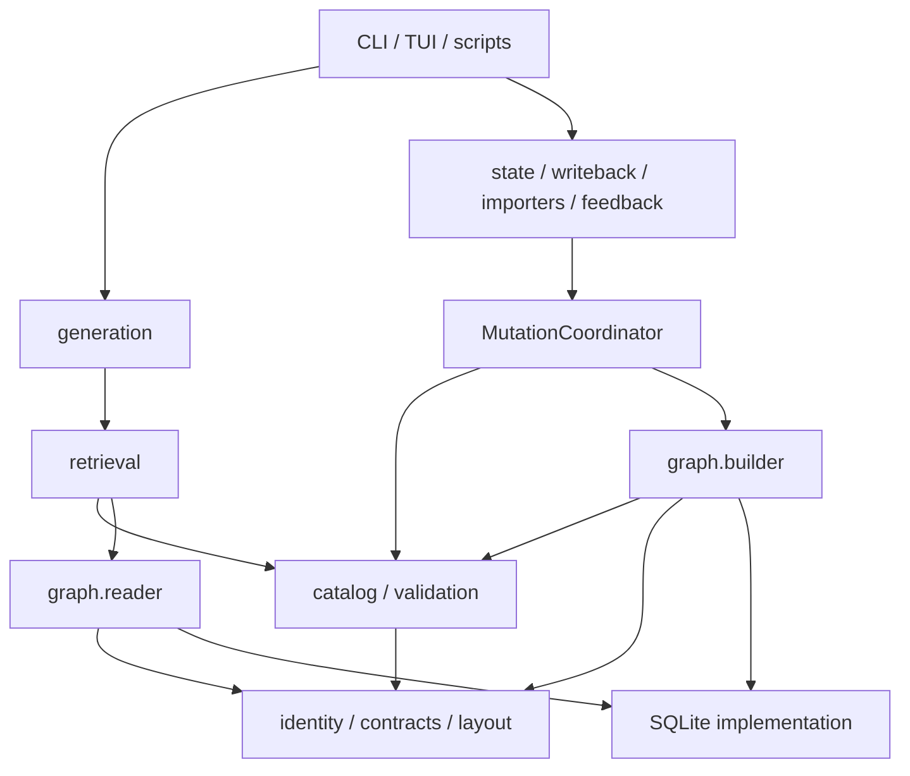

# Authority-first Hybrid GraphRAG 架构规范

> 状态：唯一权威架构基线（v2）
>
> 适用范围：`D:\novel-project` 的 `novel-rag` 资料、索引、检索、摘要和正式写入链。
>
> 配套文档：`ENGINEERING_REFACTORING_BOUNDARIES.md` 只记录现状问题、迁移阶段和验收，不得重新定义本文件中的架构合同。两者冲突时以本文件为准。

本文描述目标实现，不表示现有代码已经完成。任何突破 YAML 真相源、timeline 物理隔离、权威优先、证据可解释、过期拒绝或单图原子提升的改动，都属于新的架构变更。

## 1. 已确认决策

1. YAML 是唯一事实源。SQLite 是可删除、可重建的派生投影。
2. 一部小说的稳定公共资料放在 common；剧情资料按 timeline 保存。子 timeline 通过父线和分歧坐标继承分歧前的祖先区间，分歧后只读取自己的资料。
3. 一个 `GraphKey(story_id, timeline_id)` 对应一个完整可检索视图：`story common + 祖先有效区间 + 指定 timeline`，并输出一个物理数据库文件。
4. `shared.db` 只保存跨小说系统规则的派生索引；故事资料只能进入对应故事图。
5. RAG 是外层流程。Authority、Graph、Temporal、Lexical 和可选 Semantic 是五个召回通道，不是五套事实源。
6. 允许用户直接编辑 YAML。编辑后旧图必须被识别为 stale，检索和生成拒绝使用旧图；不得在生成时隐式重建。
7. AI 可以自动生成场景、章节和卷摘要。摘要存入 YAML，无需人工批准即可进入 Temporal 通道，但不提升为 Canon；用户可通过前端修改。
8. 不要求多个图同时切换。每张图必须先在临时文件中完成构建、完整性检查和检索回归，之后才能单独原子提升。
9. SQLite 及所需 FTS 能力属于安装前置条件。运行时不为缺失或不兼容的 SQLite 设计弱化降级路径。
10. v1 不实现任意历史时点回放。图是当前有效投影，历史坐标用于检索和摘要覆盖。

## 2. 真相源与物理布局

### 2.1 目标布局

```text
novel-rag/
├─ shared/                                  # 跨小说系统 YAML
│  ├─ rules/ judgment/ generator/ audit/
│  ├─ style-audit/ templates/
│  └─ registry/
├─ stories/<story_id>/
│  ├─ common/                               # 明确适用于全部 timeline 的稳定资料
│  │  ├─ canon/
│  │  └─ registry/
│  └─ timelines/<timeline_id>/              # 本 timeline 自己拥有的剧情资料
│     ├─ canon/ history/ outline/
│     ├─ character-state/ world-state/
│     ├─ feedback/ summaries/
│     ├─ system-overrides/
│     ├─ registry/
│     └─ retrieval-tests.yaml
└─ index/                                   # 全部为派生物
   ├─ shared.db
   └─ graphs/<story_id>/<timeline_id>.db
```

当前 `stories/<story_id>/canon|history|...` 布局在迁移期间按以下规则解释：story 根的 canon/registry 默认属于 common；history、outline、state、feedback 和 system-overrides 默认属于 timeline `main`。metadata 明确指定其他作用域时不得靠默认值覆盖。迁移适配器只负责旧布局读取，不得长期形成第三种布局。

### 2.2 timeline 继承规则

- `common/` 只保存明确适用于全部 timeline 的稳定 Canon 与故事级注册信息，不存 timeline current state。
- `timelines/<timeline_id>/` 保存该线直接创作的 History、Outline、current state、专属 Canon、反馈和摘要。
- timeline 文档可以通过稳定版本关系 `supersedes` common 或祖先有效区间中的文档，但不能原地无痕覆盖。
- 建图读取 `shared`、目标 story 的 `common`、目标 timeline 以及注册表允许的祖先区间；同级或后代 timeline 的任何资料都是构建错误。
- 分歧点由 timeline 注册表显式记录，不通过目录时间或模型推断。

```yaml
timelines:
  - story_id: overturned-world-fujimaru
    timeline_id: main
    parent_timeline_id: null
    divergence_at: null
    status: active
  - story_id: overturned-world-fujimaru
    timeline_id: branch-a
    parent_timeline_id: main
    divergence_at: volume-04/chapter-24/scene-03
    divergence_snapshot: snapshots/branch-a-at-v04-c24-s03.yaml
    status: active
```

Catalog 在建图时解析 timeline lineage，并对每一层祖先应用下一层声明的 `divergence_at` 上界。父线在分歧点以后的资料绝不能进入子图。子 timeline 不继承父线持续变化的 current state；创建分支时必须在子线固化 `divergence_snapshot`，作为角色和世界状态的起点。

祖先分歧前的资料修订会使所有继承该区间的后代图 stale；祖先分歧后的资料修改不影响已经分叉的后代。运行时不递归打开父图，只读取已经包含完整投影的目标物理图。

### 2.3 身份校验

`story_id` 和 `timeline_id` 是稳定路径标识，不使用展示标题。路径只能由校验后的 `GraphKey` 生成。进入图前必须验证：

- 物理目录；
- 文档 metadata；
- timeline 注册表；
- version-map、aliases 和 module-map；
- 目标 GraphKey。

任一不一致都使整次构建失败，不允许跳过坏文档继续生成残缺图。

## 3. 总体数据流



不同通道的原始分数没有共同尺度，只允许在通道内部排序。

## 4. 五个召回通道

### 4.1 Authority

按身份和版本确定性加载：

- module-map 指定的 shared 规则；
- common 与目标 timeline 的有效 Canon；
- 当前角色状态和世界状态；
- active feedback 和生成阶段约束。

`shared.db` 是 Authority 的数据来源，不是第六个 channel。Feedback 是写作约束，不自动成为世界事实。

### 4.2 Graph

- aliases 最长匹配优先；无法唯一解析时拒绝自动选取。
- 默认只做一跳白名单边扩展；地点父子树可配置到最多三跳。
- 关系只能从明确字段投影，不允许模型猜边。
- 每条边保存来源文档、来源版本、证据路径、authority 和 status。

### 4.3 Temporal

- 最近场景可保留原文；较早内容使用场景、章或卷摘要。
- 摘要 YAML 保存覆盖范围、来源文档、source fingerprint、实体 ID、未决事项和生成信息。
- AI 自动摘要无需批准即可使用，但始终标为 `temporal-summary`，权威低于其来源事实。
- 前端修改摘要后写入新 revision，并标记 `ownership: user`；自动任务不得覆盖 user revision。
- 来源变化时：`ownership: auto` 可自动重建；`ownership: user` 只标记 stale 并提示用户合并，不静默覆盖。stale 的用户摘要不自动进入 ContextBundle，直到用户确认保留、合并或重新生成。

建议摘要 metadata：

```yaml
metadata:
  document_type: chapter-summary
  story_id: overturned-world-fujimaru
  timeline_id: main
  ownership: auto        # auto | user
  generated_by: model-id
  covers_documents: []
  covers_through: volume-04/chapter-24
  source_fingerprint: sha256:...
  revision: 1
```

### 4.4 Lexical

- ID、短实体和别名优先走精确表。
- 中文正文使用 SQLite trigram FTS；BM25 只在本通道排序。
- 安装或 `novel-rag doctor` 必须完成 SQLite 版本与 trigram feature probe。
- probe 不通过时安装失败，index/retrieve 给出明确诊断；运行时不静默降级 tokenizer。

### 4.5 Semantic

默认关闭，仅作为可选实验通道。它不能成为必需依赖、不能改变 authority，也不能覆盖 Canon/current。启用前必须单独审批模型、费用、依赖和检索回归。

## 5. 证据与冲突合同

```python
@dataclass(frozen=True)
class Evidence:
    document_id: str
    channel: Literal["authority", "graph", "temporal", "lexical", "semantic"]
    authority: str
    fact_type: str | None
    valid_at: str | None
    entity_ids: tuple[str, ...]
    relation_path: tuple[str, ...]
    reason: str
    source_version: str | None
    source_fingerprint: str | None
    content: str
    channel_score: float | None
```

冲突不能使用一条全局来源排名解决，而应按以下键判断：

```text
事实类别 → timeline → 有效时间 → status → authority → source version
```

- Canon 管稳定规则、身份和不可随场景自然变化的事实。
- current 管明确时间点的可变状态。
- History 证明已经发生的事件。
- Outline 表示未来意图。
- Feedback 表示写作约束。
- Summary 是来源内容的压缩记忆。
- Lexical/Semantic 是召回方式，不产生额外事实权威。

同一事实键仍冲突时返回 `ContextConflict`，不得由 BM25、路径长度或向量相似度静默选边。

## 6. ContextBundle 与预算

```python
@dataclass(frozen=True)
class RetrievalRequest:
    graph_key: GraphKey
    outline: str
    target_entities: tuple[str, ...] = ()
    target_stage: str | None = None
    token_budget: int | None = None

@dataclass(frozen=True)
class ContextBundle:
    mandatory: tuple[Evidence, ...]
    graph_context: tuple[Evidence, ...]
    temporal_memory: tuple[Evidence, ...]
    lexical_supplements: tuple[Evidence, ...]
    semantic_supplements: tuple[Evidence, ...]
    conflicts: tuple["ContextConflict", ...]
    receipt: "RetrievalReceipt"
```

`token_budget=None` 表示使用系统配置的默认预算；必须拒绝小于等于零的显式预算。ContextAssembler 负责分层配额、去重、预算裁剪和回执，不允许调用方直接拼通道结果。

## 7. SQLite 投影与 manifest

故事图最小表集：

```text
graph_manifest
documents
entities
aliases
document_entities
relations
summaries
chunks_fts
```

manifest 至少保存：

```text
schema_version
story_id
timeline_id
source_fingerprint
shared_manifest_fingerprint
module_references
built_at
document_count
entity_count
relation_count
```

`source_fingerprint` 必须使用稳定排序的相对路径和文件内容计算 SHA-256。mtime 和大小只能用于快速判断是否需要重算，不能决定图是否新鲜。

shared.db 拥有独立 `shared_manifest`、builder、reader、fingerprint 和原子提升流程。module-map 形成 `shared module → GraphKey` 的反向依赖集合；共享模块变化后，所有引用它的故事图均变为 stale。

## 8. 稳定接口

```python
@dataclass(frozen=True)
class GraphKey:
    story_id: str
    timeline_id: str

class GraphReader(Protocol):
    def manifest(self) -> GraphManifest: ...
    def resolve_aliases(self, text: str) -> EntityResolution: ...
    def neighbors(
        self,
        entity_ids: set[str],
        relation_types: set[str],
        max_hops: int = 1,
    ) -> list[RelationHit]: ...
    def documents_for_entities(
        self,
        entity_ids: set[str],
        document_types: set[str] | None = None,
    ) -> list[DocumentHit]: ...

class Retriever(Protocol):
    def retrieve(self, request: RetrievalRequest) -> ContextBundle: ...
```

`GraphReader` 只读打开 SQLite URI `mode=ro`，并验证身份、schema 和 fingerprint。具体 `GraphReader`、`SharedModuleReader` 和各通道在应用组合根注入 Retriever；它们不出现在 generation 的公开调用签名中。

```python
def build_graph(
    key: GraphKey,
    corpus: ValidatedCorpus,
    target: Path,
) -> GraphBuildResult: ...

class MutationCoordinator(Protocol):
    def commit(self, changes: ChangeSet) -> MutationResult: ...

@dataclass(frozen=True)
class SummaryUpdate:
    document_id: str
    expected_revision: int
    content: str

class SummaryEditor(Protocol):
    def update(self, change: SummaryUpdate) -> SummaryDocument: ...
```

前端通过 `SummaryEditor` 修改摘要。更新必须检查 `expected_revision`，把新版本标记为 `ownership: user`，再通过 MutationCoordinator 提交 YAML 和受影响图；并发覆盖返回明确冲突。直接编辑 YAML 仍然允许，但只能依靠 fingerprint 触发 stale 检测。

## 9. 依赖方向

箭头统一表示“依赖者 → 被依赖者”。



禁止 `graph → generation`、`retrieval → CLI/TUI`、`catalog → SQLite schema`、`state/writeback → graph.schema`。SQLite 连接、游标和内部行结构不得出现在 generation/retrieval 的稳定接口中。

## 10. 建图与提交协议

### 10.1 单图构建

```text
解析 GraphKey
→ 加载 common + 祖先有效区间 + 目标 timeline + module-map
→ 校验身份、版本、引用和分歧边界
→ 计算内容 fingerprint
→ 在正式图同目录构建临时 SQLite
→ FK / integrity / manifest / FTS probe
→ 运行该 GraphKey 的 retrieval regression
→ 关闭构建连接
→ os.replace 单图原子提升
```

任一步失败都保留旧图，失败的临时图不得被运行时读取。

### 10.2 MutationCoordinator

协调式写入采用安全但不伪装为全局原子的协议：

```text
准备 staged YAML
→ validate staged corpus
→ 为全部 affected GraphKey 构建临时图并完成回归
→ 全部临时图成功后，逐文件原子提交 YAML
→ 逐 GraphKey 原子提升已经验收的图
→ 输出每个 GraphKey 的 promoted / pending / failed 状态
```

- 多图之间不承诺同时切换。
- YAML 提交到某图提升之间，fingerprint 不一致使该图拒绝生成。
- 图提升失败时保留已验收临时图以供重试，并明确报告 pending；不得退回使用旧图生成。
- 用户绕过 Coordinator 直接编辑 YAML 也是合法操作，但只触发 stale 拒绝，不自动建图。
- 实现必须处理进程锁和 Windows 文件占用；不能假设关闭 builder 自己的连接就等于没有其他 reader。

## 11. 兼容迁移

1. 冻结 GraphKey、目标目录、manifest、内容 fingerprint 和安装预检。
2. 建立 catalog 规范化、lineage 区间解析与 legacy 根布局读取适配器。
3. 建立 SharedBuilder/Reader 与逐 GraphKey 的 GraphBuilder/Reader。
4. 实现五通道 Retriever、冲突门、ContextAssembler 和 RetrievalReceipt。
5. 旧 `search_isolated()`、`rebuild_isolated_indexes()` 只保留参数/结果转换和弃用告警。
6. generation 迁移到 Retriever；state/writeback/importers/feedback 迁移到 ChangeSet。
7. 建立 AI 摘要写入、前端编辑、user revision 防覆盖和 stale 处理。
8. 迁移旧 story 根布局；全部调用点归零后删除 shim。

兼容层不得新增业务能力，也不得吞掉身份、歧义、过期或安装能力错误。

## 12. 验收

- 一个图只包含 common、注册表允许的祖先区间与目标 timeline；同级、后代和祖先分歧后命中数必须为零。
- 分歧边界、parent timeline 和 divergence snapshot 必须可验证，不能运行时递归继承可变父状态。
- Reader 缺图、身份不符、schema 不符或 stale 时失败，不创建空库。
- 所有图先构建、校验和回归，再逐图提升；失败不使旧图冒充新图。
- shared 变化能确定性列出并使所有依赖 GraphKey stale。
- AI 摘要可自动使用；用户编辑后不会被自动任务覆盖；stale 用户摘要不会自动进入生成上下文。
- Authority、Graph、Temporal、Lexical、Semantic 的结果类型一致，每条证据带来源和理由。
- 不同通道原始分数不直接相加决定事实。
- SQLite/trigram 安装预检失败时给出安装诊断，不进入半可用运行态。
- 完整测试集、隔离回归、stale、冲突、误召回和 token 预算断言全部通过；不以固定测试数量作为门禁。

## 13. v1 明确不做

- 不引入 Neo4j、NetworkX、SQLAlchemy、Alembic、Chroma、向量服务或 DI 框架。
- 不实现跨 timeline 统一查询、任意历史状态恢复或关系版本链。
- 不自动从自由文本造实体、关系、别名或 Canon。
- 不让自动摘要成为高于来源文档的事实。
- 不在运行时安装或替换 SQLite。
- 不借迁移一次性重写全部 helpers 或改变生成输出行为。

## 14. 判断标准

```text
YAML 决定“记录了什么”
GraphKey 决定“属于哪个世界线”
Authority 决定“必须带入哪些约束”
Graph 决定“相关事实在哪里”
Temporal 决定“历史保留多少”
Lexical 决定“补充哪些词面细节”
Semantic 只提供可选相似性
ContextAssembler 决定“最终给模型什么”
```

任何破坏真相源、分歧隔离、证据可解释、过期拒绝或验收后提升的修改，都必须先更新本文件并重新评审。
