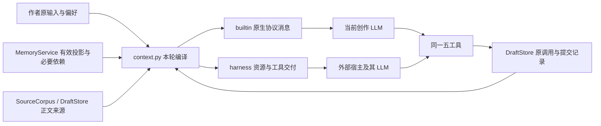

# 小说创作工作台架构（v3）

> 状态：v3/Metro网页/harness/信息迷雾、§7.9记忆可靠性六包及§7.10–7.11整体context已实施；最新615/72/729完成门及C/B冻结独立QA通过。实际Codex0.161/gpt-6.1-sol max百章AB与作者改稿后冷会话续写已独立复核，成本/感知精度/角色知识持久化仍有明确实验限度。此前Metro真实浏览器/安装包/15图轮换及短篇证据保持。执行边界见IMPLEMENTATION_STATUS_AND_NEXT.md。更新：2026-10-10。
>
> 本文件继续是唯一权威架构路径。文件名保留，以保持 AGENTS.md 与既有引用兼容。
> [v2 完整归档](archive/HYBRID_GRAPHRAG_ARCHITECTURE_V2.md)约束显式 v2 兼容链；本文定义 v3 目标及切换边界。
> [迁移计划](ENGINEERING_REFACTORING_BOUNDARIES.md#v3-plan)记录实施顺序；[当前状态](IMPLEMENTATION_STATUS_AND_NEXT.md#v3-status)记录证据。
> 本文定义已确认契约；软件验证采用实施状态中的实际证据，真实模型与文学效果仍须单独验收。既有资料与v2入口保留。

<a id="architecture-overview"></a>
## 阅读入口与设计摘要

本地网页接收原始大纲和要求，由一个创作 LLM 连贯生成正文。agent 负责提供相关设定、经过、当前有效状态与伏笔参考，保存草稿，并在作者采用后写入正式作品。质量由作者阅读判断；版本、来源与恢复由程序保证。

| 要了解什么 | 权威位置 |
|---|---|
| 产品边界、网页、模块依赖 | §1–4、[目录与 owner](#implementation-layout) |
| 单会话、输入基线、五个工具与流式正文 | §5–6、[运行绑定](#run-binding) |
| 外部LLM harness、单后端与MCP边界 | [接入增量§15](#harness-integration) |
| 状态、事件图、router、伏笔、算法 | [状态合同](#state-memory)、[事件路由](#event-memory-router)、[记录形状](#event-records) |
| 记忆可靠性增量、发布证据与反例验收 | [可靠性合同§7.9](#memory-reliability)、[增量工作包](ENGINEERING_REFACTORING_BOUNDARIES.md#memory-reliability-plan) |
| 正式来源、采用、重启与兼容 | §8–12、[引用分型](#source-references) |
| 按方案实现与验证 | [完整路径示例](#run-examples)、§13、[阶段计划](ENGINEERING_REFACTORING_BOUNDARIES.md#v3-plan) |

首版只需要本地Python服务、现有YAML库、同一个模型客户端与内存关联图。默认有界图展开和完整相关包去重，不设记忆token预算；仅显式容量路径用贪心，Dijkstra/DP按声明条件可选。文学audit、评分、自动修复、强制总结及固定回顾退出新默认链。

## 1. 已确认的产品方向

作者的大纲是航线，LLM 是创作主体，agent 提供参考、工具和边界。作者阅读与反馈决定正文是否合用。

- REQ-V3-01：本地网页输入原始大纲、本轮要求、设定和文风偏好，生成可阅读、编辑的正文。
- REQ-V3-02：同一个 LLM 会话按需读取参考，完整组织场景、对白、节奏与措辞。软件不把自由文本大纲逐句编译为硬事件。
- REQ-V3-03：默认链移除 normalize 合同审批、逐事件行为/结果/渲染、reference profiler、文学 audit、评分、polish/repair 过关循环、强制写前自检和写后回顾。
- REQ-V3-04：文风由作者的短偏好与选定范例表达；旧 shared/style-audit、judgment、generator、audit、ruler 不自动作为写作指令加载。
- REQ-V3-05：记忆供创作参考，正式前文可直接检索；参考笔记有来源、可编辑、可失效，不自动升级成 Canon。
- REQ-V3-06：草稿自动保存；作者一次“采用正文”进入正式 History。取消、断网、重复请求、改稿和重启不会静默覆盖内容。
- REQ-V3-07：保留既有作品、timeline/lineage 隔离、来源、模型配置和显式 v2 入口，分阶段切换。
- REQ-V3-08：同一创作 LLM 按情节变化批量记录 Set/Clear，正文连贯生成；状态机管理来源、生命周期与继承，不安排每个动作或周期审稿。
- REQ-V3-09：记忆区分世界结果、人物知识/信念/声称、未完成条件及连续性；绑定叙事游标、草稿分支和来源，改稿后不复活旧状态。
- REQ-V3-10：保留作者提供的 R13 原本及选用文风资源；活跃适配退出四段 CHECK、九项固定报表、逐组 Guidance 试写与硬禁修复循环。
- REQ-V3-11：memory 围绕轻量故事图、router、事件线/经历与伏笔组织；按当前情节提供小参考包，不恢复多通道配额、整库社区摘要、向量服务或另一个路由 LLM。
- REQ-V3-12：待续、未兑现约定与潜在伏笔分别表达；算法选择参考并保留必要经过/解除/知情来源，不强制 LLM 回收伏笔、推进事件或完成文学评分。

这些要求来自本次会话的明确确认。文学质量由实际输出和作者阅读判断；软件验证检查上下文、工具、版本和持久化行为，不给正文设文学合格门。

## 2. 形态与主模块

首版采用 Python 单进程本地服务，服务静态 HTML/CSS/JavaScript 页面。主入口为本地网页，CLI 是同一应用服务的辅助入口；不引入 Node 构建、桌面壳或多服务部署。

HTTP 层选 FastAPI + Uvicorn；新 turn 网络调用选支持取消的 HTTPX 异步客户端。既有 PyYAML 保留。它们只进入 web 可选依赖组，v2 CLI 不因未安装 web extra 无法运行。实施时锁定并验证与 Python >=3.10 的兼容版本，本设计不虚构已安装版本。

依据：[FastAPI 流响应](https://fastapi.tiangolo.com/advanced/custom-response/)、[本地 ASGI 服务](https://fastapi.tiangolo.com/deployment/manually/)、[HTTP 测试](https://fastapi.tiangolo.com/tutorial/testing/)、[HTTPX 异步与关闭](https://www.python-httpx.org/async/)。具体网络取消与协议能力还需实施验证。

~~~mermaid
flowchart LR
    Author["作者：大纲、偏好、反馈"] --> Web["web：本地工作台"]
    Web --> Generation["generation：单会话与工具循环"]
    Generation <--> Model["model_api：LLM turn"]
    Generation <--> Memory["memory：当前作品参考"]
    Generation --> Draft["草稿与运行记录"]
    Web --> Writeback["writeback：作者采用"]
    Writeback --> History["正式 History YAML"]
    History --> Memory
    Writeback --> Notes["可选参考笔记"]
    Notes --> Memory
~~~

| 唯一 owner | 公共责任 | 实施位置 |
|---|---|---|
| generation | 会话、上下文组装、工具分发、草稿、运行恢复 | 新增 session/context/tools/store；现有类型增加 v3 类型，v2 pipeline 保留兼容 |
| model_api | 消息与工具协议编解码、网络、取消、结束原因、用量 | 演进现有 model_api.py；v2 stage Callable 继续兼容 |
| memory | 状态投影、事件/伏笔记录、图与 router、原文回读及来源失效 | 新增 memory/service/state/graph/router，调用既有 catalog/service/documents 与检索原语 |
| writeback | 采用/修订、版本检查、幂等、提交事实恢复 | 新增 writeback/adopt.py；不调用 v2 confirm_runtime 的文学门 |
| web | HTTP 参数、静态页面、运行观察和交互 | 新增 web/app.py 与 static；不实现第二套写作业务 |
| composition | 装配 v2/v3 策略及服务 | 扩展现有 composition.py |

model_config、catalog/service/documents、mutations、graph 继续拥有各自已有公共能力。没有新的通用编排框架、事件总线、模型角色队列或平行事务引擎。

<a id="implementation-layout"></a>
### 2.1 实施目录与依赖方向

~~~text
novel_rag/
  model_api.py                # 演进 turn/流协议；保留旧 stage Callable
  composition.py              # 唯一装配点，显式选择 v2/v3
  generation/
    session.py                # 唯一创作循环、反馈和取消
    context.py                # 本轮要求/正文/资源/记忆包组装
    tools.py                  # 五个工具的定义与 dispatcher
    store.py                  # run/接收缓冲/草稿/输入快照/候选/恢复
    types.py                  # v3 运行/草稿/输入合同；正式源引用复用 documents
    pipeline.py               # 现有 v2 行为继续兼容
  memory/
    service.py                # recall/remember 组合、整批校验
    state.py                  # 唯一当前效力 reducer
    graph.py                  # 事件/伏笔记录及派生关联
    router.py                 # 候选、必要依赖包与参考预算
  writeback/adopt.py          # 作者采用、单文件提交与恢复
  web/app.py + static/        # HTTP/SSE 与静态工作台
  catalog/、documents.py、mutations/、graph/  # 复用已有归属
~~~

上表是待实施目录，当前文件不因出现在这里而被视为已存在。web/CLI 调用 generation 和 writeback；generation 调用 model_api 与 memory；memory 调用 catalog/源读取及已有图原语；writeback 调用 store、源校验与 mutations。memory 不反向 import generation 的领域逻辑，所需快照/映射由组合根注入；store 不解释人物或因果。

来源引用的最新归属沿§19：DocumentRef、DraftRef、AuthorInputRef及纯结构解析集中在业务合同包contracts；documents和generation/types保留同对象兼容导出。正式来源的签发/效力仍归documents/catalog/service，运行绑定仍归generation。纯合同不import运行服务、Store、memory或I/O实现；memory可以消费纯引用合同，不能反向调用生成实现。当前状态与图记录领域类型各由memory/state/graph拥有，不复制到generation。

## 3. 作者体验与界面边界

工作台有作品/时间线选择，以及“大纲与要求、参考资料、正文”三个区域；文风偏好与模型配置为轻量设置。

1. 选择作品，粘贴或上传 TXT/Markdown 大纲，填写本轮要求。
2. 点击创作，正文逐步显示；工具读取信息在可展开的过程区显示。
3. 可直接编辑草稿，或用一句反馈发起同会话的新 run。
4. 点击“采用正文”，选择章节坐标；同一次采用自动处理可用的参考笔记，不逐字段审批。
5. 刷新/重开能找回草稿和运行状态；停止按钮显示取消请求与实际停止的区别。

设定输入沿用 canon YAML 容器，由后端填必需元数据；作者编辑的是可读内容，不需要手填 GraphKey、版本族或 module-map。初版只上传文本，不承诺任意二进制附件解析。

生成中允许作者改输入、切作品或编辑正文。进行中的 run 使用启动时的请求快照；新输入在下一次 run 生效。迟到输出只属于原 run，不能覆盖作者已编辑的新修订。当前书无资料时仍可按大纲创作，过程区如实显示参考为空。

初版界面具备正常、空、进行中、失败状态，保留输入和未保存编辑；提交/采用去重，按钮和编辑区支持键盘操作。浏览器断开只停止观察，不等同取消任务。

### 3.1 术语与边界

| 术语 | 本文唯一含义 |
|---|---|
| GraphKey | 作品 + timeline；一条 Session 固定在这个作用域 |
| Session / Run | 作者与模型的会话 / 一次固定输入、基线和配置的请求 |
| 草稿分支 / checkpoint | 一个工作版本的继承链 / 由 host 保存的不可变正文边界 |
| narrative_cursor | 正式来源 before/after 端点与所选工作前缀；不等于消息轮数 |
| EventLine / Experience | 可跨章的独立因果线 / 一次有来源的历史经过 |
| Hook / Pending | 可再次有用的线索或计划 / 已发生因果线中仍待响应或完成的事项 |
| memory batch / StateView | 一次规范化、可恢复的差分记录 / 由记录派生的当前有效视图 |
| scene | 叙事场景；由显式声明切换，不等于 HTTP run、技术 Session 或 RP 的八轮 State |

## 4. 原始大纲、创作边界与文风

上下文保留原始大纲与本轮消息。作者明确指定的必达节点、终点、顺序和禁区是创作参考边界；动作过程、对白、场景切分、过渡和表达由 LLM 决定。软件不产生 S/A/B/C 节点等级、逐句功能配额或事件合格报告。

作者本轮明确要求具有最高指令权；显式改设定的要求可以指导本轮创作，正式 Canon 仍通过作者编辑/采用入口保存。模型自己的推断只作为参考笔记，不自动改设定。真正无法继续的关键路线歧义可以简短询问作者；普通细节留给模型补足。

文风唯一偏好源沿用 stories/<story_id>/author-preferences.txt，缺失时按空偏好运行。onboarding 的既有路径能力作为 owner，generation/CLI 委托；v2 的结构化解析仅供 v2 消费。作者选择的少量范例保存为会话参考，不进入作品事实索引。既有 shared 文风资料保留，作者可显式查看或选择；选择不意味着整库注册规则自动激活。

初始指令只描述创作职责、按需读取工具、作者边界和输出用途。资料与范例作为有来源的数据，不升级为 system 指令。模型最终正文可自由改写；不要求原句 substring、逐事件证据或“审计通过”。

### 4.1 R13 资源适配

用户提供的 [R13 原本](references/kardia-r13-full-symbolic-lean.source.txt)已按字节保存：63,106 字节、706 行，SHA-256 为 a999dd0f4113672d6c61e18b1502b7ed839f40674c5735375adc7b0cfe8e876e。它是设计/资源来源，不是整份自动注入的运行协议。只提供了这份合成文本中的内容，不把 A–H 原始文件名或书名视为完整原文已加载。

保留原本中事实/认知/条件区别、参与与 POV 边界、连续性、语言表面创作权。CPM 的意图、参与、取向、表达边界以及 AME/Tone 是给同一 LLM 的创作参考；软件不求解这些公式，也不强制每个人每轮填满九项。

Reference 与写法按实际需要选用：给模型列出确实存在的资源 ID 和适用说明，read_writing_reference 返回所选条目的实际内容、来源 hash 与范围。默认零到一个主参考，需要时加一个辅助；按需选用写法和例子，不强制输出选择报表。短偏好不意味着正文或每份参考都必须缩短。

作者禁写项可保留在可编辑偏好中，由创作提示表达；软件不在每组正文后扫描、改写、复查。RUNTIME 的 HTML、计段、周期 CHECK、START 九项列表、Guidance 试写改进和交付前修复不进入活跃适配。符号公式作为原本说明保存，不转换成通用规则 DSL。

适配的职责提示可以表达为：

~~~text
依据作者大纲和本轮要求完整创作，在既有事实与人物视角边界内自由组织场景和语言。
参考状态包含来源与覆盖缺口；需要时回读原文，人物按实际感知、理解、意愿和条件行动。
区分客观结果、人物声称或相信的内容、请求、承诺和尝试；未知保持未知。
产生会影响后续的变化时，可保存正文检查点并批量记录状态；写作本身保持连贯。
按场景选用实际提供的文风材料，允许闲笔、感受、内语、停留和语言发挥。
~~~

## 5. 一条会话与一个运行循环

Session 属于固定 GraphKey，保存作者消息、完整模型 turn、工具调用及结果。一个 Run 对应一次创作/修改/讨论请求，固定 request_snapshot、目标草稿基线和模型配置快照（不复制密钥）。

~~~text
保存 run 与请求快照
→ 组装作者要求、文风、近期正文和相关参考
→ 检查实际材料效力，在原turn记录请求/attempt绑定
→ complete_turn(messages, tool_definitions, cancel_signal, on_text_delta)
→ 持久化完整响应及 provider 继续项
→ 如有工具请求：串行执行，保存结果，回传同一个会话
→ 如有最终正文：保存新的草稿修订，展示
~~~

唯一循环属于 generation；chat/responses 的差异只在 model_api。常规工具续接保留活跃协议链，不丢弃其文本/必要项，也不让协议分支各跑一套循环。来源失效或窗口整理需要的新attempt按§7.4/§7.11建立明确安全边界，不将每次材料检查当成重启创作。

write/revise 的最终文本用作正文；discuss 的最终文本用作讨论。工具 save_draft 仅创建中间检查点，最终输出另存修订，作者可查看两者；运行时不凭文学内容判断是否保存。作者下一条反馈沿用前文，并重新核对此前实际引用文档的 source_hash；变化的旧引用保留在历史记录中但不再标作当前事实，按需重读或向模型标明失效。无关文件变化不阻断创作。预算不足时优先保留本轮要求、当前正文和相关原文。

native工具串行执行，max_turns默认None，不再以固定16turn结束正常分页/创作。显式运行限制返回run_limit；明确窗口不足返回context_limit；网络/协议错误与取消各保原结束原因。context_window_tokens/output_reserve_tokens均由显式策略提供，未知不按模型名猜。模型实际截断只保留公开接收文本与结束原因，不把工具前计划或未完成文本自动存为正文；作者可明确保存/继续。

<a id="run-binding"></a>
### 5.1 RunBinding 与反馈继承

~~~text
BaseRef = empty | DocumentRef | DraftRef
RunBinding = (scope, task_kind, target_coordinate?, narrative_cursor,
              base_ref, draft_branch, selected_parent_checkpoint?,
              baseline_source_refs, input_snapshot_refs, output_mode,
              initial_memory_revision)
~~~

scope、基线来源、所选父检查点及章节位置由后端核验后固定，单独的 revision 数字不能标识基线。新 run 的初始上下文直接提供可用引用和 memory_revision，模型首次 remember 无需先执行 recall。技术 Session 保存历史，但不授予读取任意分支或继承所有旧状态的权限。

| 请求 | 正文基线与状态起点 |
|---|---|
| 新续写 | 明确选定已采用来源之后；未选时才取最新已采用正文。新目标坐标可在采用时选定，基线游标保持固定 |
| 继续父稿 | 选定具体 DraftRef/checkpoint，保留该前缀并建子分支；继承前缀仍有效的候选和稳定 ID，不含未选兄弟稿 |
| revise 某章/整稿 | 章前正式状态起步；完整原章/父稿作为 edit_reference 供修改，不把其章末投影当开场。仅明确保留的有效前缀可叠加 |
| 同会话 feedback | 新建 run，明确 write/revise/discuss 与 BaseRef；继续动作用父检查点，修改动作按 revise，旧消息不绕过当前绑定 |

跨分支拒绝针对未选工作分支；同 scope/lineage 可见的已采用记录与明确选中的父前缀是合法来源。原章作为修改参考可由 read_document 显式读取并标 edit_reference，即使它位于章前状态游标之后；它不进入开场 StateView。采用坐标改变到原基线之前或不同修订目标时，正文仍可采用，旧候选不按原语义发布并说明基线不匹配，不引入文学审核。

output_mode 固定为 full_body 或 append_suffix：新章写作与 revise 返回完整目标正文，选定父草稿继续则返回本 run 产生的新后缀。前一正式章只是上下文，不拼入新章；继续父稿只将选中前缀拼一次。generation/session 唯一组装正文，save_draft 与最终完成共用这条规则；save_draft 的 text 是本 run 截至该检查点的完整输出（full_body 或 suffix），不是每次工具新增的一小段。原文是否重复由作者阅读反馈处理，不新增 substring 文学门。discuss 的最终文本只进会话。

## 6. 模型与工具公共合同

~~~text
async ModelClient.complete_turn(messages, tool_definitions, limits, cancel_signal, on_text_delta=None)
  -> ModelTurn(content_blocks, text, tool_calls, finish_reason, continuation, usage)

ToolCall = (provider_returned_call_id, name, arguments)
Reference = (source_ref, kind, text)
RunService.start(scope, task_kind, outline, request, base_ref, target_coordinate?, profile_name)
  -> run_id
RunService.feedback(session_id, base_run_id, task_kind, request, base_ref, selected_parent_checkpoint?)
  -> new_run_id
RunService.cancel(run_id) -> cancel_requested
DraftStore.save(run_id, expected_revision, text)
  -> DraftRef(kind=draft, draft_document_id, draft_revision, content_hash, checkpoint_id)
MemoryService.read_state(run_binding, focus_entities)
  -> StateView(state_revision, entries, source_refs, recorded_through, coverage, gaps)
MemoryService.record_state_delta(run_binding, draft_ref, expected_state_revision, changes, scene_boundary=None)
  -> (state_revision, accepted_entry_ids, source_errors)
MemoryService.recall(run_binding, focus, query, available_tokens=None)
  -> MemoryPacket(memory_revision, state_view, event_lines, experiences, hooks, references, gaps, selection_reasons)
MemoryService.remember(run_binding, draft_ref?, expected_memory_revision, update)
  -> (memory_revision, accepted_record_ids, local_ref_to_stable_id, source_errors)
AdoptionService.adopt(run_id, draft_revision, expected_source_hash, coordinates, operation_id)
  -> (adopted, document_id, source_revision, source_hash, memory_state)
~~~

ModelTurn 保留工具调用 ID、必要 provider continuation 项和混合文本/工具输出。会话不改写这些返回 ID；tool result 必须配对到实际调用。配置继续使用已有 chat/responses 规范值及别名。v2 __call__(stage,payload) 的 JSON-stage 行为冻结为兼容方式，v3 不套 _JSON_STAGES。

content_blocks 保存 provider 返回的公开内容顺序及工具调用关联，text 是其中公开文本的规范化结果；隐藏 reasoning 不作为正文/SSE 内容。适配器同时组装最终 turn，并 await generation 提供的 on_text_delta。generation 的闭包绑定 run/attempt/turn 与原 BaseRef，由 store 保存独立接收快照后发布 SSE；可合并小块，已发布块必须可恢复。回调不构成第六个工具或另一个循环。

规范化最终 text 与该 turn 的文本增量拼接一致，完整结束标记才产生完成 turn；适配失配按 model_protocol 保留 partial，不伪造完整结果。带工具的 turn 的文本留在运行过程，最终无工具的任务文本才自动成为目标正文/讨论；流式预览不会自动拼接所有中间回答成一章。

store 记录 partial/complete 与后端计算的 UTF-8 接收/持久化范围。断流/取消保留最后持久化前缀，未完成工具参数不执行；已产生部分文本后不自动重发同 turn。保存失败关闭当前响应并报 save_failed。完整 turn/continuation 落盘后才执行工具；最终正文存为新草稿修订，UI 替换该 turn 的预览，不再次追加全文。作者已编辑较新稿时只保存独立生成稿，不移动作者版本。非流式返回可一次交付完整文本，不模拟逐字流宣称 transport 支持流式。

complete_turn 明确为异步：Web await，新 CLI 在顶层创建事件循环；旧 stage Callable 保持同步。HTTPX/FastAPI 只在 v3 使用边界加载，基础安装仍可导入 model_api 并运行 v2 CLI。model owner 负责响应/client 关闭。同步资料扫描、SQLite 和正式提交进入受控 worker，Reader 在该 worker 创建/关闭；普通业务函数不会因 Web 使用 async 自动进入线程池，见 [FastAPI 并发说明](https://fastapi.tiangolo.com/async/)。

v3 要求 provider 原生工具能力；不支持时返回清晰的 capability 错误并保留任务，不静默启动另一条模拟 JSON agent。本地受控 HTTP fixture 验证两种协议，真实 provider 能力另行验证；此前只返回文本的成功记录不能充当证据。

| LLM 可调用工具 | 输入与输出 | 副作用 |
|---|---|---|
| recall | 关注人物/物品/事件线、query → 当前有效结果、完整相关经历/伏笔与来源 | 当前 scope/游标/分支只读；默认不设token预算，容量参数仅由显式调用者提供 |
| read_document | document_id、可选段落范围 → 实际正文与来源 | 当前 scope 只读 |
| read_writing_reference | 已提供资源 ID → 实际写法/例子与来源 | 不进入事实/状态记忆 |
| save_draft | text、expected_revision → DraftRef 与不可变检查点 | 只写本 run 的工作区 |
| remember | 可选 DraftRef、expected_memory_revision、分型差分 → 记录 ID/映射/版本 | 只写当前分支候选；无正文时仅允许真实作者输入支持的计划/笔记 |

工具定义与 handler 位于 generation/tools.py 同一登记处，普通循环只按名称分发，不复制工具名判断到 provider 或 UI。正式采用、改 Canon、任意文件读取、执行 shell 和读取凭证均不是模型工具。

v3已将记忆工具收拢为recall/remember；read_state/read_recent/record_state_delta作为原owner的内部能力，不各自变成模型动作。§7.9可靠性增量沿用这两个入口，已有v2入口语义保持。router是memory内部选择函数，不是另一个agent或模型阶段。

remember 是可选能力；它可以记录同次创作的参考线索，声明其来源和参考性质。没有候选笔记时，采用只保存正文并使前文可检索，不额外调用模型做章末总结。需要集中整理记忆时，由作者发起独立请求。

remember 的正文状态/经历/线索差分共用 DraftStore 的来源映射：绑定冻结检查点及覆盖范围，追加正文可保留已覆盖前缀，改写采用 §7.4 的保守失效规则。纯作者计划/笔记则绑定 §8.1 的真实输入引用，不伪造正文检查点。采用时仅映射可证明仍属于所选正文的引用，不用最终整稿 hash 相等作为唯一条件。它是来源绑定，不检查文学含义，也不阻止采用。

## 7. 记忆：原文、相关参考与低权威笔记

v3 首版使用三个实际来源：

- Canon 与当前作品资料：作者设定、已有状态资料、明确选用的反馈。
- 正式 History：完整章节/场景、近期连续正文，以及按需读取的更早原文。
- 参考笔记：角色变化、关系线索、未兑现伏笔、作者自写笔记，低于原文，不作为新事实权威。

已有 current 是兼容参考，带覆盖坐标；有效正式正文优先，不自动把早期 current 当成“现在仍然如此”。v3 状态是带来源的简化投影，不模拟每个身体数值/动作。范例、未来大纲、模型计划和未采用草稿不进入已发生事实召回。

memory 通过既有 catalog/service 公共化的 scope 加载入口读取文档，复用 ValidatedCorpus.for_graph 的 common、祖先 cutoff 与 timeline 语义。v3 校验资料格式、身份、路径、来源和 lineage；旧 module-map/version-map 的系统模块注册策略留给 v2，其他书或废弃 shared 模块错误不能阻断本书原文读取。

默认模型交付采用context_view=model：先提供本轮大纲/要求、output_mode、scope/游标、真实修订及明确来源描述符；不再把完整recall及原文检索结果自动装入首包。短输入直接逐字提供，超长输入明确标未内联并给完整Ref/字符长度/hash及read_arguments，不能把预览称为原纲。底稿、修改参考、已选稿和偏好均可按来源读取。MemoryService.recall/router仍默认容量None，保留完整相关记忆/必要依赖/全部未重复命中；模型的大工具结果可以交付冻结页，不是恢复记忆token配额。full视图保留完整导出兼容，引用只有一份，基线正文不再复制到引用文本。显式context_tokens仍核验该交付视图的完整序列化成本，超出返回context_limit并保留输入；估计不声称等同provider tokenizer。具体交付合同见§7.10。

其余资料由 LLM 按需搜索和读取。来源不足时返回真实空结果；源文损坏时报告具体文档错误，避免以失败冒充“无资料”。每条引用带版本/hash，工具在自身执行域内打开并关闭 reader。新 run 不共享长期打开的 SQLite 连接。

索引是可删、可重建的派生加速。首版无索引/相关索引 stale 时使用同一 scope 的原文搜索和显式 read，不读取 stale 投影，不要求重建整个 GraphRAG 才能写作。索引重建是显式维护能力，不是每章采用的前置步骤。轻量检索复用已有 chunk_text、FTS/短词搜索与指纹；确需跨模块复用的私有函数先在原 owner 公共化，不复制词法算法。

参考笔记、事件足迹和伏笔记录复用已有 chapter-summary 容器、ownership/revision 编辑能力，v3 使用 §8.1 的分型 source_refs，正式来源具有 ID/revision/完整文件 hash/scope。缺少这些信息的旧摘要仅供显式查看。改稿/删除/来源版本变化后，旧记录保留历史但退出默认召回；作者改过的笔记不被模型自动覆盖。候选范围无法映射到采用正文时不发布，采用成功不受影响。首版图与 router 的具体取用合同见 §7.7，原文搜索只作缺口补读。

<a id="state-memory"></a>
### 7.1 状态领域与权威

状态机辅助保持“已经发生什么、谁知道什么、什么仍未完成”。语义分类和人物决策由创作 LLM 提出，程序管理结构、作用域、版本、继承和失效；它不判断一句话是否文学上证明某种动机。

| 领域 | 保存内容 | 关键区别 |
|---|---|---|
| Persona（设定参考） | H、L、Rel_base、稳定能力/习惯/声音 | 从 Canon 读取；动态工具不改写，goal_progress 只记推进或受阻 |
| World | 当前仍有效的客观结果、位置、伤势、资源、限制等现实条件 | 历史经过另存 Experience；引用其来源，声称/相信/想象不自动变成 World |
| CharacterView | knowledge、belief、claim、相关 unknown；持续情绪、关系理解/差分 | 必须有 holder，关系有方向；不自动传播，不因世界真相更新而清空未纠正误解 |
| OpenCondition | 请求、承诺、尝试、计划及当前阶段、未完成部分 | 提出、接受、履行、完成分别记录；一次帮助不自动关闭所有诉求 |
| Continuity（派生视图） | 上述动态条目的 scene/carry 生命周期与当前有效部分 | 不独立存第二份状态；一处解除后所有视图一致，Clear 留解除来源 |

可写 domain 只有 World、CharacterView、OpenCondition；Persona 是设定只读参考，Continuity 是生命周期视图。同一动态内容只在其所属领域记录一次：客观条件归 World，人物情绪/关系理解归 CharacterView，未完成事项归 OpenCondition。一次历史经历只存 Experience，不另建 World-event ID；当前条件可以引用该经历的结果。解除当前条件保留历史经历，历史不被重新解释成当前仍有效的限制。

世界事实与人物认知可以并存且矛盾。例如“门外有危险”与“乙相信门外安全”分别保存；“甲声称知道秘密”不产生甲掌握秘密内容的知识条目。不用一个扁平 K 字段或文字去重把它们合并。

感知、理解/摄取、相信和参与是不同声明。在场、注意到或被现实约束不自动产生知识、话轮或介入；更新甲的条目不扩散到人物名单。Tone、参考选择和句式配置没有状态写入副作用。模型分类不确定时保存 unknown/claim 或不提交，正文继续。

本轮信息边界沿用户[信息迷雾协议原本](references/information-fog.source.txt)落实。U是作者上下文的全部信息（含秘密、传闻、OOC），I_c是角色在剧情内可用的信息；二者不是同一视图。C只指相应地域/圈层广泛流传的概要，角色按已有经历与处境合理知道；G_g是群体相关信息，成员身份不自动授予整个G_g。比较人物只考察当前话题Q，共享消息不表示共同解释、同等确定或双方知道彼此也知道。集合只供同一创作LLM内部判断，不输出固定表或集合计算日志。

世界内信息来自实际存在的公开传播、圈层资料、人际与现场或已成立能力；除合理背景/公开概要外，只给实际感知或收到者，且只保留实际透露部分。检查感官、在场、权限、时间、传递路径；发出、送达、阅读、理解分别成立。内心、读者旁白、隐蔽动作、未参与私密场景和OOC不自动进入I_c；转述/传闻可能失真，别名真名、旧消息现状或推测来源不得无据对应。来源未知时不能凭作者全知精准定位。默认沿当前视角叙述；作者指定全知叙述可向读者透露，仍不能授予角色知识。这是v3已确认创作合同，旧v2文学审计资料不恢复其固定配额/检查规则。

用户[渠道补充](references/information-fog-channels.addendum.txt)明确不能局限于玄鉴中的渠道。information.channel保持开放自然语言，现有四字段能表达学校课堂/教材/教师讲解/校内通知/校园广播，报纸/杂志/电视新闻/广播节目，电话/短信/邮件/网络/社交平台，及单位/军队/社团的会议、通告、授权档案；这些是适配本书时代与设定的例子，不增加封闭枚举或新传播器。受教育/职业背景可支持合理基础知识；在校/任职不自动取得全学科、内部档案和他人隐私。精确信息需实际学习、阅读、收听、观看或收到，basis按需记录刊期/节目时点、地区圈层、信号设备、语言和权限。发布/播出/上课与角色实际获知分开；媒体报道不认证World真值，转载/转播同源不算独立印证，报道时间不代替事件/获知位置。此通用适配来自用户补充，不作为《玄鉴仙族》原文证据。

《玄鉴仙族》的[公开片段证据与采用边界](references/xuanjian-information-notes.md)提供消息由人带回、地域流传、书信/当地见闻互补、来源推测、感知信号推断和接待信息删节的写法参考。作为独立writing_reference按需读取，不把原作人物/剧情/未经核实术法或统一传递延迟注入当前作品事实。

### 7.2 最小变化合同与生命周期

~~~text
MemoryUpdate = (state_changes[], event_lines[], experiences[], links[], hooks[], notes[], scene_boundary?)
StoredMemoryBatch = (batch_id, memory_revision, source_refs, narrative_position, update)
StateDeltaBatch = (draft_ref, expected_state_revision, changes[], scene_boundary?)
StateEntry = (entry_id, domain, kind, holder?, target?, value,
              lifetime: scene|carry, scene_id?, source_refs, narrative_position, information?)
StateEntryData = (domain, kind, holder?, target?, value, lifetime, information?)
Information = (channel: text, source: text|null, certainty: text, basis: text)
Change = (op: set|clear, entry_id?, local_ref?, entry?: StateEntryData)
StoredStateBatch = (batch_id, state_revision, source_refs, narrative_position,
                    changes[], scene_boundary?)
StateView = (state_revision, scope, draft_branch, baseline_ref, source_refs,
             recorded_through, coverage: bound|partial|stale|unavailable,
             gaps, invalidated_keys, entries, claims, unknowns)
~~~

条目身份、scope、草稿分支、顺序和来源绑定由 host 固定。新 set 由 host 分配 entry_id 并返回，更新/clear 使用已返回的 ID；clear 的来源继承本批 DraftRef，不允许凭空解除。value 为可读自然语言，原始记录保留；不要求数值情绪、身体变量全集、任意 JSON Patch 或可执行条件表达式。World/CharacterView/OpenCondition 的同名内容使用不同身份；holder/target 不同不合并。

information为CharacterView的可选说明，不另建知识记录/内容副本：value是实际所得或判断，channel是世界内渠道，source是人物所认知的来源标签（未知用null，不是文件Ref），certainty是人物的确定程度而非World真值，basis记录感官/权限/传递/内容范围的依据。获知位置仍是host绑定的narrative_position，文件证据仍是source_refs；模型不能在information里添加自造时点或嵌套来源Ref。新信息应注明这些依据；兼容旧无information条目，缺失只表示未注明，不自动填“亲见/已核实”。一旦提供对象，四项必需且只允许这四项；基础身份及信息类型在remember与正式容器读取时委托同一memory/schema校验。模型输入仅允许声明字段；落盘模式另外容许entry_id/source_refs/narrative_position/scene_id这四个既有host字段，不接受外层自造时间或任意扩展。程序验证结构和实际来源生命周期，不能因basis存在就认证人物真的感知、消息真实或特殊能力成立。

run_binding 从后端已保存的运行快照产生，模型不能替换 scope、分支或基线。统一 remember 使用分支 memory_revision；StateView.state_revision 是该版本的视图，不另设计数器。内部 record_state_delta 消费同一版本及批次，不再次独立落盘。来源/基线有效性变化也推进版本；expected_memory_revision 不匹配或本批结构/来源无效时整批不写，返回当前版本及错误，正文保存不受影响。正文差分只接受当前/所选父前缀的有效检查点，输入型差分按 §8.1 绑定。原始批次先完整持久化，再重建派生视图；仅计划/笔记的更新不推进正文 recorded_through。

唯一持久候选是有序 StoredMemoryBatch，含状态与事件/伏笔差分；StoredStateBatch 是其状态部分的内部投影视图，保留 set/clear、目标 ID、批次来源/生效位置，不另存一份状态日志。clear 即使没有 entry payload 也有这些字段。StateView、Continuity、claims/unknowns 都从同一批次派生，不另存 active map；省略条目不能替代解除记录。普通 note 不会自动转成状态、事件或伏笔。

set 更新指定动态条目；clear 解除当前视图中指定条目的效力，并保存解除记录。省略表示无更新/继承，unknown 表示未知，不等于 false 或 clear。Clear 不删除正式正文、Persona 或原始历史。记录失效时不只删掉 Clear 后重新套用旧 Set；对受影响 key/基线返回缺口或未知，直到有新的有效来源。

OpenCondition 的阶段由 LLM 显式记录，可保留“待响应、已接受、拒绝/撤回”“待履行、已履行/违约/解除”“进行中、成功/失败/中止”等可读阶段。软件不按时间、run 结束、言语关键词自动转移，不要求文学情节表演所有中间节点。结束来源和未满足部分仍可查询。

scene 对应叙事场景，carry 对应跨场景仍有影响的状态；R13 的 session 不映射为技术 Session。可在同一个批次声明 scene_boundary=begin_scene，绑定 DraftRef，由 host 分配场景 ID 并保存声明来源；允许零 Set/Clear 的边界批次。边界先使前一场景的 scene 条目退出，再给本批 scene 条目绑定新 ID。没有声明就不自动切场景，不从 run、段落数或 value 推断边界。新 HTTP run、正文停止或取消不会解除持续伤势/承诺。场景无法确定时标覆盖不明，不伪造清空；当前无变化可零工具调用，不要求逐项 inherit 报表。

新人物尚无 catalog ID 时保留本分支临时身份、标签和来源；不猜成已有同名人物，不因此阻止正文。正式发布可以保留 unresolved 主体引用，不自动创建 Canon/实体/别名。

### 7.3 情节触发与正文检查点

用户已明确选择“按情节变化更新状态，正文连贯生成”。同一 LLM 在已写内容改变人物所知、现实限制、关系、未完成事项或场景连续性时，可先 save_draft，再通过 remember 批量记录状态与重要经历/伏笔；不按段落数、固定事件数量或完整 CPM 表触发。没有变化记录不等于证明没有变化。

~~~text
游标之前的设定/前文 + 有效参考投影
→ 同一 LLM 连续创作
→ 可选：正文不可变检查点 + 一批状态/事件/伏笔差分
→ 当前草稿分支的有效 StateView
→ 作者采用正文后，映射有效候选为正式来源参考
~~~

DraftRef 指向被冻结的真实正文。默认覆盖该检查点已保存的前缀；模型不用填字级坐标、逐字证明或自造 hash。host 管来源范围及映射，状态工具只接收软件已返回的引用。结构/来源错误只影响候选记录，返回具体错误供参考，不自动修复正文，不强迫重新输出状态表。

projection 的 bound 仅表示记录与有效来源绑定，不表示已经理解整段或记全事实。recorded_through 是最后记录位置，gaps 表示尚无记录、失效或时点不明的来源。回读始终保留相关原文入口；正文可在 partial/stale 时继续写作、编辑、采用。

### 7.4 追加、重写、分支与发布

| 操作 | 状态/笔记处理 |
|---|---|
| 仅追加正文 | 同一 DraftStore 核验已覆盖前缀字节不变，保留检查点/候选；新后缀尚未记录时显示缺口 |
| 只编辑未覆盖后缀 | 已覆盖检查点仍可用；不把覆盖推进到未记录后缀 |
| 改写已覆盖前缀 | 该检查点及依赖它的后续候选退出当前投影；保留历史，退回有效基线并标 partial/unknown |
| 全文重写或不能确定来源映射 | 保守失效整批候选，正文照常保存；同一 LLM可按需更新，不另起 observer |
| 部分采用 | 首版只发布同一分支且所选正文从原覆盖起点保留完整检查点前缀、字节一致的批次；跨边界/中段搬移/重复出现均不构成映射 |
| 取消/恢复/换草稿分支 | 候选留在原分支，新的 attempt 明确选择父检查点；未采用条目不进入正式作品记忆 |
| 正文采用、派生保存失败 | 返回 adopted + memory_pending；可重试物理保存，不撤销正文、不重新审稿 |

首版不做任意改稿的语义/substring 重定位：即使短引仍存在，前文改写也可能改变其含义；无法证明完整覆盖前缀保留时，不声称旧状态仍准确。后续需要范围映射再用具体场景扩展，不以此恢复原句锁。

采用后的条目仍是低权威 reference，映射为正式文档 ID/revision/完整文件 source_hash 和覆盖坐标。源版本改写/删除使相关投影及依赖基线失效；Clear 所在链失效时不能悄悄复活旧值。合法查询较早游标则先裁掉未来记录，按当时有效前缀组装，不把它误当成当前源失效。

当前上下文只合并经过分支、游标、source 校验的 StateView。旧工具结果保留原始调用关联用于追溯，但不能重新合并成当前状态。若 provider continuation 会继续包含已失效的草稿/状态项，则新 attempt 从选定正文、有效引用和作者消息显式重建消息上下文，放弃该旧 continuation；仍使用同一个创作 LLM，不是额外模型角色。

2026-10-10整体context评审曾复现native只启动组装一次、作者改稿后仍发送旧稿/状态的P1。§7.11源码现已补请求前实际材料与作者版本检查，原chat/responses反例已由独立C/B冻结复验；Store作者选择保护继续保留。此修复证据与§7.10首包分页验收分开，见IMPLEMENTATION_STATUS_AND_NEXT.md本轮记录。

### 7.5 游标与 memory 回读

每个 run 绑定 GraphKey + narrative_cursor + 已采用来源版本 + draft_branch。新增续写以最新已采用正文之后为基线；改写某章从章前有效来源起步，当前草稿已覆盖前缀另叠加，不能把该章章末或后续章节状态当作开场知识。

共用 catalog/service 的游标选择入口，复用 StoryCoordinate 与现有 _document_coordinate（跨域先公共化），在 lineage/common 筛选后限制当前 timeline 的动态来源。角色知识用摄取位置，不仅是事实最早出现位置。旧 current/笔记缺时点时作为带缺口的兼容参考，不自动成为最新状态。无需实现任意历史世界模拟。

首版正式来源游标只支持明确 StoryCoordinate 的 before/after 端点：before 不包含该坐标，after 包含该来源的当前有效修订。草稿内使用 host 返回的 checkpoint 边界，按同分支已保存正文的前缀关系比较；不以工具调用序号或墙钟时间代替故事顺序。采用映射把完整批次定位到正式来源的 after 端点，并保留批次序；首版不承诺任意段落的历史查询。坐标缺失/无法排序时显示缺口。

新 Delta 默认在绑定检查点末端生效，人物摄取位置不能取引用事实的最早坐标。例如事实第一章出现、乙第三章才获知，乙的知识在第三章检查点之后可见。需要更早生效点时只能引用 host 已返回且仍有效的较早检查点；否则保留保守时点和覆盖缺口，软件不从正文推断摄取发生在哪句。

memory 回读先提供作者路线/当前正文，随后按需提供：

1. 相关人物 Persona 和稳定设定。
2. 游标前的近期连续原文/尾段。
3. 有来源与覆盖信息的 World/CharacterView/OpenCondition/Continuity。
4. 根据实体/别名、查询词和实际写作困难补读更早原文或笔记。

这些是取用顺序，不是固定通道比例；超出预算先减少可选参考或返回原文范围入口，不再按前 12 条二次裁剪。矛盾源保留各自出处及 unresolved 标记，由 LLM 理解或作者反馈纠正，不因为参考矛盾自动停止小说。

默认 search/read/recent/state 共用同一游标。作者明确要求查后文时，可作为带“未来上下文”标记的写作参考提供，不进入该游标的 StateView 或人物知识。未来大纲、范例与未采用分支同样不能成为已发生事实。

### 7.6 唯一 owner、容器与维护边界

memory/state.py 是唯一 v3 状态条目、Set/Clear reducer、覆盖/失效的 owner；generation 消费这个合同，不再定义第二个同义 SceneState。既有 generation_schema 的宽松类型和 novel_rag/state 字段审批保留为 v2，不能把 _deep_merge 或 state-approve 当成 v3 发布路径。

generation/store 唯一持有不可变正文检查点、草稿分支、memory_revision、原始候选批次及来源范围映射；remember/state/graph/writeback 都委托同一映射，它不解释人物或因果语义。catalog/service 唯一负责作用域、lineage、时点。writeback 只请求发布映射后的有效候选；模型配置、锁、YAML加载、指纹和实际保存继续由已有 owner 负责。

复用 SummaryDocument 的 chapter-summary envelope、ownership/revision 生命周期：v3 的 memory_schema_version/memory_kind/source_refs/coverage/memory_batches 放在由 summary owner 保证往返保留的 metadata 中，memory_batches 保存 StoredMemoryBatch 的变化内容而非当前快照，content 是可读展示文字。memory/state 解释状态，memory/graph 解释事件与伏笔关联；容器与 documents/config 只校验格式/来源身份。SummaryWriter 的 v3 source-only 策略退出非空 graph-key 要求，v2 行为保留。

memory_kind 明确为 memory_projection 或 author_note。作者编辑展示文字时，与 content/revision 一起持久化为 author_note，reader 排除其结构化投影；历史变化批次仍保留，对原投影及依赖链标失效/缺口，不能删掉 Clear 后复活旧 Set。不会凭自由文本反向推导确认事实。自动发布不覆盖 user ownership 的条目，也不把旧无时点/来源摘要自动升格。memory_batches/memory_projection 已在v3实施，保留已有v2 YAML；容器缺失后的保护证据与完整失效合同按§7.9加固，不能把现有通过用例当成该增量已实现。不存在全书共享的可变 current_state.json 或第二事实库。

SummaryEditor/Writer 的 revision、ownership、内容与 expected 文件指纹必须来自同一份实际源快照，或在既有源锁内共同读取/核验；不得读取旧内容后才给它配上作者新文件的 hash。新目标显式以 MISSING_FINGERPRINT 核验不存在，保护作者并发编辑/创建，仍由原 summary/mutations owner 提交。

<a id="event-memory-router"></a>
### 7.7 事件图、router、伏笔与预算

用户提供的 [Kardia Memory v0.5 原本](references/kardia-memory-v0.5.source.txt)保留在 references，SHA-256 为 f901468cec65320f6025b14b90077d95f5d90546eab0bd4d8a12d6ca027f3c71。它是 RP 条件下的纯 Prompt 记忆区；agent 适配保留差分、独立因果线、历史/现状分离、来源、未知和知情时点。八轮冻结、120–300 字 Turn、主要人物上限、完整 HTML 栏、轮末 Memory Check、手动归档口令及 6000 字满后停叙事不进入软件默认链。正文和候选由软件保存，注入只取本轮需要的参考。

~~~mermaid
flowchart LR
    Focus["当前大纲/正文与关注对象"] --> Router["router"]
    Sources["当前作品有效来源"] --> Graph["事件/伏笔关联图"]
    Graph --> Router
    State["唯一状态投影"] --> Router
    Router --> Pack["小参考包：经过、有效结果、待续/伏笔、出处"]
    Pack --> LLM["同一个创作 LLM"]
    LLM --> Draft["连贯正文"]
    LLM -. "可选 remember 差分" .-> Candidate["当前草稿分支候选"]
~~~

| 数据/视图 | 最小含义与边界 |
|---|---|
| EntityRef | 引用现有角色/物品身份或 unresolved 临时身份；不另存人物所知、物品所有权/持有者 |
| EventLine | 原 RP Event 的独立因果线，带稳定 ID、名称、参与对象和来源；可跨章节/地点，换 run/话题不自动新建，结束后仍可检索 |
| Experience | 一次有影响的经历：谁对谁做了什么、回应/结果如何形成；带正文来源、生效位置、相关 EventLine ID，可属于多条线，只存一次 |
| Hook | setup 来源、所涉对象/事件线、记录性质和解释候选；区分 written_clue、inferred_echo、author_plan。猜测/未来计划不升级为已发生事实 |
| state_ref | 指向唯一 reducer 条目。待续、关系/约定、伤势、物品归属、事件/伏笔当前阶段均由该条目读取，图不另存当前值 |
| Link | 显式 belongs_to/involves/follows/causes/plants/pays_off/required_context，带来源；结构关系从已保存 ID 构造，因果/兑现须由同一 LLM 声明，不能由相邻段落或同词推导 |

EventLine/Experience/Hook 及 links 是低权威参考记录；正式原文仍是最终来源。历史经过用 Experience，World 只保存当前有效客观条件或引用经历结果。Pending 是已经发生的因果线中尚待响应、选择或完成的事；潜在伏笔是可能再次有用的线索。hook_stage 可引用 OpenCondition 的独立 kind，但不列为必须完成的 Pending；词语再次出现不自动兑现，关闭伏笔不自动履行承诺。作者明确计划的回收单列 author_plan，LLM 可以决定本轮不回收。

同批新建记录可以用仅本批有效的 local_ref 声明 links/state_ref，host 一次分配稳定 ID、解析全部引用再持久化规范化批次，并返回映射。更新或跨批引用使用已经返回的稳定 ID；悬空/未选分支引用使整批不写，不猜同名对象。已采用同 scope 记录和选中父前缀可合法引用。call_id 幂等记录保留分配映射，重试/重启返回同一 ID，不增 allocate 工具。

实体关系只用于“值得回读”的关联，不能传播知识或证明因果；借用、持有、所有权分别从状态参考读取。作者可以看未来计划/答案，正文沿指定 POV 和揭示节奏创作，不照搬 RP 玩家隐私体系；作者读过资料不等于人物获知。所有参考仍保留领域、holder、性质与来源。

router 是普通选择函数：由作者当前要求、选定章节大纲、当前正文和显式 focus/ID 提供 seed，复用现有身份/别名。先按 scope、lineage、游标、草稿分支和来源有效性构造可见诱导图，再展开；未来/其他线/失效节点与边不能充当桥梁。作者已提供或明确要看的计划另附带性质标记，不参与事实图扩展或 StateView；本轮原始大纲保留在 request_snapshot，不伪造正式文档来源。已采用正文里的旧经历不因 recall 得到新 ID、位置或当前效力，重复 recall 不写任何差分；补建旧章索引由作者单独发起，沿原来源位置记录。

初始参考优先保留作者明确边界、当前正文、相关稳定设定和近期连续前文。其余路由为“直接 seed → 当前事件线及必要前因 → 相关 Pending/约定/关键物品 → 匹配 setup 的伏笔 → 必要时读更早原文”。不按全库中心性或单纯新旧排序；一条长时间没出现但直接匹配本轮物品的伏笔仍可被选中。语义不明的别名或空图返回缺口及原文入口，不编造事件、边或知情。

相关参考以不可拆的因果包为单位：经历/结果 + 显式 required_context + 相关当前效力/解除来源 + 原文入口；普通关联边不全部成为必带前因。只沿有限、显式的必要依赖取闭包，去环去重；同一经历多线只注入一次。required_context 因不可见/来源失效而排除时，保留依赖缺口，包不能作为完整包入选；不能删除依赖边后把结果独立选中，也不能跨不可见来源补齐。默认不因文本长度退包、不压缩经历、不删缺口；访问上限仍应返回缺口和可读来源。记忆容量不停止叙事；明确提供的上下文容量不足时沿 §7 的context_limit返回并保留输入。

默认路由按相关性构造候选和必要闭包，然后去重合并全部完整相关包；无token容量约束时不运行收益/成本背包选择。直接相关的关键约定/Pending应优先进入候选，而不是在访问量截断之后才排序。当前有界展开的访问量与token预算是不同合同，64候选的直接关注饥饿仍待修正，不因取消token预算宣称已修复。明确传入available_tokens的兼容路径才按边际估算成本贪心；成本包含正文、来源、claims等完整返回结构，最后按整包核验，容量连元数据也放不下时明确context_limit。完整receipt留在run，选择不声称记全历史；未决解释仍保持未决。

| 算法 | 在本项目中的位置 | 适用限制 |
|---|---|---|
| 有界 BFS | 首版等成本关联图展开 | 深度/访问量有界；方向/允许关系由合同固定，距离不是人物知识或文学重要性 |
| Dijkstra | 可选的加权候选展开 | 可见图、有限正整数边成本、cost cutoff/访问上限；只最小化声明路径成本，不与预算选择合并。权重相同时用 BFS |
| 完整包去重并集 | 默认无token上限的相关参考装配 | 保留必要依赖、来源与未决性质；相关性和可见性先决定候选 |
| 贪心 | 仅显式容量的兼容路径 | 按完整因果包与边际成本选择，不保证全局最优，不评分正文 |
| DP 背包 | 显式容量下小集合固定收益的可选对照 | 先完成依赖闭包，包独立、成本/收益固定；共享依赖、动态去重/覆盖收益不能直接套普通0/1背包。无容量约束的默认链不需要背包算法 |

算法依据：[多源 Dijkstra 与非负权/距离 cutoff](https://networkx.org/documentation/stable/reference/algorithms/generated/networkx.algorithms.shortest_paths.weighted.multi_source_dijkstra.html)、[MIT 0/1 背包与 O(nS) DP](https://ocw.mit.edu/courses/6-006-introduction-to-algorithms-spring-2020/7232b0ff982f501556118a8552654762_MIT6_006S20_r19.pdf)、[预算次模选择的适用条件](https://arxiv.org/abs/2007.04937)。本项目的依赖包/边际成本贪心是工程启发式，未证明标准近似比；不借算法定理宣称“最优小说记忆”。例如预算 10，A 成本6/固定收益12，B/C各成本5/收益9，比值贪心选 A，独立固定收益 DP 选 B+C；这只说明声明目标的取舍，不说明正文好坏。

memory/graph 管事件记录与派生邻接，memory/router 管候选/包/预算，memory/state 保持唯一 reducer；memory/service 组合这些能力。原始候选仍在 generation/store，正式记录仍在原 summary 容器，图可从有效记录与 Canon 关系重建，重建不调用模型、不改源。首版使用内存邻接，不新增数据库/图服务/必需 NetworkX；以后若缓存，沿 graph owner 的指纹/新鲜度责任。

现有 GraphReader.neighbors 是双端跳数扩展，不是有向因果或加权最短路。v3 可以复用已验证原始关系/实体取数，不能调用 v2 多跳后再过滤来替代可见图；逐一跳取数时，节点与边过滤后才允许继续。确需公共化的别名/关系解析仍在原 owner，不复制 v2 RetrieverService 的五通道组装。旧库没有事件/伏笔记录时，router 以原文/已有实体关联供参考并显示覆盖缺口，不额外启动自动抽取模型。

<a id="event-records"></a>
### 7.8 记录写入、链接方向与返回形状

下面定义 MemoryUpdate 数组的最小元素合同，引用分型在 §8.1；它们是声明式数据，不是可执行规则。source_refs/生效位置/分支/版本由 host 校验与填入。每条记录各有实际来源，批次头只保存来源并集，不能把 author_input 不加区别地赋给同批正文状态。

~~~text
RecordRef = {kind: event_line|experience|hook|note|link|state|entity, id}
          | {local_ref}                       # 只在本次 remember 内有效
RecordWrite = {op: create, local_ref, record}
            | {op: update, ref, record}
            | {op: retire, ref}               # 退出当前图，历史保留
RecordData = {record_kind, payload, source_refs?}  # RecordWrite.record；不接受自造 id/位置
MemoryRecord = {id, record_kind, scope, source_refs, narrative_position, payload}
~~~

| record_kind | 写入 payload | 派生的读取字段 |
|---|---|---|
| event_line | title | entity_refs、state_refs、相关 experiences |
| experience | text（谁做了什么、回应与结果） | event_line_refs、entity_refs、state_refs |
| hook | nature、text、explanation_candidates[] | setup 经历/来源、entity_refs、event_line_refs、stage_state_ref |
| note | text | 原始出处；不自动转成其它记录 |
| link | relation_type、subject_ref、object_ref | 定向邻接/反向索引，不复制当前状态值 |

记录 create/update/retire 保存在统一 memory batch；类型和稳定 ID 不因更新改变。省略记录表示继承。状态仍用原 Set/Clear，允许新 Set 携 local_ref，host 分配 entry_id 后供同批 Link 引用。entity 指既有实体或 host 已返回的 unresolved 身份，不靠同名文字合并。

正文记录省略 source_refs 时绑定本批实际 DraftRef；author_plan 必须明确引用已经提供的 AuthorInputRef。note 可按实际来源选择。记录来源分别校验，批次来源并集不替代逐项绑定；退役只改变图记录的效力，不能删正文、清人物状态或裁掉历史。

所有拓扑只由 Link 保存一次，节点表中的成员/参与者/setup/state_refs 是读取时派生字段，不能再独立写回一份数组。正式 Canon 关系继续使用既有 relationship-canon.yaml；这里的 Link 是来源绑定的低权威记忆关联，不产生第二种 Canon 关系文档。

| relation_type | 保存方向及合法端点 | router 可用的反向索引 |
|---|---|---|
| belongs_to | Experience → EventLine | EventLine 定位其经历 |
| involves | EventLine/Experience/Hook → EntityRef | 人物/物品定位相关记录 |
| follows | 后一 Experience → 前一 Experience | 可列后续，但不是自动因果 |
| causes | 前因 Experience → 后果 Experience | 后果定位前因；不自动进入必要闭包 |
| plants / pays_off | Experience → Hook | Hook 定位已记录铺垫/回收；不自动改阶段 |
| uses_state | EventLine/Experience/Hook → StateEntry | 从唯一 reducer 读阶段/待续/归属 |
| required_context | 依赖记录 → 必要记录/StateEntry | 必要闭包只沿正向；不跨不可见目标 |

involves 的反向索引让物品 seed 能找到经历；它不会倒转人物知识或因果。普通 causes 只供定位，只有显式 required_context 成为必须随包提供的前因。author_plan 节点及其 links 只在计划参考视图中使用，不参与事实图桥接。端点类型错误、悬空或越域引用整批拒绝。

remember 没有 DraftRef 时，只接受真实 AuthorInputRef 支持的 author_plan Hook/Note 及其计划关联；state_changes、Experience、written_clue 不能由纯输入支持。讨论和模型计划也不能成为正文事实来源。已有正式来源索引整理仍由作者显式发起，保留原来源位置，不生成一条“今天又发生”的经历。

StoredMemoryBatch 保存规范化稳定 ID 与各记录来源、完整差分、共同绑定和版本。run+call_id、参数 hash、local_ref 映射及结果版本由同一 store 幂等记录关联；批次已落盘但回执失败时，可恢复同 ID/结果，不再次提交。MemoryPacket 统一使用 event_lines/experiences，不用另一套 threads/episodes 名称；state_view 只含本包选中的条目及其来源/覆盖信息，省略不表示解除。

2026-10-20记忆工具易用性增量：原remember的Schema显式声明新Set、更新Set、Clear及Create/Update/Retire的互斥必需/禁用字段，host输入校验消费同一声明；StoredMemoryBatch保留原落盘兼容。结构拒绝以`update.<group>[index]`定位，保留原错误码/message及整批不写合同；可附`error.details`，仅包含字段问题、该失败项的合法键/record与payload必需字段，以及按调用者原ID构造的recall只读入口。状态身份拒绝可提示原domain/kind/holder/target，不能自动将belief升为knowledge、改ID、补正文或提交“修正”批次。指引归memory/schema，工具层只交付；未知写效果仍先恢复原操作结果，不因指引换参数重发。

这里的run+call_id保留旧提交身份的兼容语义。§7.11中native新attempt的内部调用键为run+invocation_key，provider_call_id只用于协议配对；旧记录无attempt字段仍按旧call_id解析，harness沿用operation_id派生的原提交键。原意图恢复沿原键及原参数，不因窗口整理重新分配身份。

<a id="memory-reliability"></a>
### 7.9 记忆可靠性增量（2026-10-10，已实施）

本节承接用户显式design-review-council评审及既有§7.1–7.8。现有来源、分支、状态、事件图和router继续演进；以下新增控制合同尚待实现。代码门的461/72/729是已有功能基线，不覆盖下述新反例。角色信息迷雾及学校、报刊、电视广播等渠道沿§7.1–7.2保留；维护不引入文学审稿或周期报表。

#### 7.9.1 证据层次与唯一归属

| 层次 | 内容与效力 | 唯一owner |
|---|---|---|
| 正式来源 | 当前Canon/History及其真实修订、完整文件hash；记忆的最终核对入口 | documents、catalog/service及原源提交owner |
| 不可变记忆证据 | 已规范化StoredMemoryBatch、实际检查点、采用时冻结的候选/顺序/来源和发布绑定；仍是低权威笔记 | DraftStore持原始批次与保护版本，AdoptionService持既有adoption journal |
| 派生参考 | 在本次可见来源、分支及游标上回放得到的状态、事件图、失效效果、覆盖和路由包 | MemoryService组合，state/graph/router各守原职责 |

StoredMemoryBatch的原始身份与发布身份分开。batch_id对应唯一规范差分及其内容指纹，原指纹在来源映射前复用json_text/fingerprint_bytes计算；保护副本不是新的写入。同一batch_id可有多次publication binding，分别指向不同adoption_id及正式source_revision/hash。先核验绑定与可见性，再对等效 materialization 去重；不能按文件名或batch_id留第一份。相同batch_id却有不同规范原始内容，返回冲突缺口并退出默认有效投影，不能任选一个；不同发布副本的合法来源映射差异不构成原始内容冲突。发布时转换来源得到的副本不改变原始批次身份；旧副本缺原批次证据时保留比较缺口，不拿映射后hash冒充原指纹。

PublicationBinding是已落盘的内部控制形状，留在现有adoption journal：publication_id、scope、实际adopted DocumentRef、冻结批次/顺序的保护引用、预期投影身份、实际投影revision/hash及发布状态。保护引用只由Store解析，不冒充模型可用MemorySourceRef。History沿用adoption_id作为发现入口；若需要声明预期投影，只保存稳定标识。不得把summary完整hash写入History又让summary.source_refs引用History完整hash，形成循环指纹。显式空候选也保存“本次无候选”的完成证据，以区别容器或记录丢失。新绑定中的目标/备份定位使用库根或Store根下经核验的逻辑相对路径/存储键；搬迁后重新绑定实际根目录，不依赖原机器绝对路径。旧journal仍可读取，无法证明旧路径归属时只报告恢复缺口，不能向原绝对位置写入。

#### 7.9.2 冻结发布、保护与失效

采用继续使用§9的单文件正文提交及可恢复intent。候选冻结与发布顺序如下：

1. 在现有Store边界冻结本次选定正文对应的候选集合、稳定ID、来源及故事回放序。prepared intent保留该集合，或在先保存并核验不可变快照后引用其键/hash。恢复不能重新采集最新run候选。
2. 沿原源提交owner提交History并核对实际采用事实，取得正式DocumentRef；已提交正文保持已采用。
3. 从冻结内容和实际正式Ref产生映射后的保护快照及publication binding，先保留影响目标和预期投影身份，再交SummaryWriter保存投影。输入保护委托protect_input；源字节/版本保护委托protect_source和原子保存原语。实际投影字节、解析值、revision、ownership与hash必须来自同一快照，完成回执记录其真实绑定。
4. 正文提交后任一记忆物理保存或回执失败，返回adopted + memory_pending。原operation_id只恢复原快照/绑定/回执，不重新分配ID、重提正文或改变候选集合。后续正式修订已取代原源时，保留原采用事实，原投影失效或skipped，不覆盖新修订。

上述步骤是有durable intent的可恢复顺序，不宣称跨History、summary与journal的全局原子性。保护内容随作品备份/搬迁保存；清理临时run不能删掉已发布批次所需的保护快照、publication binding、input-versions与source-versions。使用同一Store/版本目录，不增加事实数据库或另一个事务引擎。

当前投影容器删除、损坏、被作者改成author_note、绑定不符或缺批次时，reader仍能沿发布证据确认受影响entry_id、record_id、必要依赖和覆盖范围。历史快照只产生stale/unknown控制效果和原文入口，不将旧value、经历或Link重新注入有效事实。失效的Clear/retire仍抑制旧Set/记录复活；只有共同回放序更晚且来源有效的明确更新才能重新提供该条目的当前值，包括同位置合法稳定批序修正。合法较早游标先排除未来操作，不能应用未来Clear的失效效果。

旧资料保护是增量、证据驱动的：仍存在的v3投影可保存实际版本；具有原始批次/检查点/采用映射者可补建绑定。已丢失且无证据的容器不能逐key重建。能确定存在投影缺口但不能确定影响目标时，在该来源之后的受影响基线范围显示unknown/partial；早先状态仅作带缺口的历史参考，不能继续显示为确定当前值。无法比较的旧批次保留可读来源与顺序缺口。不得从content、文件名、当前状态或今日输入推造旧经历、Clear或批次顺序；v2资料和user ownership保留。

#### 7.9.3 一次读取快照与共同故事回放

MemoryService为一次recall/remember准备同一内部读取快照：固定run binding/所选父检查点、同次实际源字节与解析、发布清单、完整性/来源状态、可比较的批次位置。可见范围从该快照派生，来源核验、reducer、graph和router共同消费；同一工具内不反复扫描corpus、读旧解析值配新hash或另建持久current map。公开原文读取仍委托service/documents。

共同回放入口由MemoryService协调，Store只提供实际检查点、前缀及发布映射证据。正式记录按StoryCoordinate与有效来源修订处理；草稿记录先核验选定分支/父前缀，再按真实已保存前缀位置比较。同位置允许按稳定提交批序修正；提交时间、调用到达序、UUID、文件名和默认零坐标都不是故事顺序。来源或位置不可比较时保留缺口，不强造全序。ID引用合法性按该操作的故事位置核验，不能引用同一分支未来才创建的ID。

recall、remember端点/身份校验和adopt发布消费同一回放序。adopt必须在DraftRef映射为正式after端点之前排好序，保护原检查点顺序及正式源内的批序；不能在位置折叠后依提交顺序回放。recorded_through只取可比较的有效正文记录边界，不被迟到早位置批次或计划/笔记推进、倒退。scene_boundary、Clear和retire参与同一回放。

#### 7.9.4 效力版本、提交窗口与锁

沿用唯一memory_revision。来源效力签名覆盖会改变本分支记忆输入的正式来源身份/revision/hash、预期投影清单及其存在/完整性/kind/ownership、发布绑定版本，以及所选父DraftRef和实际继承批次的前缀效力。签名不随query/focus、无关文档、文件扫描序变化；保留父前缀的纯追加不使继承状态失效。有效输入变化被观察到时只推进一次，重复recall不再推进；本run自己的批次提交已推进版本，不再重复计数。新run仍初始化自己的版本，不能靠revision=0表示无历史失效。

remember先以同一快照协调来源效力，再核expected_memory_revision和整批结构/来源，最后在原Store提交边界确认分支未变。旧CAS、已失效父前缀或已知坏来源整批拒绝；不留下可见候选/ID映射或半批结果。原已提交幂等回执仍表示原提交事实，不能当作最新StateView；最新效力由新recall取得。

实现优先使用原源/Store校验与原子提交，不增锁体系。涉及两种锁时固定为既有源锁→Store锁，不持Store锁再进入源锁，不重复获取非重入FileMutationLock；读工具不持源锁穿过全量路由。读取快照在写效力签名前原子复核captured memory_revision/draft_ref，过期只对该内部读取冲突有界重读，不能用旧签名覆盖并发新提交。generation/session及ToolDispatcher的外层Store锁也必须纳入此顺序，不能仅在MemoryService内部追加源锁；取消/终态检查和副作用提交的原子保护继续保留。遵守源锁的作者修改可在此边界协调；不合作的外部编辑通过实际源快照及提交前复核检测，不能宣称冻结所有外部写入。回执绑定被验证版本，后续源变化沿签名失效；无法取得一致快照时返回可重读的来源错误/缺口，不能拼出混合版本。用barrier验证内部编辑窗口与锁释放，不用单线程mock宣布并发安全。

#### 7.9.5 必要依赖、候选上限与覆盖

graph投影把可遍历有效拓扑与不可用required_context证据分开。必要Link本身、目标或其容器失效时，仍沿保护证据标明该结果有缺失前提；不可用边不进入邻接，不作为隐藏桥梁。router只选完整包，或返回该包未选及缺口/可读原文入口。未来记录先按其获知/生效位置排除，来源损坏不能把未来失效控制提前施加到过去。未来/越域前提只给必要缺口，不泄露隐藏节点内容；author_plan不变成事实桥梁。

直接focus/ID匹配及相关Pending/Hook在max_nodes访问截断前确定优先级；同级沿既有确定性规则排序。BFS/必要闭包的访问上限保持有界，达到候选/跳数/依赖上限时receipt和gaps说明省略原因，不能把“未访问/未选择”称为“没有记录”。默认available_tokens=None继续去重合并完整相关包；不恢复固定渠道配额，也不靠提高token预算修复候选饥饿。

2026-10-11无名称/ID查询增量：没有focus时，在词面seed之外并列发现当前有效的非作者材料Hook和OpenCondition，避免无命中按ID取最后8项或普通词面噪声饿掉旧线索；词面命中的作者计划也不占用实际线索的优先级。发现项明确标为“线索候选（未确认对应）”，不是同义语义命中、唯一物件识别、人物知情或确定未完成；原nature/text/来源/位置保持。显式focus仍走定向路径，不自动并列全库伏笔。发现候选沿同一访问/跳数/必要闭包及显式容量，不新增模型、同义词表、工具或Store；超过max_nodes只报告真实未访问缺口，冻结结果续页不补回未进入原包的候选。完整语义包及过大包恢复入口携带原selection_reasons，供创作LLM判断并以实际返回ID/来源继续定位。

作者材料判定归memory/graph.is_author_material，邻接、候选发现和必要闭包共同复用。事实的required_context指向author_plan或纯AuthorInputRef时，主体整包不选并报告作者材料依赖缺口；不能删边后把主体作为完整事实返回。被明确检索的作者计划可孤立保留原性质，不沿其必要关系扩展其他事实，即使Link引用实际正文也不能解除此边界。

2026-10-21按用户第4项授权扩展候选继续查找：原tool_results的recall行保存同次BFS frontier、已访问ID及图/查询/可见来源/别名指纹，控制状态单列candidate_search_state并由原结果state_hash绑定，不计入事实包容量，也不新增Store或工具。每次最多新访问64节点；继续frontier，不提高默认上限，也不从头遍历后按offset跳过。必要包可重复携带共享依赖，候选根不重复访问；跳数/必要依赖/显式容量缺口保持，frontier耗尽不宣称全图语义穷尽。交付只给访问/剩余frontier数量、完成边界及小cursor，不内联完整frontier。`candidate_search.next_arguments`使用`recall(continuation={kind:candidates,call_id,content_hash})`查下一批候选；原`next_arguments`只读同一冻结语义/JSON包，两者可独立推进。

候选cursor只定位本run的成功完整recall行，校验原结果hash、memory_revision、逐项来源与本次可见源/图/查询指纹；任何相关变化返回snapshot_stale，不能沿旧位置拼新查询。保留原query/有效focus、人物信息边界、原nature/text/来源/位置及歧义；继续查找不修改持续focus/Q或版本。精确重复cursor在相同输入上得到相同候选，服务/adapter重启后仍可从原Store恢复；终页不给下一入口，重复终页入口仍只重读该页。实时工作集不是冻结回执，须先按其read_arguments发起根recall后取得可用候选cursor。

公开技术回执的原参数/result/delivered_result保持，generation/store.public_tool_row为唯一公开工具行投影，UI snapshot与technical_tool_receipt共同消费并排除行内candidate_search_state；read_document技术读取与context恢复材料沿原公开owner，不能把完整frontier/已访问列表经公开入口重新交付。Store原行仍保留控制状态供候选恢复，隐藏控制字段不改变剧情来源权限。

coverage/recorded_through反映实际有效的正文记录范围。未记录追加后缀、需要scene生命周期判断但场景未知、位置不可比较、保护证据缺失、来源失效、查询未选和访问截断分别说明，不共用一个“都不知道”；有效carry条目不因没有场景边界而自动失效。bound仅指有效来源绑定，不证明全段理解或记全历史。查询Historical Experience引用已Clear/结束的state_ref时，可回读其结束/解除来源，不能给它重新赋当前值。gap不阻止正文保存、连续创作或作者采用。

#### 7.9.6 人物身份、信息与结构兼容

人物知情继续使用CharacterView的holder、kind、value、information和host获知位置，不再复制知识表或新增人物时钟。频道开放：学校课堂/教材/广播、报刊/电视/广播、电话/网络、组织资料与当面感知都只进入实际接收者的I_c；转载不是独立印证，收到可能过时/失实的消息仍按当时certainty保留。World来源变化不自动清空误信。传播、保密和调查由同一LLM依据正文声明，程序不自动模拟受众或认证basis。

未定实体的host分配路径已作为同remember兼容增量落盘：同remember可选声明有实际来源的临时身份并返回稳定ID，存入原批次/Store身份域；已有实体/别名仍由原owner提供。沿现有local_ref映射支持同批引用，规范存储后的holder/target仍为稳定字符串ID；旧字符串输入保持兼容并区分已解析/未定，不凭同名合并，不静默改挂已有状态。临时身份后来与正式身份对应需要明确依据与引用迁移检查。实际Schema采用可选unresolved_entities(local_ref/name/entity_type)，同批holder/target及Link端点可用local_ref；host返回稳定ID，规范存储仍为字符串。旧输入与调用方已回归，不新增allocate工具。

memory/schema是共同输入/落盘结构的唯一owner，覆盖StoredMemoryBatch、操作、record、state entry与分型SourceRef，复用现有state_entry_schema/validate_state_entry及graph字段/端点定义。模型输入与host落盘字段分开；container层委托同一校验，source资格归MemoryService。结构化存储模式的必需ID/位置不能因“字段允许”就被视为可省略，内外entry_id/record ID必须一致；旧非结构化摘要仅作显式参考。坏memory_kind、缺stable ID/位置、错误数组/对象、未知host字段或同ID冲突返回字段路径，reader将该容器作为缺口而非异常退出。含动态状态/已发生经历的记忆需要实际正文来源；Canon只能支持其声明的设定或作补充，不能单独伪造Experience/动态差分；author_plan必须显式引用真实AuthorInputRef。来源映射只遍历声明的Ref/位置字段，不递归改写自由payload里恰好写着kind=draft的对象。

#### 7.9.7 可区分前后的验收

以下AC-MEM是新增验收，不重编号既有AC-V3。测试用临时库与实际Store/prepare/remember/adopt/新run；纯reducer输入夹具不足以验收丢失容器和发布恢复。实施结果记入状态文档。

| 验收ID | 当/执行/应观察到 |
|---|---|
| AC-MEM-01 | 章1 Set、章2 Clear/retire均实际采用后，分别删除/损坏/作者编辑投影；live、重建服务、新run及清理原run后，旧值/节点均不复活，失效目标与来源缺口可见；较早游标仍可读取当时有效值 |
| AC-MEM-02 | 同batch_id以两operation_id采用同坐标不同正式revision/hash，交换扫描顺序、保留旧失效绑定；当前有效绑定仍可读。相同ID不同规范payload或声明批次缺失时返回冲突/完整性缺口，不任选副本 |
| AC-MEM-03 | r1受伤→r2治愈→迟到r1补记；草稿及采用后新run均保持r2治愈，recorded_through不退。覆盖Clear、scene_boundary、父前缀、同位置合法修正及未来ID引用拒绝；不可比较位置报告缺口 |
| AC-MEM-04 | 父前缀改写或有效投影kind/ownership/来源变化后，直接用旧CAS remember应拒绝；效力revision只升一次，重复recall不升。父纯追加保留前缀、无关文件及query/focus变化不误升 |
| AC-MEM-05 | 在冻结候选、正文replace、保护快照、summary保存及回执之间故障；提交点之前保持原源并明确未提交，提交点之后正文保持已采用、未决记忆为memory_pending，原ID恢复原集合/映射。随后B修订再重试A不覆盖B；搬迁库与Store后同ID恢复不用原绝对路径；实际提交后丢HTTP回执不自动重发POST，显式恢复同operation_id |
| AC-MEM-06 | required_context的目标、Link来源、Link容器分别失效/未来/越域；结果不独立作为完整包入选，有依赖缺口，隐藏内容及桥梁不泄露。已结束state_ref有解除原文入口，旧值无当前效力 |
| AC-MEM-07 | 65个普通seed竞争且直接focus命中旧物Hook/有效Pending；直接项先进入有界候选，遗漏/依赖上限在receipt/gaps说明。无token容量下完整相关包不因文字长截断，显式容量兼容路径及稳定同分保持 |
| AC-MEM-08 | save追加新后缀而未remember、仅写计划/笔记、未知scene/位置；覆盖不假装推进，有对应缺口，保存/采用可继续。未记、未选、失效与用户明确声明unknown可区分 |
| AC-MEM-09 | 实际工具输入与源容器包含list memory_kind、缺entry_id、坏信息类型/来源/端点、有效项混坏项；输入整批拒绝、reader不崩溃，详细字段路径可见。Canon单独Experience拒绝、显式真实输入计划接受、自由payload不被误当Ref改写 |
| AC-MEM-10 | 学校/媒体/组织渠道的公开概要、精确信息和失实转述保存→采用→before/after→新run回读，实际获知位置与certainty保留，无群体/读者/World自动传播。未定同名人物若启用输入增量，host身份分开、同批引用与重试ID稳定 |
| AC-MEM-11 | barrier在来源校验/提交间插入受控作者修改，并测试取消/异常；遵守既有锁序、不死锁/泄漏锁、不返回混合来源快照。后续外部源变化可观察地失效；回执不被解释成永久有效 |
| AC-MEM-12 | 130个有效Hook按64/64/2候选继续查找，重复cursor和服务重启结果相同且候选根不重访；混合OpenCondition、循环/重复边、共享必要依赖与作者材料保持原包/来源/性质/位置，末页边界明确，查询不改变focus/Q/CAS/记忆版本 |
| AC-MEM-13 | 同一候选页先分语义/JSON交付再继续未访问候选，两种入口分开；异run/假hash/额外cursor字段拒绝。已选/未选来源改字节、记忆新增/退役、别名或图变化后旧候选入口snapshot_stale，不拼混版本；真实HTTP/stdio沿原五工具转发同样参数，无归档作品写入 |

结构及生命周期检查不证明LLM记全了所有信息、正确理解传闻、长期保持POV或提高文学效果；这些仍沿AC-V3-09由真实输出与作者阅读验证。语义检索/经历gist等索引只在实际遗漏样例证明需要时评估，可从来源重建并同步失效，不成为这批可靠性修复的必需服务。

### 7.10 模型上下文交付（2026-10-10）

长篇实测确认：255039字符user消息内有100项重复引用（39项含相同原文文本），宿主截断导致原始大纲缺失。仅换字段顺序不能修复。共同owner仍为generation/context.py，传输层只选择视图，不在HTTP/stdio/网页各删一次字段。

- full是兼容完整导出；model是自动创作与MCP入口的任务核心/来源导览。model不自动route/注入整份记忆，先用MemoryService.current_snapshot刷新原memory_revision及来源效力，保留coverage/recorded_through。bound只表示来源绑定，不代表已记全事实。导览最多8项不代替完整recall、不表示其他来源不可读。
- model短原纲/要求直接提供完整文本；超过2048字符的单块仅提供描述符，完整文本仍在原owner。4096字符是模型交付窗口，可用max_characters/page_characters显式调整，不是token容量、记忆删除或固定回顾轮数。偏好、底稿与当前稿也有完整读取入口；固定基线版本已变标stale，不悄悄把新源当旧基线。
- read_document保留document_id/段落调用，新增source_ref或context_slot=author_preferences（三选一）。DocumentRef须符合本scope/游标及确切版本；revise目标仍只标edit_reference。AuthorInputRef仅限本run已提供的两输入槽；DraftRef只允许当前选中稿/所选父链中的有效前缀，revise选定稿只作修改参考。底层hash正确不等于权限。
- 字符范围以Python Unicode码点计数，零基、右端不包含，针对返回paragraph_range选定的实际文本；不把chunk_ordinal变成正文偏移，不规范换行。回执给总长度、实际Ref、文本hash、delivery_complete和next_arguments。续读锁定原Ref/hash；来源变化拒绝拼接旧页，调用者可显式新读。
- model的大recall结果首次仍是完整MemoryPacket，保存在本run原tool_results；交付为frozen_json_page，含原版本、结果hash、字符范围和next_arguments。续页只能引用本run原调用，先刷新效力并委托MemoryService.source_refs_status逐项复核原包来源；版本变化或原包来源已失效返回snapshot_stale，包括prepare后新增但未进入初始效力签名的查询来源。不重新route后按旧offset切新结果。部分JSON文本页只是一段交付数据，不是完整因果包或“无记录”。没有另建cache、Store、记忆工具、传播器或路由模型。
- 交付不会修改正文/CAS、自动改生成基线、恢复已取消任务或重发未知写操作。原完整记录、正式来源和v2兼容入口保留；文学效果及角色知情仍由实际创作/来源使用验证，不恢复文学audit。

| 验收 | 必须区分的行为 |
|---|---|
| AC-CTX-01 | 短任务首包不随历史全文膨胀，原纲/要求/output_mode/版本完整可解析；全部延后内容有入口，full导出仍完整 |
| AC-CTX-02 | 长单段/Unicode/CRLF/空文本的输入、原文、父稿及选中稿续读无遗漏/重叠；整体hash一致 |
| AC-CTX-03 | 改源后原Ref续读失败；异书/未选兄弟稿/未来Ref拒绝；revise原章用途不变 |
| AC-CTX-04 | 大recall一次选择冻结，重启Store后可续读；异run/hash伪造/效力变化拒绝，完整必要依赖与原始包不被删 |
| AC-CTX-05 | 内置chat/responses及真实stdio/TCP共用交付，text/structuredContent均为同一小结果；取消/CAS/未知结果恢复保持 |
| AC-CTX-06 | 实际宿主从资源取得原纲（聊天不另带），保存并记忆成功；公开返回没有截断关键输入，不把结构测试当模型理解或长篇自动维护证明 |

<a id="context-architecture"></a>
### 7.11 整体context注入与运行架构（2026-10-10，源码已实施，真实宿主验收单列）

本节扩展§7.10，保留AC-CTX-01–06。22项一手依据、版本差异与裁决见[研究记录](references/context-engineering-research-20261010.md)。源码、实际公共接口及冻结QA见[实施交接](IMPLEMENTATION_STATUS_AND_NEXT.md)；新完成门615/72/729与C集成67＋投影5/B反例24已验证本地边界，真实宿主/模型实验另记。provider compaction仍unsupported；真实窗口/缓存收益不能由配置字段或静态测试认证。

采用方向：**稳定规则与工具合同＋完整作者任务＋明确焦点的当前工作集＋语义证据入口＋按需原文＋安全的上下文attempt更新**。持久小说记忆、完整运行记录、下一次模型输入各有现有owner。缓存、字符分页、摘要与新attempt解决不同问题，不能相互冒充。

#### 7.11.1 注入层与信息性质

| 材料层 | 内容与权威 | 注入规则与来源 |
|---|---|---|
| 稳定规则 | WRITER_PROMPT、信息迷雾、output_mode说明与五工具schema | 只放共同规则；顺序/序列化稳定。动态ID、修订、检索结果不进入此层；原文/摘要不得变developer指令。 |
| 作者任务 | 原outline/request、明确反馈与偏好 | 仍从request_snapshot、AuthorInputRef和偏好owner取得；短文逐字内联，长文完整可读。导览不能替换原要求或吞掉末尾条件。 |
| 运行绑定 | scope、cursor、draft_branch、output_mode、选中稿、作者/稿/记忆修订与效力 | 每次发送前从原Store/MemoryService取得，不用第一次调用的旧版本；固定RunBinding不因技术整理自动改绑。 |
| 当前工作集 | 本轮明确focus/Q涉及的有效World、CharacterView、OpenCondition及必要依赖 | MemoryService/state/router唯一选择与效力owner。完整值、稳定ID、holder/target、获知位置、channel/source/certainty/basis及缺口随条目交付；World与人物误信/明确未知分开。 |
| 正文连续性 | 选中稿/有效父前缀与已生成正文的实际来源 | 以DraftRef和已选段落/原文字节为准；尾段可作带范围的原文入口，不称整稿已读。范例与作者计划单列低权威参考。 |
| 经过与原文 | 历史经历、伏笔、解除来源、必要前因及原文 | 有条目/因果包导览，沿同一recall/read_document读取；原完整MemoryPacket与来源保留，未读/失效/无记录不同。 |
| 技术恢复材料 | 原操作身份、实际回执、当前错误、未决效果、已读范围 | 从原turns/tool_results/tool_commits确定性派生；不能从自由文本摘要推断提交或恢复结果。 |

focus来自作者明确选择、模型recall的真实focus，或已有实体/别名元数据能无歧义对应的任务引用。关注人物不等于此人已在场；关键词出现不能生成场景成员、别名真名对应或群体内部知识。未选focus时继续§7.10任务/来源首包，不恢复全局自动recall。显式focus工作集是本节的增量，不能让context.py另造第二router；holder/target相关状态须在原router候选截断之前可见。

跨刷新recall选择从原tool_results行的真实arguments及成功回执派生，native另保留attempt/provider/turn关联；harness仍使用原调用行，没有新建native turn或focus Store。旧行缺字段继续任务/来源视图，不从selection_reasons或结果正文猜当前focus。

持续选择按真实参数是否出现及成功回执判断，不用补默认值后的参数猜意图。作者明确选择，或成功的新recall显式给出的非空focus，替换旧focus；该调用的query作为新的Q，省略query则Q为空，不沿用旧话题。不隐式累积人物；需要合并时由调用方传完整合并后的focus。显式focus=[]清空持续focus/Q，回到§7.10任务/来源首包。未给focus的query只作临时检索，不改变持续选择；失败、拒绝与冻结cursor续页也不改变选择。续页始终恢复原包，不因后来的focus/Q重新route。

工作集只代表该scope/cursor/focus/Q的选择，不是全量I_c。明确unknown是已有记录；没有匹配项或尚未读取不证明人物明确不知道。World更新不自动纠正belief，成员身份不授予G_g；C的地域/圈层概要与学校、报刊、电视、广播等实际接收仍沿§7.8信息渠道合同。场景未知时不借用技术turn/session当scene，不擅自结束scene条目。

#### 7.11.2 共同编译、材料效力与owner

generation/context.py编译临时模型视图；MemoryService.current_snapshot/source_refs_status、state reducer、router提供同次有效材料；SourceCorpus/DraftStore提供原文与真实Ref。原turns、工具结果、批次及提交身份仍归DraftStore。编译产物可保存来源清单/组装说明用于复现，不保存第二份可编辑current_state，不新增事实Store、摘要框架或全局serializer。



builtin在每次发送前检查当前选中DraftRef/author_revision、memory_revision、实际已交付来源及规则/schema/输入绑定。材料清单包括prepare后才加入的查询来源；不能只看memory_revision或第一次baseline_source_refs。上下文绑定由既有字段及材料Ref/hash派生，不新增第二个记忆版本计数器。原文片段hash/chunk_ordinal不是全文hash/字符偏移。

检查后分两条路径：依赖仍有效且协议窗口可继续，保留该attempt活跃链；材料效力/选中稿已变或需要整理窗口，进入明确的新provider attempt。重建包括当前有效投影、实际稿件入口、原作者任务、未读范围与操作恢复材料，舍弃旧provider continuation。仍是同一业务run/创作LLM，不能重置取消、CAS、作者选中保护、scope/cursor或output_mode；失效固定基线保持stale，不把新源悄悄当旧基线。

已知自身save/remember仅按真实回执推进预期版本；合法前缀及材料仍有效时KEEP，不按版本数字变化一律重启。活跃链中的原user头标明attempt_initial_snapshot，后续以实际工具回执更新。作者版本、原材料效力、规则/schema/输入/偏好变化仍重新核验；新读来源加入实际依赖，不将全部历史Ref反复纳入新窗口。

恢复材料区分历史attempt曾交付范围与本attempt实际包含范围。长纲即使曾逐页交付完，未保留到新窗口的原文范围仍列为需重读，并给原AuthorInputRef精确入口；不能因历史未读范围为空而声称新窗口具备完整末段约束。只有本窗口实际包含的原文字节计入当前原文范围；低权威导览或概要不充当原文已包含的证明。

不持源码/Store锁跨网络推理；发送后发生作者编辑/源变化时，结果只保留原attempt关联，既有迟到保存与记忆CAS仍约束写入。下一请求重新检查；“检查过一次”不保证后续材料永久新鲜。

#### 7.11.3 语义交付与精确恢复

完整MemoryPacket及full接口保留。模型新增的阅读投影优先显示可读的当前条目、经过/Hook/条件导览、必要依赖与source入口；不是先让模型解析一段任意JSON字符再寻找state_view。

语义导览/读取属于同一recall，不加第六工具。导览只使用原包字段/标题/ID及显式关系，不生成新事实摘要。语义页以完整记录或完整必要依赖包为单位，包不能被截成结果先出现而前提后丢失；过大包返回未交付范围与原读取入口，不能标完整。记录完整与证据包完整分别标明，解除/失效信息不复活成当前值。显式请求原JSON仍沿§7.10字符页精确恢复。

冻结语义入口绑定本run原invocation_key、原包hash与投影版本；升级投影不能把旧offset套在新形状上。旧字符cursor按原格式恢复并复核所有原包Ref，不重新route；跨run/越域/失效依赖仍拒绝。完整结果不因交付窗而删减，默认Memory容量None不变；focus和分页不是隐藏固定条数/token配额。

确定性卸载仅作用于新attempt重建视图、非受保护材料，或已验收provider compaction允许的窗口；不改写下节受保护活跃链中的原参数/结果。优先处理重复原文、已保存的save_draft全文参数及重复结果；原参数在原turn/提交关联中保留，新视图给真实DraftRef或原结果定位。未知写参数、operation_id、CAS、真实错误不得变成一段含糊“成功/失败”的概要。

#### 7.11.4 provider attempt、协议组与提交身份

Responses连续函数调用的活跃段保留从最后user之后的相关reasoning/function_call/function_call_output，不能仅因配对完整而删除其中旧read/recall项；依据[官方continuation合同](https://developers.openai.com/api/docs/guides/reasoning#keeping-reasoning-items-in-context)。Chat也不能产生孤立调用/结果；未知兼容端点不套用未经测试的裁剪推断。

首版只在完整turn及全部工具结果已确定、网络请求/流回调已静默的边界切attempt。没有检查点或尚未提交的公开文本不能默认为可丢材料，更不能把工具前的计划/说明自动保存为故事正文。无法获得安全边界时保留原材料及具体限制；未知效果先沿既有提交表和原身份核实，不当新意图重放。

DraftStore.prepare_turn在网络前保存turn_id、attempt_id与无凭证request_manifest；commit_turn更新同一行，保留原绑定。公开未保存文本与原参数/回执沿同read_document的turn_text/tool_receipt技术入口精确读取，kind为technical_turn/technical_receipt，无MemorySourceRef，不能供remember。未有回执的原调用仍显示unknown；已提交但结果行丢失时沿原turn/提交表恢复，不换namespace或重发新写。同turn重复provider ID在工具副作用前拒绝。

同run的新attempt可能重用provider call_id。**provider_call_id只做协议配对；内部invocation_key用于提交/冻结原结果定位。** namespace由本attempt与原call_id形成，复用现有指纹/安全身份能力，不改变向provider返回的ID。attempt身份及关联只挂既有turn/tool_result/receipt元数据，不另建epoch日志；旧记录无字段按旧call_id兼容。harness的operation_id继续使用原harness提交键，不因宿主压缩或刷新重命名。原未知意图的恢复必须继续使用原invocation_key/operation_id及原参数。

技术整理不默认调用feedback生成child：child会改变branch/引用及可能的full_body→append_suffix；feedback的request是替换语义，空串不代表继承。作者明确续接仍走现有feedback/prepare并重建新run引用。不能复制旧run的AuthorInputRef、冻结cursor或manifest当新run当前引用。

#### 7.11.5 容量、缓存与可选概要

取消预算上限不等于provider单次窗口无限。技术窗口来自已核实的模型/端点能力或显式配置；估算复用现有estimate_tokens，标明估算与真实usage不同，计入规则、工具、原输入、活跃协议段和输出预留。未知窗口/预留保持unknown，不从型号名字或某篇示例猜固定数值。必要原任务/恢复材料实际无法安全交付时返回context_limit并保留输入，不静默裁掉原纲末段。

max_turns已改为显式可选策略，未提供时不以16/固定回顾轮数终止正常分页与创作；取消、实际容量、协议/网络故障及显式运行限制各有结束原因。未知窗口按既有交付发送，只有明确provider容量code/type归context_limit，普通400不猜、不循环重发。技术轮数不作为故事scene或记忆容量。

默认采用确定性投影及完整turn、效果已知、请求/回调静默边界的新attempt，不调用额外摘要LLM。只有读取、尚无DraftRef时也可重建，不为技术整理制造故事稿；已有检查点和未保存文本仍按上述材料保护规则保留。技术恢复卡先从原字段派生；可选工作概要只作可丢弃、可追溯的辅助，标明生成者/材料范围及未覆盖内容，不替代正文、reducer当前状态或完整作者输入，不产生World/CharacterView/Experience。失效来源所支持的概要退出当前视图；原概要不能证明人物理解、真名对应或消息接收。

稳定前缀只优化计算复用；实时状态在后层更新，不能为了缓存命中保留旧真相。prompt_cache_key/retention仅显式配置时发送，真实收益仍待端点证据。provider_compaction默认False，显式True或意外compaction响应返回capability unsupported；未把压缩接入或opaque解释为正文。未来独立compact返回的完整窗口须按官方合同原样续用，源失效时对应旧opaque窗口整体弃用；这些可选能力需独立验收。已有store=False流程未改为服务端Conversation库。

#### 7.11.6 harness控制边界与发送证据

后端harness给同一任务/工作集/来源绑定、真实回执和需刷新提示；外部宿主控制历史、缓存、compaction、实际模型请求及新会话。更新资源不证明旧内容已从宿主窗口移除，也不保证模型忘记秘密。host未提供已支持的更新机制时，保持§7.10标准资源/五工具兼容，明确需要重新读取/独立继续的状态；不伪造MCP通知能力或强制重发写调用。

技术绑定变化的读操作可重新查询；写操作仍执行原CAS/作者选择保护，并且未知结果只用原身份恢复。后端取消不等于取消外部模型。兼容宿主可以主动取得最新资源，但测试必须查看公开实际交付与后续保存/记忆，不能只检验后台编译对象。

每次native请求的可观察manifest记录组装版本、材料Ref/效力、focus、保留/卸载范围、消息类型、字符/逻辑JSON大小、估算token、provider报告usage及cache字段。复用原run/turn记录，不新建全局遥测事实库，不记录凭证或解密opaque推理。若外部宿主没有逐请求数据，峰值记unavailable；累计输入、缓存输入、净新增输入、额外压缩调用与首包估算分列。字节对象重序列化不称精确wire捕获。

#### 7.11.7 实施与新增验收

| 包 | 实施边界 / 原owner | 完成依据 |
|---|---|---|
| IMP-CTX-01 | session/context/Store/models发送前材料校验、新attempt及invocation_key；复用Memory效力/原提交表 | 先关闭现存失效历史P1；不重置作者保护或回放未知写 |
| IMP-CTX-02 | MemoryService/state/router焦点工作集、holder/target优先及ToolDispatcher语义投影 | World/人物误信/unknown/条件完整且分开；原原包与字符恢复保持 |
| IMP-CTX-03 | ModelClient/RunService容量与活跃协议组、确定性卸载、显式可选运行限制 | 超过16次正常读取仍可完成；不丢未保存文本/必要输入/协议组 |
| IMP-CTX-04 | harness_context/HTTP/stdio/网页交接使用共同投影与绑定，保留full/v2 | 实际宿主刷新或新继续闭环，后端不宣称替宿主清历史 |
| IMP-CTX-05 | 现model_config/model_api的可选能力与原turn请求观测 | 未知能力不启用；compaction/caching真实端点独立验证 |
| IMP-CTX-06 | 现native/harness/100章夹具的反例与实跑AB | 成本/来源/连续性分别检查，新增AC不由旧536基线认证 |

| 验收 | 可区分前后的条件与结果 |
|---|---|
| AC-CTX-07 | B真实RunService探针：读旧状态/稿后作者全文改写，下一请求不再把旧条目当当前，取得新稿入口/修订；旧轨迹与作者指针保留。 |
| AC-CTX-08 | 同run多个attempt重用provider call_id、同turn多工具；协议配对不变，提交/冻结包不冲突。旧ID原参数恢复唯一原回执；不同参数不被当同意图。 |
| AC-CTX-09 | prepare后新增查询源变化、未记录后缀作者编辑、父前缀改写/纯追加：实际依赖/选中稿更新可判定，合法前缀保留；opaque历史不会藏住失效源。 |
| AC-CTX-10 | World开放/角色旧广播误信/明确未知/来源不明/未送达/OOC计划同在：工作集保留性质、holder/来源/摄取位置；没有给未接收者新增知识。 |
| AC-CTX-11 | Hook/结果的前因或解除来源跨交付边界：语义包完整性正确，未读页不称无记忆；source/hash/投影升级/跨run拒绝路径保持。 |
| AC-CTX-12 | 长纲末段含身份/结局约束、Unicode/CRLF/空文：原输入仍完整可读；检查点和新attempt不换原任务、不丢未读范围。旧attempt读完后重建但未保留末段时，显示需重读，不把历史交付冒充当前包含。 |
| AC-CTX-13 | Responses活跃链与Chat多工具组保留，整理仅发生在安全边界；流取消/长度截断/未保存文本保留，不能将compaction或计划文本存为终稿。 |
| AC-CTX-14 | 正常分页/查询需要第17turn：未显式限制时可继续；显式限制/实际容量分别报告，不以记忆满或固定回顾轮数结束。 |
| AC-CTX-15 | 书信/范例/错误/概要含命令样式文本：仍为低优先级资料，不提升权限、重绑scope或自动更新角色知识；实际叙事另读来源核对。 |
| AC-CTX-16 | harness旧窗口及作者更新：后台刷新不算清除；实际宿主重新读取/新继续后保存和记忆一致，取消/CAS/原operation_id恢复保持。 |
| AC-CTX-17 | 上下文/工具schema/模型能力变化：旧恢复格式可读，未支持能力关闭，稳定prefix无动态事实；显式focus替换/清空、完整列表合并、临时query、失败与续页不误改持续选择；harness recall后刷新/重载保留真实选择，旧行缺focus不猜；清理后只有一个共同owner。 |
| AC-CTX-18 | 同种子/原纲/模型条件比较§7.10与新投影/attempt，记录每请求可见大小和累计usage/cache/耗时/额外调用/拒绝；缺失host峰值标unavailable，正文盲读来源与连续性。 |

AC07–17先使用独立B/C/D原反例及既有真实HTTP/SSE/stdio/browser夹具；源码实施后执行项目三完成门并由非实现者定向复验。AC18是真实模型实验，固定可控条件、保留原失败/版本，单次成功不外推所有长篇。人物知情与连续性的实验检查不成为创作过程的文学audit/审批门。

2026-10-10实际结果见[本轮验收报告](D:/novel-project/output/context-runtime-20261010-bd48b011/RESULTS.md)和[机器汇总](D:/novel-project/output/context-runtime-20261010-bd48b011/summary.json)。本地运行与协议反例通过；AC16取得作者显式feedback后新冷host的实际正文/经历续接证据，但该样本没有成功写入CharacterView；AC18取得单对百章AB，seed/逐请求峰值不可观察且独立读审未盲化，因此保留实验覆盖限度，不将两项写成无条件全通过。

本节不做：更换创作模型、引入路由/摘要后台agent、第二事实库、强制场景规划、默认小说摘要树、自动角色知识传播、任意源重定位、v2升级、全局配置或主预览部署。研究来源不导入正式世界资料。

## 8. 数据与版本：保留既有库

YAML仍由documents的共同字节读取/解析入口负责。可选LibYAML存在时使用CSafeLoader，无该后端时回退SafeLoader；不使用可构造任意Python对象的Loader。读取仍重新取得源字节，解析与DocumentRef/hash绑定同一快照；解析加速不引入可变事实缓存、按mtime跳过读取或放宽来源/游标权限。2026-10-20用户将已有作品视为归档资料，本轮只读验证其兼容与指纹，不补建v3记忆或改写作品。

正式作品事实继续使用 YAML，现有路径、ID、status、版本和正文在设计/初始迁移阶段保持原样。SQLite 继续只存投影。会话与草稿是工作产物，不成为第二套事实库。

~~~text
novel-rag/stories/<story_id>/
  author-preferences.txt
  common/、timelines/<timeline_id>/      # 既有资料，不整体搬迁
outputs/.workspace/<story_id>/<timeline_id>/
  sessions/<session_id>/session.json
  runs/<run_id>/run.json
  runs/<run_id>/turns/<turn_id>/received.json  # 部分文本快照，非 DraftRef
  runs/<run_id>/drafts/<revision>.txt
  runs/<run_id>/tool-results/
  source-versions/<safe_storage_key>/<file_hash_hex>.yaml
  input-versions/<safe_storage_key>/<snapshot_hash_hex>.txt
~~~

v3 runtime 显式记录 schema_version=3、writer_version、固定 scope、请求快照、正文基线、消息/工具结果、引用版本、执行状态、草稿修订和采用 operation_id。密钥只留在已有本地 ModelConfigStore，run 只保存 profile 名称及非敏感参数。run/session ID 由后端生成安全键；不透明 document_id、provider call_id 不直接拼路径，使用校验过的存储键与映射。source-versions 是必须保留的修订历史，作品备份/搬迁包含它，清理工作产物不得删除它。

正式 History 沿用 history-scene.yaml 的 metadata+content 形状；全章可保存为该章一个场景，不强制细分节点。v3 增加 source_revision、adoption_id、source_sha256，身份与格式检查由 documents owner 维护。既有 document_id 是不透明稳定身份，修订不因 ID 中旧版本字样/哈希字样重新命名；相关读取入口统一采用 revision/hash 判断内容版本。

旧文档没有 source_revision 时读取为 0，不从 version 字符串或 ID 猜测；第一次作者修订写为 1。缺少显式 metadata.document_id 的旧文档，先取得 RagDocument 的旧有效 ID 并固化，再改 metadata.version，避免派生 ID 随版本改变。读取归一化不回写原库。

hash 输入域固定：source_hash/expected_source_hash 委托 fingerprint_file，表示完整 YAML 字节、带 sha256: 前缀，用于引用失效、备份键和并发检查；新目标使用既有 MISSING_FINGERPRINT，不能以 None 跳过检查。content_hash 委托 fingerprint_bytes(正文 UTF-8)，用于草稿/采用内容核对。源内 source_sha256 保留旧字段名，只存正文哈希的十六进制值；不把整个 YAML 的 hash 填进自身并要求自校验。备份文件名只取文件哈希十六进制部分，Windows 路径不含冒号。

新章节先创建一个正式 History 文件。作者采用既有章节修订时，先保存旧 YAML 完整不可变版本备份并核验 hash，再单文件原子替换该章节；document_id/坐标保持，metadata.version 与 source_revision 更新。历史备份位于 outputs 工作区，不进入默认 corpus 扫描；恢复历史版本同样形成一个新的当前修订，不倒退 revision。只有作者明确编辑/采用才改正式源，自动迁移不改 729 份既有资料。

<a id="source-references"></a>
### 8.1 来源引用分型

~~~text
MemorySourceRef = DocumentRef | DraftRef | AuthorInputRef
DocumentRef = {kind: document, document_id, source_revision, source_hash, scope, coordinate?}
DraftRef = {kind: draft, draft_document_id, draft_revision, content_hash, checkpoint_id}
AuthorInputRef = {kind: author_input, run_id, input_slot, snapshot_hash}
~~~

DocumentRef 由 catalog/源读取 owner 返回，source_hash 是完整 YAML 文件指纹，scope 是来源实际归属，目标可见性由 lineage/cursor 校验。源解析、返回正文和 hash 使用同次实际读取的字节，不能读旧解析值后再单独 fingerprint_file 新文件。DraftRef 由 store 返回，content_hash 是冻结完整正文 UTF-8 指纹，run/分支从 checkpoint 解析，模型不能改绑定。AuthorInputRef 指向 store 已保存的 request_snapshot 固定文本块（outline/request），snapshot_hash 是该块 UTF-8 指纹，不是可变 run.json 的 hash。三者复用既有 fingerprint_file/fingerprint_bytes，不用同名 hash 猜输入域。

DocumentRef 支持其实际声明的 Canon/前文，经历与动态差分需要对应实际正文 DocumentRef/合法正文检查点；讨论文本不能伪装成这种正文。作者要求、计划和原输入笔记用 AuthorInputRef，仍是 author_plan/参考性质，不能自动成为 History、World 或人物知识；输入引用只由后端提供，模型原样使用。每项 mixed update 可以声明额外已返回引用，host 验证其适用域与来源；缺正文依据时整批不写并返回错误，正文仍保存。旧章索引整理不属于首版默认写作链，后续显式扩展沿原 DocumentRef 位置登记，不能使用今日输入的时间伪造过去经历。

采用时可映射的 DraftRef 转为正式 DocumentRef，AuthorInputRef 保留原输入身份与计划性质。发布引用输入的笔记前，store 先将确切文本保留到 input-versions 并核验 hash，再交 summary 保存引用。失败只为 memory_pending，重试复用原 ID/hash。作品备份/搬迁和工作区清理保留被发布记录引用的 input-versions 与 source-versions，不依赖原 run.json 永远存在；这两类是来源版本，不是另一个事实库。没有引用计数数据库或跨文件原子事务承诺。

## 9. 采用、幂等与可恢复提交

v3 AdoptionService 不调用 confirm_runtime，不伪造 validation.pass，不调用 state-approve，不删除草稿或完整正文。

采用准备在下述锁域内保存 durable intent：operation_id、scope、目标文档/坐标、草稿 revision/content_hash、expected_source_hash、备份位置。客户端双击/重试复用同一 operation_id；同 ID 不同正文或目标返回冲突。

采用服务以进程内互斥覆盖整次采用。在 mutations owner 给 Coordinator 增加明确的锁内预提交挂接点，使“恢复未决 intent→核验目标完整文件 hash→核验/固化旧源备份→持久化 intent→stage/validate→单文件 replace→核对提交事实”处于同一跨进程源锁域。FileMutationLock 只获取/释放一次；不能外层再取同路径锁或嵌套同一实例假设其计数重入。核对提交事实之后在进程内互斥下整理回执。该挂接点不是第二套事务引擎。

同一 MutationCoordinator 配置 v3 source-only 验证和空 affected_graph_keys，复用 FileMutationLock、staging、文件指纹与替换。v2 graph factory 仍遵守其建图协议。v3 单次权威提交只改一个 History YAML，adoption_id 与正文落在同一个文件内；不能把“章节+笔记+runtime JSON”宣称成现成的跨文件原子事务。

重启/重试及同文档新采用前先核对未决 intent，恢复分三种：

1. 正式文件身份、adoption_id 与实际正文 content_hash 匹配：恢复为 adopted，补齐回执。
2. 当前文件指纹仍等于 expected_source_hash（含 MISSING_FINGERPRINT）：恢复为未提交，结束该未决 intent，允许作者主动重试/新采用，不自动重放。
3. 两者都不满足：保留 intent 并返回冲突，不能盲目覆盖当前源。

前次提交事实必须在新 adoption_id 写入前被记录。备份或正文提交前失败保持原源不变；正文已提交后的错误如实返回 adopted，并注明笔记/索引/回执尚待整理。

可用参考笔记随后单独保存，失败为 memory_pending，可重试但不撤销正文；索引更新另行执行或重建。不依据整库检索测试或旧图提升决定作者正文是否采用。旧 v2 图在源变化后正常 stale，显式 v2 检索仍拒绝旧图。

当前 MutationCoordinator 多文件 replace 不具备全局原子性，现有 graph pending 也不是正文采用 journal；v3 通过单文件权威提交及 durable intent 解决本路径，不为本轮泛化重写所有 v2 事务。

## 10. 取消、重启、重复工具与资料变化

执行状态为 queued/running/completed/cancelled/failed/interrupted；cancel_requested 是独立标志。首版同一后端只运行一个创作 run，作者仍可编辑和浏览；采用用 ThreadMutationLock 等进程内互斥串行化，Coordinator 的 FileMutationLock 管跨进程责任，不把实例 _owned 标志当成线程互斥。

取消信号传给模型 transport、可中断重试等待及工具 dispatcher。每次远端调用/工具副作用前后检查信号；取消后不发新请求、不执行新的工具写入。当前提交已越过提交点时报告实际结果。网络客户端关闭当前响应并释放占用后才显示 cancelled；不承诺远端服务器停止生成或停止计费。

每个完整 model turn 及工具结果 checkpoint 持久化。文本流保留已接收部分，损坏的未完成 turn 不当成完成响应。启动时遗留 running 标为 interrupted；恢复由作者发起新的 attempt/run，复用最后完整检查点和可读草稿，不自动重发未知结果的远端请求。

接收快照不推进 Draft revision，不能直接作为 remember 来源。作者明确保存/继续时，可把持久化部分按本 run 的 output_mode 冻结成 DraftRef，标明 origin=partial；随后仍不重放未完成调用。缓冲按固定 run/attempt/turn 归属，取消等待 transport/回调清理；清理可保存已经收到的前缀，迟到块不能进入新 attempt 或作者新稿。SSE 断开只结束观察。

工具记录 provider call_id、参数 hash、状态和结果。save_draft/remember 按 run+call_id 幂等，remember 包含的状态/事件/伏笔同批恢复；同一 ID 的参数变化返回冲突，重试不重复推进 revision 或追加记录。重启先核对已保存结果，未知副作用不盲目重放。每个 run 的作用域固定，切换 UI 作品不改变后台权限。

资料引用记录实际读到的版本。作者修改资料后，下一次读取拿当前源并返回新版本；已有上下文保留其来源。无关资料变化不强制打断创作。采用检查目标源/草稿基线，版本冲突把输出保留为独立草稿，作者选择后发起新采用；不自动合并文学内容。

## 11. HTTP、事件与本地信任边界

v1 HTTP 前缀为 /api/v1；JSON 输入输出用于操作，SSE 只用于运行观察。

| 操作 | 入口与参数要点 |
|---|---|
| 列作品/读资料 | GET /stories；GET /documents/{id}，作者 scope 由服务验证 |
| 开始/反馈 | POST /runs 与 POST /sessions/{id}/feedback，以 request_id 恢复固定的子运行、父稿检查点与会话登记 |
| 读状态/事件 | GET /runs/{id}；GET /runs/{id}/events，支持 Last-Event-ID |
| 停止 | POST /runs/{id}/cancel |
| 编辑草稿 | PUT /runs/{id}/draft 使用 expected_revision。默认 full 兼容原有快照，网页指定 view=live |
| 采用 | POST /runs/{id}/adopt，具体 draft_revision、expected_source_hash、operation_id |
| 偏好/设定/笔记 | 作用域编辑入口，expected_revision；不开放任意文件路径 |

续写创建写入固定绑定后，同一意图重试先补齐尚未建立的父稿检查点，再核对会话登记。已经保存的修订和运行状态均沿用原值。相同请求 ID 更改参数仍返回冲突。

作者保存成功后，`saved_draft_ref`、`saved_draft_revision` 和 `saved_draft_text` 对应同一次提交。完整视图和热视图中的 `draft_ref` 可以反映随后选中的新稿。记忆读取结果由 `memory_read.status` 表示，取值为 `not_requested`、`available` 或 `unavailable`。运行视图无法读取时另附 `snapshot_read.status=unavailable`。CAS 或提交写入失败沿原错误返回。浏览器打开记忆页时独立读取作者记忆。

工作台在资料面板展开时读取偏好、列表与选中条目。偏好 GET 和 PUT 共用作品线注册校验，保留文件路径边界和写入版本检查。文档列表与详情继续验证各自读取的实际源版本。

流式接收先保存本轮累计前缀，再在同一次 `run.json` 替换中登记当前 turn、已发布字符位置和 `text_delta`。旧运行和切换 turn 时可从原有事件恢复发布位置。接收文件已保存、事件提交失败后，重试相同或更长前缀只追加尚未发布的文本。草稿选择及 `draft_saved` 也在一次运行快照替换中提交。

如果下一轮的首段正文已经写入，而运行快照仍指向上一轮，`full` 和 `live` 依照已登记的 turn 顺序返回新轮的已收正文。下一轮尚无接收文件时仍显示上一轮的前缀。重启只标记运行中断，原事件序号保持到下次显式提交。浏览器收到终态事件后以覆盖该序号的快照确认终态，再结束观察。

事件仅含 run_id、单调 seq、type、payload，类型为 text_delta/tool_started/tool_finished/draft_saved/status/error。磁盘 run/draft 是恢复依据，SSE 不是另一套状态源。事件重连按序号续读；过期游标返回完整快照再接续。

服务只绑定 loopback，静态页面与 API 同源。启动生成本地会话 token，验证请求 token/Origin，拒绝跨源凭证及写操作；没有远程用户体系。文档 ID 经 catalog 映射并校验最终路径及符号链接，模型参数不能更改 scope。资料、范例、正文作为文本渲染，禁止执行其中 HTML/script。profile 密钥不返回给浏览器、不进入事件或调试日志。

错误按 capability、scope_denied、revision_conflict、model_network、model_protocol、context_limit、source_invalid、save_failed 呈现，携带 run_id 与恢复动作。失败不清空输入/草稿；错误提示不泄漏 API key、整段敏感请求或无关本地文件内容。

## 12. 兼容与切换

M0–M5 期间新增 write/workspace v3 入口，既有 generate/continue/confirm/state-*、Python 导出和 outputs/.workflow 保持 v2 语义。已有 --legacy 仍表示检索兼容，不重新解释成写作引擎选择。旧 model-command stage 适配器仅供 v2，新接口不能假装兼容其旧返回形状。

M6 切换用户主入口到 workspace/write；明确 v2 commands 是兼容入口，不在同名 generate 上静默更换结果 schema。旧 v2 runtime 由 v2 读取，v3 runtime 由 v3 读取，不就地升级或混用 pass 状态。

旧 v2 底层仍保留：GraphKey/lineage、当前 Canon/History、只读 reader、指纹、单图原子提升、graph pending 的真实语义。v3 替代其默认写作相关的 module-map 必带、五通道配额、索引必备/生成前 stale 阻断，以及文学流程门。原文兜底读取通过新 v3 策略公开装配，不修改显式 v2 检索承诺。

回退关闭 v3 入口，恢复 v2 主入口即可。新 History 仍是兼容 YAML；重建 v2 索引后可以读取。模型追加笔记使用兼容 summary 容器，不自动迁移为关系边或 current。旧风格资料与 v2 代码的删除要另有调用清单和授权，本轮计划没有删除数据动作。

<a id="run-examples"></a>
### 12.1 一次创作、记忆更新与采用

以下是设计示例，ID/人物/正文均不写入实际作品。外层 DraftRef、memory_revision 以及 entity ID 在运行时使用后端真实返回值，示例不是可重放工具调用。

1. 作者选择作品，提供“甲借给乙信物，天亮归还；背面刻痕留下疑问”的大纲。start 固定作用域、输入快照、正式前文之后的游标和 empty/所选 BaseRef；初始上下文给出稳定设定、近期正文、memory_revision 与来源引用。
2. router 从人物/信物定位事件线与未履行条件，提供完整借用背景和原文入口。LLM 自由安排对白、动作与刻痕的出现，文本增量保存在本 run 接收快照后显示。
3. LLM 可调用 save_draft 保存阶段正文，取得真实 DraftRef；需要记住借用与刻痕时，同次 remember.update 使用下面的数据形状。一次规范化批次关联事件线、经过、待续与线索，不逐字段审阅。

~~~json
{
  "event_lines": [{"op": "create", "local_ref": "borrow_line", "record": {"record_kind": "event_line", "payload": {"title": "借用信物"}}}],
  "experiences": [{"op": "create", "local_ref": "handoff", "record": {"record_kind": "experience", "payload": {"text": "甲把信物借给乙，乙答应天亮归还，并注意到背面的旧刻痕。"}}}],
  "state_changes": [{"op": "set", "local_ref": "return_due", "entry": {"domain": "OpenCondition", "kind": "promise", "holder": "actor_b", "target": "actor_a", "value": "乙应在天亮归还信物，目前是借用，尚未履行。", "lifetime": "carry"}}],
  "hooks": [{"op": "create", "local_ref": "mark", "record": {"record_kind": "hook", "payload": {"nature": "written_clue", "text": "信物背面有旧刻痕，含义尚未确定。", "explanation_candidates": []}}}],
  "links": [
    {"op": "create", "local_ref": "membership", "record": {"record_kind": "link", "payload": {"relation_type": "belongs_to", "subject_ref": {"local_ref": "handoff"}, "object_ref": {"local_ref": "borrow_line"}}}},
    {"op": "create", "local_ref": "item", "record": {"record_kind": "link", "payload": {"relation_type": "involves", "subject_ref": {"local_ref": "handoff"}, "object_ref": {"kind": "entity", "id": "item_token"}}}},
    {"op": "create", "local_ref": "pending", "record": {"record_kind": "link", "payload": {"relation_type": "uses_state", "subject_ref": {"local_ref": "borrow_line"}, "object_ref": {"local_ref": "return_due"}}}},
    {"op": "create", "local_ref": "condition", "record": {"record_kind": "link", "payload": {"relation_type": "required_context", "subject_ref": {"local_ref": "handoff"}, "object_ref": {"local_ref": "return_due"}}}},
    {"op": "create", "local_ref": "setup", "record": {"record_kind": "link", "payload": {"relation_type": "plants", "subject_ref": {"local_ref": "handoff"}, "object_ref": {"local_ref": "mark"}}}}
  ]
}
~~~

4. host 校验来源、端点与版本，一次分配 local_ref→stable ID 并持久化，再返回新 memory_revision。重复同 call_id 恢复同结果；失败整批不写。图仅派生，不能另外写一份“当前持有者/已归还”。
5. 最终正文按 output_mode 组装为新草稿。作者修改或采用；正式 History 单文件提交成功后，有效候选映射正式出处，笔记保存失败只显示 memory_pending。刻痕没有因此变成必须揭晓的任务。

| 后续动作 | 实际继承结果 |
|---|---|
| 接着写所选父稿 | 固定父检查点，新 suffix 与所选前缀组装一次；借用条件和线索 ID 可沿有效前缀继承 |
| 改写第三章开头 | 原第三章作 edit_reference，状态从章前起步；第三章末尾获知内容及未保留旧候选不入开场视图 |
| 接收文字期间作者保存新稿，随后断网 | 已发布前缀可恢复到原 run 的 partial 快照；作者版本保持，保存/继续后才冻结为检查点 |
| 只记作者未来计划、尚无正文 | remember 可不带 DraftRef，但必须用实际 AuthorInputRef；仅计划/笔记视图，不创建已发生经历 |
| 以后归还信物 | 同一 reducer 更新承诺/当前条件；旧交接经历保留，召回时带解除/归还来源，不重新建立借用限制 |

## 13. 验证与完成边界

详细阶段见迁移计划。以下是最小可区分前后行为的验收，执行结果写入当前状态文档。

| 验收 ID | 场景与可观察结果 | 关联需求 |
|---|---|---|
| AC-V3-01 | 真实临时 YAML corpus→scope loader→最终模型输入包含原始大纲、前文与选定参考，无 shared 占位、deprecated 模块或 12 条二次截断 | 01/02/04/05 |
| AC-V3-02 | chat/responses 受控 HTTP 分块fixture完成增量落盘/SSE→完整turn→工具→正文；最终全文不重复追加，非流式正确；旧stage/基础安装兼容 | 02/06/07 |
| AC-V3-03 | 默认生成没有 validate/repair/polish/逐事件三段调用；草稿可读，未采用前正式库字节不变 | 02/03/06 |
| AC-V3-04 | 延迟响应期间作者改正文/切作品，迟到结果不覆盖新稿、不跨 scope | 06/07 |
| AC-V3-05 | 等待响应头、流式断开/取消、接收保存失败、工具落盘及重启：持久化partial可恢复，未完整参数不执行，已输出不自动重发；取消清理后可启动下一任务 | 06 |
| AC-V3-06 | 并发创建/修订、双击、元数据-only 修改、旧章缺 ID、A 已提交回执失败后 B 采用再重试 A：正文单结果、备份字节一致、ID稳定、revision递增、回执可恢复、旧笔记失效；空笔记不调用模型 | 05/06 |
| AC-V3-07 | 无索引/坏旧 module-map 仍能读取本书有效原文；源文损坏可见；无跨书/兄弟线/父线分歧后泄漏 | 05/07 |
| AC-V3-08 | 真服务浏览器输入→创作→编辑→采用；停止→刷新→恢复，键盘可操作 | 01/06 |
| AC-V3-09 | 固定大纲、参考、模型参数的实际章节由作者阅读比较；保存输出、用量/耗时与反馈，不用机器文学分数阻止采用 | 02/03/04 |
| AC-V3-10 | 显式分类的甲声称/乙相信/世界结果分别回读，误解未被真相自动清空，关系不对称；软件不宣称识别撒谎 | 08/09 |
| AC-V3-11 | 请求/承诺/尝试和未来计划保留阶段；run结束不自动接受/履行/完成；Tone或在场不产生人物知识/介入 | 08/09 |
| AC-V3-12 | Set/Clear后各派生视图一致，其余继承；零变化批次的显式场景边界使scene退出、carry保持；技术Session不触发，Persona未变 | 08/09 |
| AC-V3-13 | 追加保留已覆盖前缀；重写/部分采用失效，中段搬移原文也不发布旧候选；分支/旧continuation不复活，状态工具重试幂等、CAS冲突整批不写 | 06/08/09 |
| AC-V3-14 | 改写早期章不读未来/章末知识；事实先出现、人物后获知；同章较早检查点不读后检查点知识；父子cutoff/未采用分支/未知旧时点分开 | 07/09 |
| AC-V3-15 | 回读显示来源、recorded_through和gaps；源更新/Clear链失效不伪造最新状态；矛盾参考不阻断正文 | 05/09 |
| AC-V3-16 | 实际装配只有R13语义与选用写法，资源ID存在且内容加载；无四段CHECK/九项报表/Guidance复查指令 | 03/04/10 |
| AC-V3-17 | summary新metadata/Set/Clear批次往返；作者编辑后重启回读排除旧投影、旧值不复活且缺口可见；source-only发布、memory_pending恢复，不调用state-approve | 05/06/09 |
| AC-V3-18 | 当前 seed 经未来/隐藏节点通向有效节点时不展开；图边/距离不传播知识，claim/计划仍带性质；空图原文可读并显示缺口 | 09/11 |
| AC-V3-19 | 借用/归还、部分帮助和剩余Pending的因果包完整或明确未选；必要前因未来/失效则包未选且缺口可见；默认完整相关包不按token预算截断，显式容量整体可复算，未决解释不被选择确认 | 05/11/12 |
| AC-V3-20 | 跨章同线、同经历多线正确；旧伏笔直接匹配当前物品仍能召回，重复提及不自动兑现/变成 Pending；重复 recall 不写状态/历史 | 08/11/12 |
| AC-V3-21 | remember 同批状态/经历/伏笔及local_ref；非法端点/未选分支/CAS/来源错误整批不写；已保存回执失败后重启同ID；更新唯一Link使所有成员视图一致 | 06/09/11 |
| AC-V3-22 | Document/Draft/AuthorInput引用往返、hash分域；无正文计划不入事实图/StateView；发布输入引用后清理/搬迁仍可回读，保留失败仅memory_pending | 05/06/09/11 |
| AC-V3-23 | 同revision的两稿能唯一定位；选父前缀继续只拼一次、正式前章不拼新章；反馈改早章不继承章末知识，作者编辑不被迟到结果覆盖 | 02/06/09 |

测试替身用于协议与故障控制；结构测试不能证明真实工具支持、文风或读者体验。付费真实模型调用由已有明确授权决定，缺少时标待验证，不从文本 fixture 推断质量提升。

涉及通用模块实施后仍执行 AGENTS.md 三道门：排除指定跨进程锁用例的 pytest、72 检索回归、library validate。被排除的锁测试单列，不宣称无条件全量通过。

## 14. 首轮 council 裁决

2026-10-08 已通过真实 subagent 工具执行 A 架构、B 红队、C 实施验证、D 维护四个独立只读角色；已对文档变更做定向复核。以下是主 agent 的处置，不以人数证明设计正确；结论为可实施设计，运行证据仍待取得。

| 发现/建议 | 裁决与理由 |
|---|---|
| stage Callable 无会话工具协议；原始大纲逐句硬化；占位注册挤掉前文 | 采纳：§4–7 统一 turn、保留原文、实际参考准入 |
| 旧 confirm 的文学 pass、正文清理和回执失败窗口 | 采纳：§8–9 新采用操作，保留正文，以源内 adoption_id 恢复 |
| 取消只是 UI 标志、可变 scope、长寿命 reader | 采纳：§5/10–11 运行 owner、固定 scope、短生命周期 reader 与真正取消状态 |
| 原 source loader 仍校验旧模块登记；graph factory 禁止无图提交 | 采纳：在已有 owner 公开 v3 策略，复用 scope/提交能力，保留 v2 factory |
| 多文件提交没有全局原子性 | 采纳：单文件权威正文提交，记忆派生单独恢复 |
| 定向复核：文件锁非线程互斥，锁域/预提交挂接点，hash 分域、旧 ID/revision 及笔记绑定 | 采纳：§6/8–10 明确合同；AC-V3-05/06 覆盖；修订历史保留 |
| 预提交 intent 已写、replace 前退出时的恢复 | 采纳：§9 区分已提交/原源未变/外部冲突，避免未提交操作阻塞后续采用 |
| 保留五通道 ContextAssembler 作为新默认；全库变化立即中断写作 | 不采纳：与减负目标不符；复用底层检索与估算，参考版本可见，避免无关变化阻断 |
| 每次采用再调用一个模型做后记忆/摘要 | 不采纳为默认：正文直接可检索，remember 可选，无强制总结阶段 |
| 真实模型质量、工具能力、网络取消、浏览器与恢复 | 待验证：AC-V3-02/05/08/09，不凭设计/现有 v2 绿灯宣布已完成 |

### 14.1 R13 状态/memory 增量裁决

2026-10-09 延续架构、红队、实施验证、维护四个独立角色，核对用户原本与现有状态/summary/corpus 调用方；对新增合同做架构、实施、维护的定向复核。最终三项实施问题、两项维护问题已由原 reviewer 确认闭合。以下是设计裁决，尚无 v3 运行或模型效果证据。

| 发现/建议 | 裁决与落点 |
|---|---|
| 事实、人物声称/相信、请求/承诺/尝试容易被旧 knowledge/merge 混同 | 采纳：§7.1–7.2 三个可写领域，明确 holder/方向/阶段；Persona 只读，Continuity 是派生视图 |
| World 与 Continuity 同存伤势/限制，解除一份后另一份仍返回 | 采纳：动态内容唯一归属，所有视图从同一批次派生；AC-V3-12 |
| 全文 hash 绑定使追加后的有效状态全部失效；substring 搬移又可能保留错误语义 | 采纳：§7.3–7.4 不可变检查点、同分支/原起点前缀核验、改写保守失效；只影响候选参考，不阻止正文采用 |
| 未来章节或事实最早坐标提前泄漏人物知识 | 采纳：§7.5 before/after 与草稿检查点边界，摄取默认末端；范围不明显示缺口，AC-V3-14 |
| Clear 未持久化、作者只改 summary content、旧 continuation 重放 | 采纳：§7.2/7.4/7.6 保存变化批次，编辑同步存 memory_kind，失效链不复活；AC-V3-13/17 |
| scene 只有描述、没有工具输入，实施者可能用 run/段落数推断 | 采纳：同批可选 begin_scene，host 固定场景身份，允许零变化声明；AC-V3-12 |
| 一整份 R13 注入或把 CPM 公式编译成规则引擎 | 不采纳：保留原本，§4.1 活跃适配仅职责/语义/实际选用资源；不恢复 CHECK、固定报表、修复或 observer |
| 结构 fixtures 能证明模型懂撒谎、记全设定或提升文风 | 不采纳：fixtures 只证明软件管理显式声明；文学效果由实际输出和作者阅读验证 |

### 14.2 事件图/router/伏笔裁决

延续四角色独立审查原 Memory v0.5 与现有 graph/retrieval/summary 能力；实施/维护完成定向复核，主 agent 已采纳最后的“不可见必要前因仍是依赖缺口”。当前交付是设计，未新增执行图/router，也未运行模型。

| 发现/建议 | 裁决与落点 |
|---|---|
| RP Event 是因果线，World-event/Experience 或图内当前值容易重复 | 采纳：§7.1/7.7 EventLine 与 Experience 分开，经历只存一次；图当前值仅 state_ref，唯一 reducer |
| 旧 neighbors 是双端跳数，未来节点可充当路由桥；关联不等于知情 | 采纳：先可见诱导图，显式因果方向；不改 v2 neighbors，不事后过滤多跳代替；AC-V3-18 |
| 贪心/背包会切掉借用条件、解除或剩余 Pending；不可见依赖被删后结果误显完整 | 采纳：有限显式必要依赖组成不可拆包，完整或未选并有缺口；共享来源边际成本，AC-V3-19 |
| 单选伏笔答案或再次提及被当兑现；过去 Recall 被重记成新事件 | 采纳：线索/解释/作者计划分开，unresolved 保留；回读只读，无自动 Set/兑现，AC-V3-20 |
| 增加更多 memory 工具、双 revision/日志、同批新 ID 端点不可用 | 采纳：recall/remember，统一 memory_revision/StoredMemoryBatch，批内 local_ref 一次解析，AC-V3-21；维护 reviewer 已确认闭合 |
| 所有查询都用 DP/Dijkstra，声称最优记忆或剧情 | 不采纳为默认：按2026-10-10用户新约束，默认有界展开/完整包去重，显式容量才用贪心；Dijkstra/DP按明确条件可选。算法不能补出未记录事实或证明文学效果 |
| 原本的八轮、完整 HTML、Memory Check、手动归档/6000 满后停叙事 | 不采纳为活跃软件协议：软件保存来源/批次，预算只控制本轮参考，正文连贯生成 |

### 14.3 正式架构定稿裁决

按用户再次显式要求，沿同一权威文件完成正式文档；复用先前有效评审与 v2 基线，本轮不重复全库复盘。架构、红队、实施验证、维护独立核对公共数据/运行边界，架构/实施/维护已对最终补充确认闭合。红队的流式保存反例已采纳并由实施角色复核。

| 定稿缺口 | 裁决与验证落点 |
|---|---|
| 逐步正文承诺没有增量接口，取消丢部分文本或覆盖作者较新稿 | 采纳：§6/10 on_text_delta→独立接收快照→SSE，partial明确冻结；AC-V3-02/04/05/08 |
| 基线只有revision，续写/反馈/revise继承含糊或重复拼前缀 | 采纳：§5.1 RunBinding/BaseRef/选定父前缀/output_mode，唯一组装，原章修改参考与章前状态分开；AC-V3-23 |
| 图语义没有写入字段/方向，成员数组与Link双写 | 采纳：§7.8 RecordData/RecordWrite/RecordRef、定向Link及反向索引，拓扑只存一次；§12.1 JSON示例，AC-V3-21 |
| 输入/草稿/正式源共用YAML hash形状，作者计划被迫伪造正文 | 采纳：§8.1分型引用，按实际记录逐项绑定；无正文计划/笔记可用真实输入，保护输入版本后发布；AC-V3-22 |
| 目录/术语/完整路径不足以交给后续实施 | 采纳：阅读入口、§2.1/3.1/12.1与M1–M6同步；主控文件不变，不旁建PRD |
| 通过文档/示例即证明流式、模型和文学效果 | 不采纳：当前定稿只证实合同一致与来源完整；软件/真实模型/浏览器验收从对应实施阶段取证 |

<a id="harness-integration"></a>
<a id="memory-reliability-review"></a>
### 14.4 记忆可靠性增量裁决（2026-10-10）

用户显式调用design-review-council，沿同一权威链执行A架构、B反例、C实施与验收、D可维护性四个独立只读角色；受并发槽位限制，D在前三岗有完成者后派发。主agent更新§7.9及原实施计划，并让B/C定向复核反例与执行边界。角色意见是证据输入；准备阶段仅形成可实施合同，随后用户授权实施六包。实现与验收证据沿当前状态本轮记录，不以准备阶段共识代替运行结果。

| 发现/建议及证据性质 | 裁决与落点 |
|---|---|
| B/C真实采用Set→Clear后删摘要，live/restart/new run复活旧值；新run甚至bound、gaps空、revision=0 | 采纳：独立于展示容器生命周期的冻结发布证据与失效目标；§7.9.1–2、AC-MEM-01/05。不能仅改当前run的signature或自动注入旧快照 |
| B真实迟到早检查点覆盖治愈状态，并在正式采用后固化；A确认两条独立排序链及位置折叠 | 采纳：共同读取/回放入口、映射前排序与原序保护；§7.9.3、AC-MEM-03。同位置合法修正按共同回放序处理 |
| B真实父前缀改写后状态失效但revision不变，旧CAS写入成功 | 采纳：完整效力签名仍用同一revision；§7.9.4、AC-MEM-04 |
| B/D真实同batch以不同operation_id发布不同正式revision/hash；D核journal无冻结批次/绑定且用绝对路径 | 采纳：raw身份与publication身份分开、逻辑路径/存储键和保留迁移合同；§7.9.1–2、AC-MEM-02/05。合法映射差异不是raw内容冲突 |
| D真实存储条目删inner entry_id仍通过结构校验；现有state information仅覆盖局部 | 采纳：共同StoredBatch/操作/record/SourceRef形状与内外ID一致；§7.9.6、AC-MEM-09。source资格和语义判断仍归不同责任层 |
| 已复现失效required_context Link删除后结果独立入选、64普通seed挤掉直接Hook/Pending；C核小图夹具盲点 | 采纳：保留不可遍历的必要依赖缺口、截断前焦点优先和访问receipt；§7.9.5、AC-MEM-06/07，默认无token上限保持 |
| A确认Canon与实际正文来源适用域混同、新人物host身份无生产声明路径、泛化Ref映射风险 | 采纳：来源资格与声明字段映射先修；未定身份同remember兼容增量后置；§7.9.6、AC-MEM-09/10，不阻塞首批可靠性工作 |
| B静态提交窗口风险，C确认tools/session外层已持Store锁 | 采纳：实际入口共同调整源锁→Store锁，保留取消/终态保护；§7.9.4、AC-MEM-11。并发尚待barrier测试，不能声称设计已证明无竞态 |
| C定向复核指出故障提交前后混同，以及“更晚坐标”排除了同位置修正 | 采纳：AC-MEM-05分提交点；失效恢复按共同回放序更晚，AC-MEM-02/03覆盖合法修正 |
| 为增强记忆另起事实Store/路由模型、自动知识传播、全库语义提取或文学检查 | 不采纳：现有owner及原文入口可承载已确认缺口，缺少实际收益证据且增加维护/事实冲突 |
| 所有旧删除容器精确恢复、外部任意文件编辑全局原子、真实长篇知情正确性 | 待验证或不承诺：缺原证据保守unknown/partial；外部编辑按真实快照失效；实际模型与文学效果沿AC-V3-09 |

实际反例证据与文档检查写入[当前状态](IMPLEMENTATION_STATUS_AND_NEXT.md#memory-reliability-implementation)。准备阶段复用未变的461/72/729基线。后续实施新增真实采用、并发、故障及坏容器反例，并由C/D/B定向复验；最终门禁以当前状态的最新记录为准。

## 15. Harness 接入增量（2026-10-09）

用户已确认：已有模型的 Codex / Claude Code / Pi 等 harness 使用自己的 LLM 与工具循环，项目提供小说参考、记忆和保存。网页继续使用内置创作驱动。两者共用同一后端的 RunService、DraftStore、MemoryService 与五工具登记，不装配第二个 agent 或第二份记忆。

### 15.1 两种驱动与共同 owner

RunService.prepare 固定作品线、原纲、要求、游标、父检查点、输出模式及请求幂等身份，不读取模型配置；内置 start 委托 prepare 后构造原模型 client，run 只接受 builtin。旧记录无 driver 时仍按 builtin 解释。harness 的 driver 是技术元数据，不是叙事状态；新任务为 prepared，表示本地工具入口已准备，不声称外部模型正在运行。

外部上下文复用build_context的同一full/model视图。旧HTTP/CLI默认full用于完整导出，MCP resource与网页交接按钮显式model；不是注册resource后自动注入的承诺。model返回任务核心、五工具名称、真实修订及可读来源，五工具schema由原tools/list/harness-tools登记提供，不重复塞进资源。saved_draft在model中只带真实Ref/长度/hash/读取参数；完整提交结果沿full导出或原operation_id恢复。外部save_draft仍复用assemble_output和作者版本保护，remember仍提交原批次；execute_tool先把完整首次结果存入原tool_results，再用共同交付函数返回冻结页。内置模型同样消费model视图和共同工具交付。模型仍只见recall/read_document/read_writing_reference/save_draft/remember；准备/完成/取消/采用/资料编辑仍是host入口。

### 15.2 单写者、重试和生命周期

Web 后端和单次内置 write CLI 在恢复或写入前，使用既有 FileMutationLock 独占工作区生命周期；源提交锁仍属于原 Coordinator。stdio 适配器仅通过 loopback HTTP 连接已有后端，不能构造 Store 或直接写工作区。死亡进程恢复沿已有锁协议；Windows 查询 PID 使用只读进程 API。

写工具明确提供稳定 operation_id，其作用域为 run + 工具名，与 JSON-RPC 请求编号分离。后端复用原 tool_commits，在同锁内先恢复已有提交，再查取消/终态、校验 CAS 与执行；同编号改参数冲突。丢回执可能已有副作用，适配器不自动重试 POST；同编号同参数可恢复。作者保存仍可在工具关闭后进行。

prepared 在后端重启和 stdio EOF 后保留：没有项目持有的外部模型请求需要重放或推断中断。作者显式停止关闭本地工具，不能证明外部 LLM 已停止。host finish 标记技术完成/中断/取消；正文完成须已有明确检查点，不审核文学内容，不自动保存 harness 聊天。终态仅能恢复原写操作，不能开始新副作用；继续通过明确父检查点创建新 run。

### 15.3 首版协议与交接

首版标准库 stdio adapter 只实现已核对的 MCP 2025-11-25 / 2025-06-18 能力：版本协商、initialize/initialized、ping、tools/list、tools/call、resources/list/read/templates/list。工具 schema 从唯一登记转换；仅写工具增加 transport 的 operation_id，后端拆去该元数据再交 dispatcher。结果以 JSON text 和 structuredContent 返回，业务错误 isError，协议错误保持 JSON-RPC 错误。stdout 只发 UTF-8 单行协议，不自动更新客户端全局配置。

这里只选择一条实现，不新增 SDK fallback 或通用 MCP 框架。当前环境无 MCP SDK；实现与受控真进程测试基于已核对的 [生命周期](https://modelcontextprotocol.io/specification/2025-11-25/basic/lifecycle)、[stdio](https://modelcontextprotocol.io/specification/2025-11-25/basic/transports)、[工具](https://modelcontextprotocol.io/specification/2025-11-25/server/tools)。当前新协议时代/未测试客户端的兼容性另行取证，不能声称所有 harness 已验证。

实际Codex CLI 0.161.0/gpt-6.1-sol max案例已完成，首轮记忆错误与修正后结果按实施状态记录。模型可见记忆update必须声明真实record/payload/小写kind/text等结构，定义由memory/schema生成并复用原字段常量；错误指出实际字段路径。不能用受控夹具给出的正确JSON代替“模型能从工具声明构造合法参数”的验证。

网页可选择自己的写作工具，或 CLI harness prepare 返回原样上下文和 `?run=` 工作台链接；显式 context 读取与 MCP resource 两种交接都指向同一组装结果。五工具只同步已保存检查点；逐 token 显示须有实际宿主回调，首版不承诺。正式采用保持独立作者动作。

### 15.4 本次评审与验收

架构、红队、实现验证、可维护性四位独立审查者已交付。采纳：抽无模型准备、prepared 与 driver、同锁取消/提交与幂等恢复、生命周期单写者、不读 profile 的握手、网页打开外部 run、共享 schema/正文拼装/工具记录。不增加第六创作工具，不重建文学 audit。

实现验收：真实零配置准备和五工具；受控 stdio 子进程→真实后端 TCP→草稿/事件/记忆；重连/同操作ID、改参/旧 CAS/作者稿保护、停止与终态/已有结果恢复；第二写者拒绝与退出释放；网页加载外部 run 并编辑/采用。还须通过 AGENTS 三项完成门。此处记录合同，具体通过证据沿 IMPLEMENTATION_STATUS_AND_NEXT.md；不把受控协议测试写成真实模型或第三方宿主验收。

## 16. Metro Mosaic 网页前端（2026-10-10，R1）

用户明确选择全屏非对称Metro/Mosaic，替代先前A/B纸页工作台建议；网页布局与交互获准整体重构，业务合同继续适用。素材按后续纠正使用公开Pixiv/X现成作品，不使用自行生成图。原版源码保留于output/metro-mosaic-20261010/baseline。

### 16.1 R1可观察验收

| ID | 需求与验收 |
| --- | --- |
| AC-UI-M01 | 16:9桌面完整全屏：左约30%纵图/时钟，中大横入口，顶矮入口、右纵区和底快捷；12–16px深间隔、直角、面积不同，无首页传统topbar/侧栏/白卡后台 |
| AC-UI-M02 | 独立本地图/色块构图，暗遮罩保证文字，记录画师/原帖；不拿整张参考截图当界面 |
| AC-UI-M03 | 整块原生按钮点击/Enter/Space、轻亮轻缩图、清晰focus、短反馈、Tab/方向键/返回焦点；reduced-motion静态展示 |
| AC-UI-M04 | 全入口实际面板或明确占位，hash/浏览器返回/URL深链保留run；导航不生成、采用或取消 |
| AC-UI-M05 | 1920×1080/1366×768和手机重排，无横向溢出或操作裁切，短屏可滚动；未保存输入跨面板保留；图片/配置故障仍能进入工作台 |
| AC-UI-M06 | 文案/图/色/整数grid/action纯配置；未知动作占位，非法配置可见降级；不执行配置HTML/JS/CSS或外站图片，展示偏好独立key |
| AC-UI-M07 | 内置创作、偏好/资料编辑、草稿/采用、反馈、partial/迟到稿、harness零配置与恢复真服务可用；新run不继承坐标，慢启动保留已选driver |
| AC-UI-M08 | wheel包括配置/JS/manifest/本地图，安装产物实际可请求；函数四项注释、三完成门通过，独立QA绑定当前工作树 |

首版启动组件通用且内容可替换，当前actions连接真实小说面板；插件/终端明确占位，不执行shell或安装。正文工作页延续深色直角语言和正常长文编辑。

### 16.2 状态与组件合同

tiles.json唯一配置图文/色/grid/action，assets/manifest.json登记本地图、作者和来源；公开可查看不等同再分发许可。launcher.js只管理新增外层view/受控hash/焦点和时钟/轮图；作用域隔离、配置/图片独立降级。导航保留?run，无hash的run深链直接写作；所有业务ID唯一、一次挂载，仅改外层hidden。

图片轮换扩展沿用该配置和唯一timer：当前15张本地图分配到四个图片磁贴，每个磁贴最多4张，每45秒渐变切换。manifest可选imagePosition为两个0–100整数百分比，决定该图片的裁切焦点；无效或缺省时继承磁贴位置。展示设置与系统prefers-reduced-motion暂停轮图但不停止时钟；不增加远程图片直链或轮图依赖。

workspace.js仍唯一拥有token/run/dirty/CAS/SSE/操作ID/资料/采用，内层hidden/disabled仍归业务。History修改同步workspace:navigate先展写作页再聚焦，不复制base_ref规则。首页摘要观察业务已渲染DOM，不另开poll/SSE或Store。首页/文档可见时唯一展示timer，退出暂停，返回重算；不停止业务观察。展示偏好独立key，CSS是唯一样式owner，无新框架。

### 16.3 Council裁决

四角色独立源码评审已交付。采纳持久DOM导航、History同步显示、hash/深链、慢启动保留driver、新run重置坐标、首次快照恢复大纲/要求且保留新输入、配置/图片降级、嵌套资源打包、真实浏览器调用方更新。拒绝新框架/API client/Store/事件总线、shell能力、额外创作模型和文学audit。评审不等于运行通过；I/Q沿IMPLEMENTATION_STATUS_AND_NEXT.md。

<a id="writing-experience"></a>
## 17. 写作体验续接（2026-10-10，R1）

续接原聊天已确认的三项：防丢稿、首次设置/新建作品、写作页重排。沿既有网页与v3业务owner实施；资料搜索、记忆可靠性加固、真实provider及文学效果属于原待办，不借本增量扩大范围。

### 17.1 需求与验收

| ID | 可观察验收 |
| --- | --- |
| AC-UI-W01 | 未开任务的大纲/要求/手写正文、已有run的未保存编辑和坐标刷新后可恢复；切换run/作品前保留原输入，导航不取消后端任务 |
| AC-UI-W02 | 浏览器副本按无路径/凭证的稳定workspace_id、作品线、run和tab归属；深链优先、异库/异书不误恢复，两个tab不覆盖彼此记录 |
| AC-UI-W03 | 正文编辑绑定原baseline_revision；dirty期间新快照不自动换CAS基线。旧副本遇到服务器新稿显示恢复候选，明确选择后才建立新基线；冲突/迟到响应不丢较新输入 |
| AC-UI-W04 | 创建/反馈/采用的未知结果保留原路径、完整参数与稳定编号；刷新不自动发副作用，同操作显式重试不生成第二结果。存储损坏/禁用/满时提示、正文可复制，离开未提交输入有保护 |
| AC-UI-W05 | 无作品、无profile或配置损坏时明确给新建作品、本机模型设置指引和零配置外部工具入口；刷新仅更新脱敏选择列表，不覆盖输入或自动调用模型，网页不处理密钥 |
| AC-UI-W06 | 新建作品复用scaffold.create_story，合法ID/路径及现有库锁保护；注册原子提交、普通失败只清本次建树，重复同意图不重复注册，不同意图/崩溃残留保留并报错；CLI/TUI兼容 |
| AC-UI-W07 | 1366×768写作首屏可见原始大纲和开始动作；作品/工具简短选择保留，时间线/profile/方式折叠，正文与保存动作可读可操作；手机和键盘无裁切/横向溢出 |
| AC-UI-W08 | 保留Metro磁贴、持久DOM/所有原业务ID、五创作工具、v2入口和现有资料；真实浏览器验收、函数四项注释及AGENTS三完成门通过，独立QA绑定本轮输入 |

### 17.2 状态、接口与恢复

workspace.js仍唯一管理API、业务状态、CAS和SSE。bootstrap只额外返回由库根/工作根身份生成的稳定workspace_id，不含原路径；脱敏profile白名单不变。浏览器临时记录使用独立版本键与tab身份，存文本、原编辑基线和待确认envelope，不存token/key、模型上下文或记忆副本。服务器DraftStore及来源继续权威；本机记录只供恢复，任何恢复都不自动save/start/adopt。浏览器/端口改变不能承诺恢复。

同基线副本恢复为dirty；服务器已改变则正文先显示服务器版本，旧稿在恢复区供查看和明确取回。dirty编辑保存用建立基线时的revision；轮询不得静默rebase。保存响应只确认其发出的文本，新输入仍dirty。启动新run或切作品先保留旧副本；本地保存失败时保留当前编辑并阻止会清空它的动作。未知请求保留原操作身份，点击原动作才重试；采用保留整份原envelope而非仅ID。

首次设置提供已有本地TUI/api-config指南、显式重读脱敏profile，以及选择外部工具；不执行shell、不写全局配置、不探测付费模型。新建作品薄POST只收title/story_id并委托scaffold，默认main，网页沿v3不继承文学审计模块。scaffold共用已有FileMutationLock、read_yaml_mapping和atomic_write_bytes，注册表最后提交；仅清理本次确认创建且解析归属仍在库内的目录。硬崩溃遗留的不完整目录不猜测删除；已有目录同ID不同意图拒绝。没有第二Store/事务日志。

### 17.3 评审与实施边界

独立A/B/C/D按UI职责核查现有入口；采纳原CAS基线、workspace归属、每tab副本、未知结果envelope，以及scaffold原owner安全化。保留原框架/数据/凭证边界；不新增通用前端框架、模型探测、文学检查或记忆事实库。具体评审事实、实际实现、当前测试身份与未覆盖边界由IMPLEMENTATION_STATUS_AND_NEXT.md记录；设计声明不替代运行证据。

## 18. 状态观察、作者记忆浏览与运行存储（2026-10-21）

本增量沿用户对design-review-council及前三项优化的授权。A架构、B反例、C实现验证、D可维护性独立审查；原权威来源、唯一DraftStore、MemoryService/router和五工具保持。已有归档作品与旧运行不批量迁移。

- 状态观察：原GET运行默认full保留兼容；网页显式`view=live&after=N`只取得热字段、接收文本、事件增量及`event_seq/events_reset`，不隐式recall。完整记忆需要作者主动读取。Store提供文件替换身份的变更提示，SSE未变化时不解析完整run；此提示仅优化观察，不证明故事来源有效。原连续事件与seq不裁剪。来源签名相同的_reconcile仍完成持锁重读和CAS，但不重复write。
- 作者浏览：`POST /api/v1/runs/{run_id}/memory`接受`arguments`中的query或原候选continuation，委托RunService/ToolDispatcher共同recall验证与冻结规则；只读作者路径在取消和终态仍可用，模型五工具停止门保持。原tool_results行以`origin=author_browse`记录冻结回执和控制进度，模型持续选择、作者输入交付历史及context恢复材料排除此来源。浏览不加入模型工具事件，不改变草稿、批次或提交身份。
- 完整浏览：router显式`browse_all`仅用于作者浏览，把同次已过滤可见节点（含无关联笔记/经历及当前/结束状态）作为有界根；仍每批最多新访问64，作者材料作为孤立且有性质的参考，不能补成事实必要依赖。浏览模式纳入原候选图指纹，默认模型recall选择保持。每次主动读及续查都沿真实源/别名/记忆效力校验。响应含自身`browse_binding`，不把异步的热状态与记忆包伪称同一原子快照。
- 网页：由workspace.js单独管理作者浏览请求与展示，按run/generation绑定拒绝迟到响应；热快照缺memory_state不清空或覆盖浏览包。本批完整条目和未访问候选继续查找分别展示，卡片保留原ID、性质、原文、位置、来源及选择理由。状态读取state_view.entries/ended_entries；共享必要依赖只去显示重复，不改变原包或认证完整性。来源失效明确重查，不混入旧包。
- 物理存储：DraftStore将较大的tool_results、turns、memory_batches、drafts保存在本run受控内容hash文件，run.json内联热字段及精确引用。先原子保存payload，再替换run引用；load统一还原新旧布局的原逻辑dict，公开回执/hash/cursor不变。缺失、坏hash或非法引用明确失败，不回退为空。热事件/接收/状态观察沿Store内部原始表示，不加载冷内容；不缓冲已公开正文，不删除事件、工具结果、活跃协议链或修改未知写参数。无新事实库/提交日志，未引用孤儿可留待明确清理任务，不自动删除。

验收：AC-WO-01无变化live刷新不recall/写盘；AC-WO-02连续事件/SSE恢复及断开不取消、并发请求不叠加；AC-WO-03浏览130线索和无关联记录/状态，取消后仍可读且不改模型选择/材料；AC-WO-04来源失效、共享依赖去重及跨run/重查乱序；AC-WO-05新旧布局、重启、payload先写失败/缺失/损坏、原cursor与未知写恢复；AC-WO-06比较实际累计写入字节及整个workspace占用，不以run.json缩小认证总收益。实际验证统一记当前摘要。

## 19. 项目基础库、业务包与安装边界（2026-10-23）

用户在整体审查后批准四批重构。目标为单一novel-rag发行包，内部业务包与小型std分离，最终源码位于src/novel_rag；不是重新实现创作流程或拆多个独立服务。实施状态与证据仍只由当前状态摘要导航。

目录与依赖方向（箭头表示调用）：

```text
CLI / Web / Harness → RunService / 应用用例 → 领域包
                              ↓                  ↓
                        contracts          std → Python标准库
```

`src/novel_rag/std/`只放跨业务原语；`contracts/`放纯来源合同；`generation/memory/catalog/graph/retrieval/mutations/writeback`继续按业务职责维护。已有通用函数在其唯一owner公开复用，不另建万能utils。领域包可使用标准库和已有明确依赖，组合根负责装配。

- std只依赖Python标准库，拥有UTC秒级时间、字节指纹、原子保存、既有稳定JSON编码及必要的OS互斥机制。仅封装已存在的共同合同；不创建utils杂物层，不承载GraphKey、来源效力、CAS或记忆/采用策略。业务异常、缺失文件语义和凭证权限仍由业务适配负责。
- contracts拥有DocumentRef、DraftRef、AuthorInputRef、来源Union/解析及纯结构校验。无I/O、运行服务或memory依赖；documents与generation.types重导出同一类型兼容，正式引用签发与效力核验仍归原来源owner。RunBinding留generation。包初始化不隐式加载旧v2管线，旧公开名字按需委托。
- 源提交能力归mutations/source唯一工厂；composition只装配或兼容委托，v3业务不反向import组合根。作者保存由RunService统一本次接收文本、partial/author判定、前缀拼装和保护，HTTP只适配参数与公开快照。源锁→Store锁、单Store、同run批次/revision/tool_commits提交、正文成功后的memory_pending/receipt_pending保持。
- 过期锁恢复须在OS级跨进程互斥下完成检查/删除/创建；稳定旁路guard文件不随元数据删除，所有权持有期间保持OS锁，退出/进程死亡释放。旧锁元数据形状、活owner拒绝、未知PID保守判断保持。不得用再次读取假装比较删除原子性；不得在进程持锁时删除guard或混用旧不识别guard的写入实现。源投影不复制库根`.novel-rag/mutation.lock.guard`，并将任意目录内的精确文件名`.writer.lock.guard`视为运行时保留名一律排除，覆盖自定义workspace位于资料库内及owner元数据尚未创建/已移除的窗口；原文件不删除，其他`.guard`与普通资料仍复制。
- 原字节域不变：compact JSON、缩进JSON、工具参数hash和采用参数hash各沿旧策略。迁移只改变owner，不重写旧run/Ref/cursor/回执，不为统一格式改变幂等身份。保留旧公共导入与v2语义；六组同名shim不以无仓内调用为由删除。
- 资料根来自调用者或工作目录，不能从已安装源码位置推断；原repo根启动默认仍指向同一novel-rag库。模板先用显式资料库，再用声明的随包默认资源。src迁移须同步包发现、测试/脚本入口和源码身份检查，资源缺失应失败，不静默缩小记录范围。核心、模型传输、TUI、Web与测试依赖分别声明，web保持原传输依赖兼容。

验收：AC-STD-01基础包不导入业务/第三方；AC-STD-02旧新公共符号身份与持久字节等价；AC-STD-03双恢复者/真实子进程互斥及进程死亡恢复；AC-STD-04来源校验不加载v2管线且旧API保持；AC-STD-05业务无反向composition依赖、作者保存沿唯一服务；AC-STD-06从仓库外安装wheel验证CLI/写作资源/网页资源/模板与显式资料根；AC-STD-07源库1567份非索引文件不变、旧运行格式与未知写恢复保持；AC-STD-08三项项目完成门及独立QA在最终输入上通过。旧legacy检索词法与两种manifest输入域差异不改。

## 20. 应用入口与运行提交边界（2026-10-23）

用户在耦合审查后指定解耦CLI/Web和草稿/记忆/采用两处。沿现有RunService、DraftStore、MemoryService、AdoptionService实施；运行JSON、原工具回执、Ref、游标和参数hash保持兼容，不新建存储或事务框架。具体完成状态沿当前摘要。

- 应用入口：RunService拥有工作台full/live投影、建议采用坐标与目标hash、运行启动信息、脱敏配置查询、harness权限、观察变化及采用/编辑操作。Web只适配HTTP参数、错误、SSE编码和async任务生命周期；CLI只组织参数、打印原结果与选择退出码。Web不读取Store/config/memory内部对象，不解析binding推断采用目标。CLI结果读取不隐式recall；工作台旧full仍带记忆结果，live不展开冷历史。观察token仅为文件变化提示，不能认证来源或替代memory_revision。
- 单一运行提交：DraftStore拥有草稿选择、revision、提交表及采用回执镜像的原子更新。MemoryService负责来源/记忆语义、规范化和效力计算，通过明确结果交给Store；AdoptionService通过record_adoption_receipt写回镜像。其他包不得用旧run快照直接write覆盖。generation包内部的运行调度仍在原Store锁域，不以本增量重写整个聚合。
- 草稿失效：memory/effects的纯函数拥有前缀失效判定，返回失效检查点与签名，不修改输入、不读写文件。save在原锁内一次提交草稿、记忆版本、效力签名和局部失效标记；作者、模型和直接Store调用共用此路径。std不得承载此业务规则。
- 记忆提交：显式MemoryCommit分开batch、result和effect_signature，不把控制字段塞入业务batch。Store先恢复原幂等结果，再查终态/CAS并提交批次、版本和原回执；旧二元组builder只可在入口转换到同一实现，原`_effect_signature`在该兼容入口提取并移除，不能落入持久批次。新MemoryService只使用明确结构。来源效力reconcile同锁重读并同时校验memory_revision与draft_ref；首次有效签名初始化不增版本，同签名不写盘，变化只推进一次。remember仍先在源锁→Store锁下持久化reconcile，再核提交CAS；冲突不能抹去已发现的来源失效。
- 采用恢复：History提交、durable intent和冻结记忆候选仍归AdoptionService；应用服务不能先持Store锁再进入源提交。正文成功后的memory_pending及receipt_state=pending保持，先写journal再写run回执镜像。镜像操作重读最新run，不覆盖并发草稿、记忆和工具提交；原ID恢复原冻结集合，不重采样或重提正文。

验收：AC-AB-01应用服务与HTTP/CLI原响应一致，live/未变观察无recall/冷读；AC-AB-02继承父采用目标及普通续章目标不混淆；AC-AB-03只换草稿而记忆版本不变也拒绝旧快照，记忆批次/版本/回执一次提交；AC-AB-04首次签名、前缀保留/改写和同签名无写保持；AC-AB-05采用派生失败、同ID恢复、作者保护及源锁→Store锁保持；AC-AB-06三完成门、独立QA与正式资料字节核对基于最终输入。包初始化、v2装配和context/tools循环不属于本轮两处解耦。

## 21. 记忆首次使用、实际入口加载与架构检查（2026-10-23）

用户指定实施后续建议3/4/5，沿design-review-council的A设计、B反例、C实施验证、D可维护性独立审查裁决。继续使用原五工具、唯一Store与既有严格校验；采用待恢复UI与完整错误类型体系不属于本增量。

- 记忆首次使用：`memory/schema.py`拥有可写字段、操作分支和简短示例；原生模型请求与MCP从同一工具登记交付，不能另维护一份教程或自动转换错误输入。示例只表达参数形状，真实DraftRef、稳定ID和memory_revision来自本次工具回执。读回记录含host字段，更新应重组Schema声明的可写entry，entry_id放在操作层；clear仅带op和真实entry_id。无holder的World省略该字段，不能写null。明确结构校验拒绝后修正参数使用新操作身份；结果未知沿原身份、原参数恢复，不能仅凭ok:false视为可重发的新意图。
- 惰性入口：CLI parser保留真实command函数与原执行语义，重依赖在所需命令中解析，保留既有monkeypatch接缝。writeback/retrieval包沿generation既有惰性重导出模式，旧公开/私有兼容符号、star导出、对象身份保持；显式请求全部导出可以加载其owner。不新增动态调度框架。实际v3准备/运行入口不得隐式加载旧生成、状态审批、正式确认链；composition中的canonical检索装配保持其现有职责，不把它误称为旧v2执行。
- 架构检查：既有pytest承担少量明确owner规则的AST检查和新进程实际加载断言。检查std只依赖标准库/自身、contracts纯依赖、应用适配层经RunService、memory/adopt不直写run等已确认边界。合法/违规夹具验证检查能因预期规则失败，并给出文件/行/操作。静态规则不声称覆盖任意反射或动态别名。
- CI：Windows/Ubuntu的最低声明Python版本运行既有三完成门；浏览器使用已安装浏览器或Playwright Chromium，CI缺浏览器明确失败。干净资料副本先建canonical索引再跑检索，不能依赖开发机索引。完成门后执行实际wheel安装及仓外资源验证。工作流配置、本地复现、远端作业和真实模型分别记录证据；不将YAML落盘或单个模型样本视为远端CI/整体文学效果认证。

验收：AC-EIC-01实际交付示例真实经过创建→原ID更新→解除，来源与版本正确；AC-EIC-02混入host字段/坏第二项整批拒绝、旧ID改参冲突、原ID恢复只提交一次；AC-EIC-03原生请求和真实stdio交付同一说明；AC-EIC-04实际CLI/Web/harness入口轻量且旧API/命令兼容；AC-EIC-05架构规则正反例与干净索引/安装路径通过；AC-EIC-06三完成门、独立QA、正式资料字节核对与有界连续写样本基于实际输入。具体完成状态统一见当前摘要。

## 本文档不做的事（Out-of-Scope）

- 不实施多 agent 写作、文学审计、自动评分与修复闭环：用户明确取消这些默认机制。
- 不整体迁移/删除既有正文、设定、文风资料或未提交改动：保留资料与可回退入口。
- 不新增向量服务、知识图谱必备条件或通用 agent 框架：首版实际需求由原文参考与按需工具支撑。
- 不提供公网托管、多用户协作、任意 shell/文件工具、桌面安装包：首版本地单作者工作台。
- 不在设计阶段安装依赖、调用收费模型、提交/push 或发布：这些不是本次架构交付。
